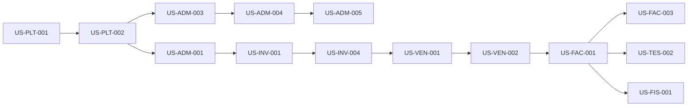

# Sprint backlog — Historias iniciales

**Versión:** 1.0 · **Fecha:** 2026-11-08 · **Estado:** vivo

> **Sin fechas.** Los sprints son unidades de capacidad (hipótesis: 2 semanas) y se ajustan al equipo real. El orden expresa dependencia y valor, no un compromiso de calendario. R3–R6 se refinan al abrir cada release.

## 1. Definición de preparado (Ready)

Una historia entra a un sprint cuando:

- Tiene requisito (`RF`) y criterio de aceptación (`AC`).
- Tiene reglas de negocio e invariantes identificadas.
- Tiene dependencias resueltas o explícitamente bloqueadas.
- Tiene datos de prueba definidos.
- Tiene decisión arquitectónica aplicable (ADR) o no la requiere.

## 2. Sprint 0 — Fundaciones

**Objetivo:** dejar el repositorio, el pipeline y la base técnica listos para construir con seguridad.

| Tarea | Resultado | Evidencia |
|---|---|---|
| S0-01 Repositorio y convenciones | Estructura, ramas, plantillas, licencia pendiente | `README`, `CONTRIBUTING`, `AGENTS` |
| S0-02 Solución .NET y frontend | Proyectos base vacíos, sin lógica de negocio | Build verde |
| S0-03 PostgreSQL local y CI | Contenedor, migraciones vacías, RLS de prueba | Pipeline |
| S0-04 Pipeline CI | Build, lint, tests, SAST, dependencias, migraciones | Ejecución verde |
| S0-05 Observabilidad base | OTel, health checks, logs estructurados | Traza de ejemplo |
| S0-06 Threat model inicial | Aislamiento, auth, documentos, archivos | Documento revisado |
| S0-07 Design system y navegación | Tema, layout, accesibilidad base | Storybook o demo |
| S0-08 ADR fundacionales | ADR-001…006 ratificados | Actas |
| S0-09 Ambientes | Dev, staging, secretos, respaldo | URL y acceso |
| S0-10 Spikes | RLS + numeración + outbox con prueba de concepto | Informe técnico |

**Salida:** pipeline verde, base multi-tenant demostrable, sin funcionalidad de negocio.

> **Refinamiento de hardening (T-003):** el mapa P1/P2 → historia → ADR → prueba → dueño está en [hardening-refinement.md](../docs/architecture/hardening-refinement.md). No crea IDs nuevos; refina las historias existentes y separa spike de producción.

## 3. R1 — Sprints 1 a 4

### Sprint 1 — Tenancy y organización

| ID | Historia | Epic | RF | AC | Tam. |
|---|---|---|---|---|---|
| US-PLT-001 | Aprovisionar organización con empresa, sucursal y administrador | EP-PLT-01 | `ADM-001`, `ADM-002` | AC-ADM-01 | L |
| US-PLT-002 | Resolver contexto de tenant y aplicar RLS en cada petición | EP-PLT-01 | `ADM-003` | AC-SEC-01 | L |
| US-ADM-001 | Crear y editar empresas y sucursales | EP-ADM-03 | `ADM-002` | AC-ADM-01 | M |
| US-ADM-002 | Registrar terceros con roles de cliente y proveedor | EP-ADM-03 | `ADM-010` | AC-ADM-05 | M |

**Salida:** dos organizaciones aisladas, con empresa y sucursal; prueba de acceso cruzado en CI.

### Sprint 2 — Identidad, permisos y auditoría

| ID | Historia | Epic | RF | AC | Tam. |
|---|---|---|---|---|---|
| US-ADM-003 | Invitar usuario y aceptar membresía multi-organización | EP-ADM-01 | `ADM-003`, `ADM-004` | AC-ADM-02 | L |
| US-ADM-004 | Definir roles y permisos con alcance por empresa/sucursal | EP-ADM-02 | `ADM-005`, `ADM-006` | AC-ADM-03, AC-SEC-03 | L |
| US-ADM-005 | Registrar auditoría append-only de operaciones sensibles | EP-ADM-04 | `ADM-009` | AC-ADM-04 | M |
| US-ADM-006 | Configurar series y numeración documental | EP-ADM-04 | `ADM-012` | AC-ADM-06 | M |

**Salida:** un usuario cambia de organización sin mezclar datos; permisos verificados en servidor; auditoría consultable.

### Sprint 3 — Seguridad de cuenta y configuración

| ID | Historia | Epic | RF | AC | Tam. |
|---|---|---|---|---|---|
| US-ADM-007 | MFA y política de contraseñas | EP-ADM-01 | `ADM-007` | AC-SEC-02 | M |
| US-ADM-008 | Sesiones, expiración y revocación remota | EP-ADM-01 | `ADM-008` | AC-SEC-02 | M |
| US-ADM-009 | Publicar parámetros versionados con vigencia y fuente | EP-ADM-04 | `ADM-013` | AC-FIS-01 | M |
| US-ADM-010 | Perfil fiscal de empresa y validación previa a emitir | EP-ADM-03 | `ADM-011` | AC-ADM-05 | M |
| US-ADM-011 | Acceso de soporte auditado con justificación | EP-PLT-03 | `ADM-014` | AC-PLT-03 | M |

**Salida:** seguridad de cuenta completa; parámetros versionados; acceso de soporte trazable.

### Sprint 4 — Plataforma, aprobaciones y cierre de R1

| ID | Historia | Epic | RF | AC | Tam. |
|---|---|---|---|---|---|
| US-PLT-003 | Planes, límites y medición de uso | EP-PLT-02 | `PLT-001`, `PLT-002`, `ADM-017` | AC-PLT-01, AC-PLT-02 | L |
| US-ADM-012 | Flujos de aprobación por tipo y monto | EP-ADM-04 | `ADM-020` | AC-VEN-02 | M |
| US-ADM-013 | Suspensión, reactivación y exportación de datos | EP-ADM-05 | `ADM-015`, `ADM-016` | AC-ADM-07 | M |
| US-PLT-004 | Consola de operador y feature flags | EP-PLT-03 | `PLT-005`, `ADM-018` | AC-PLT-03 | M |

**Salida:** criterios de R1 cumplidos; compuerta G1 superada; auditoría de aislamiento y restauración documentadas.

## 4. R2 — Sprints 5 a 10

### Sprint 5 — Inventario: catálogo y existencias

| ID | Historia | Epic | RF | AC | Tam. |
|---|---|---|---|---|---|
| US-INV-001 | Crear artículos, servicios, variantes y SKU | EP-INV-01 | `INV-001`, `INV-014` | AC-INV-01 | L |
| US-INV-002 | Unidades de medida y conversiones | EP-INV-01 | `INV-002` | AC-INV-01 | M |
| US-INV-003 | Almacenes y consulta de existencias | EP-INV-02 | `INV-003`, `INV-005` | AC-INV-02 | M |
| US-INV-004 | Movimientos y kardex con trazabilidad | EP-INV-02 | `INV-004` | AC-INV-02 | L |

**Salida:** catálogo operable; stock y kardex confiables; costo promedio con casos dorados.

### Sprint 6 — Inventario avanzado y compras

| ID | Historia | Epic | RF | AC | Tam. |
|---|---|---|---|---|---|
| US-INV-005 | Transferencias entre almacenes | EP-INV-03 | `INV-006` | AC-INV-03 | M |
| US-INV-006 | Ajustes y conteos con aprobación | EP-INV-03 | `INV-007` | AC-INV-03 | M |
| US-INV-007 | Lotes, vencimientos, reservas y reposición | EP-INV-04 | `INV-008`, `INV-011`…`INV-013` | AC-INV-04, AC-INV-06 | L |
| US-COM-001 | Proveedores y órdenes de compra con aprobación | EP-COM-01 | `COM-001`, `COM-002`, `COM-008` | AC-COM-01 | L |

**Salida:** flujo de abastecimiento y control de stock; costos actualizados.

### Sprint 7 — Compras y ventas

| ID | Historia | Epic | RF | AC | Tam. |
|---|---|---|---|---|---|
| US-COM-002 | Recepción parcial y total | EP-COM-02 | `COM-003` | AC-COM-02 | M |
| US-COM-003 | Factura de compra y validación de tres vías | EP-COM-02 | `COM-004`, `COM-006`, `COM-007` | AC-COM-02, AC-COM-03 | L |
| US-COM-004 | Devolución a proveedor | EP-COM-02 | `COM-005` | AC-COM-03 | M |
| US-VEN-001 | Cotización, versiones y conversión a pedido | EP-VEN-01 | `VEN-001`, `VEN-002` | AC-VEN-01 | L |
| US-VEN-002 | Confirmación con reserva y crédito | EP-VEN-02 | `VEN-009`, `VEN-010` | AC-VEN-01, AC-VEN-03 | M |

**Salida:** compra completa con costo real y tres vías; venta desde cotización hasta pedido confirmado.

### Sprint 8 — Precios, facturación y comisiones

| ID | Historia | Epic | RF | AC | Tam. |
|---|---|---|---|---|---|
| US-VEN-003 | Listas de precios y descuentos con aprobación | EP-VEN-02 | `VEN-003`, `VEN-004` | AC-VEN-02 | L |
| US-VEN-004 | Comisiones y devoluciones | EP-VEN-03 | `VEN-005`, `VEN-007`, `VEN-008` | AC-VEN-03, AC-VEN-04 | L |
| US-FAC-001 | Emitir factura con numeración y snapshot | EP-FAC-01 | `FAC-001`, `FAC-002`, `FAC-006`, `FAC-007`, `FAC-013` | AC-FAC-01, AC-FAC-02 | L |
| US-FAC-002 | Representación gráfica y reimpresión | EP-FAC-02 | `FAC-008` | AC-FAC-04 | M |
| US-FAC-003 | Nota de crédito y anulación por reversión | EP-FAC-02 | `FAC-003`, `FAC-010` | AC-FAC-03, AC-FAC-04 | L |

**Salida:** factura válida emitida desde pedido; nota de crédito revierte sin destruir; comisión revertida.

### Sprint 9 — Tesorería básica y adaptador fiscal

| ID | Historia | Epic | RF | AC | Tam. |
|---|---|---|---|---|---|
| US-TES-001 | Caja, apertura, cierre y arqueo | EP-TES-01 | `TES-001`, `TES-012` | AC-TES-01 | L |
| US-TES-002 | Cobros y pagos con múltiples medios | EP-TES-02 | `TES-003`, `TES-004` | AC-TES-02 | L |
| US-TES-003 | Aplicación parcial, anticipos y saldos | EP-TES-02 | `TES-005`, `TES-011` | AC-TES-03 | M |
| US-FAC-004 | Adaptador con proveedor de emisión autorizado | EP-FAC-03 | `FAC-011` | AC-FAC-05 | L |
| US-FIS-001 | Motor de reglas fiscales versionado | EP-FIS-01 | `FIS-001`, `FIS-002`, `FIS-008` | AC-FIS-01, AC-FIS-04 | L |

**Salida:** cobro y caja cuadran; emisión integrada con proveedor; reglas fiscales configurables.

### Sprint 10 — IGTF, migración y preparación comercial

| ID | Historia | Epic | RF | AC | Tam. |
|---|---|---|---|---|---|
| US-FIS-002 | IGTF, exenciones y auditoría fiscal | EP-FIS-02 | `FIS-006`, `FIS-007`, `FIS-010` | AC-FIS-02, AC-FIS-04 | M |
| US-INT-001 | Importación CSV con validación y errores | EP-INT-02 | `INT-004` | AC-MIG-01 | L |
| US-PLT-005 | Onboarding y activación de primeros clientes | EP-PLT-02 | `PLT-003` | AC-PLT-02 | M |

**Salida:** piloto operando; migración validada; criterios de R2 y compuerta G2 evaluados.

## 5. Dependencias entre historias

## 6. Historias de R3–R6 (esbozo)

| Release | Historias iniciales |
|---|---|
| R3 | `US-CON-001` plan de cuentas; `US-CON-002` asiento y reversión; `US-CON-003` cierre; `US-TES-004` conciliación; `US-FIS-003` retenciones y libros |
| R4 | `US-POS-001` turno y venta; `US-POS-002` hardware; `US-POS-003` offline; `US-INV-008` seriales |
| R5 | `US-RRH-001` expediente; `US-NOM-001` conceptos; `US-NOM-002` corrida; `US-NOM-003` liquidación |
| R6 | `US-PRO-001` BOM y orden; `US-CRM-001` oportunidad; `US-INT-003` API pública; `US-INT-004` webhooks |

Se refinan al abrir cada release y se añaden aquí con sus AC.

## 7. Reglas de seguimiento

- El tablero usa: `Backlog → Ready → En curso → En revisión → Hecho`.
- `Bloqueado` requiere causa y dueño de desbloqueo.
- Una historia no se cierra sin evidencia enlazada en el PR.
- Los cambios de alcance se reflejan en [releases.md](releases.md) y [roadmap.md](../docs/product/roadmap.md).

## 8. Documentos relacionados

- [Epics](epics.md)
- [Releases](releases.md)
- [Definición de terminado](../CONTRIBUTING.md#12-definición-de-terminado-definition-of-done)
- [Requisitos funcionales](../docs/requirements/functional-requirements.md)
