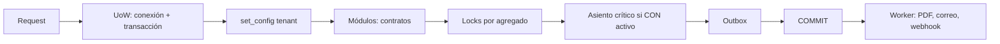
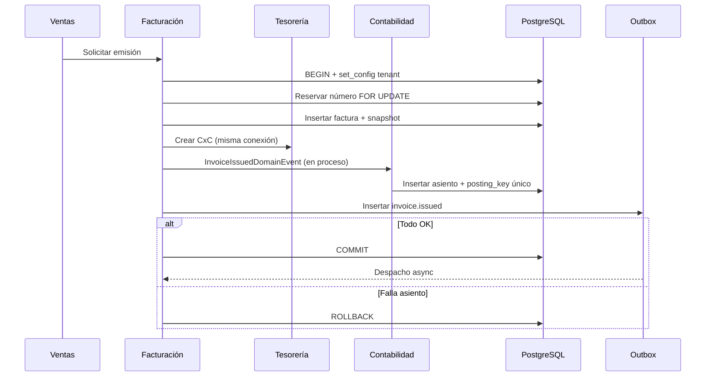

# Plan de hardening arquitectónico — ÁVILA ERP

**Versión:** 1.0 · **Fecha:** 2026-11-08
**Estado:** Decisiones aprobadas técnicamente el 2026-11-08; implementación y verificación pendientes. No hay código de producto. `D-02`, `D-03` y `D-14` siguen sujetas a validación contable antes de R3.
**Fuente:** [Auditoría independiente](independent-architecture-audit.md)
**Alcance:** cierre de los 9 hallazgos P1 y de los P2 con impacto directo en transacciones, tenancy y contabilidad.

---

## 1. Cómo leer este plan

Este documento distingue cuatro estados y no los mezcla:

| Estado | Significado |
|---|---|
| **Diseño propuesto** | Existe una decisión técnica documentada, pendiente de aprobación |
| **Aprobación pendiente** | Requiere decisión de Arquitectura/Producto/Contabilidad/Seguridad |
| **Implementación pendiente** | No hay código; no se ha tocado el repositorio de aplicación |
| **Verificación pendiente** | Existe una prueba definida; no se ha ejecutado con PostgreSQL real |

**Ningún hallazgo está “resuelto” por este documento.** Un hallazgo se cierra solo cuando la decisión está aprobada, la implementación existe y la prueba de aceptación pasa con evidencia reproducible.

## 2. Resumen de la solución propuesta

| ADR | Decisión central | Hallazgos que aborda |
|---|---|---|
| [ADR-007](../decisions/ADR-007-transaction-and-tenant-context.md) | Una UoW por solicitud/mensaje, una conexión y una transacción compartida por los `DbContext`, `set_config(..., true)` para tenant, RLS en negocio y `platform`, pooling transaccional | `P1-03`, `P1-05`, `P1-06`, `P2-10`, `P2-11` |
| [ADR-008](../decisions/ADR-008-concurrency-by-aggregate.md) | Bloqueo pesimista por agregado (stock, cartera, crédito, numeración, período), constraints y unique para idempotencia | `P1-01`, `P1-02`, `P1-07`, `P2-12`, `P2-13`, `P2-14` |
| [ADR-009](../decisions/ADR-009-accounting-and-cutover.md) | Posting contable síncrono cuando la contabilidad está activa, outbox solo post-commit, cutover híbrido R2→R3 | `P1-04`, `P1-08`, `P1-09`, `P2-02`, `P2-03`, `P2-04` |

La solución **no** introduce microservicios, broker externo, base de datos por módulo ni transacciones distribuidas. Todo ocurre en el monolito modular y en PostgreSQL.



---

## 3. Matriz de hallazgos y solución propuesta

### 3.1 Hallazgos P1

| ID | Solución propuesta | ADR / sección | Estado | Verificación |
|---|---|---|---|---|
| `AUD-P1-01` Stock concurrente | `FOR UPDATE` sobre `stock_balances`, orden de bloqueo, costo bajo el mismo lock, unique de movimiento por origen | [ADR-008 §2.3](../decisions/ADR-008-concurrency-by-aggregate.md#23-existencias-y-movimientos) | Spike T-01/T-02 passed; production pending | T-01, T-02 |
| `AUD-P1-02` Pagos concurrentes | `FOR UPDATE` sobre partida, suma de aplicaciones, unique por cobro/partida, trigger de red | [ADR-008 §2.4](../decisions/ADR-008-concurrency-by-aggregate.md#24-aplicación-de-pagos) | Diseño aprobado; verificación pendiente | T-03 |
| `AUD-P1-03` Transacción entre módulos | UoW dueño de conexión/transacción; contextos comparten; `SaveChanges` coordinado; rollback único | [ADR-007 §2.1–2.2](../decisions/ADR-007-transaction-and-tenant-context.md#21-propiedad-y-ciclo-de-vida-de-la-transacción) | Diseño aprobado; verificación pendiente | T-04 |
| `AUD-P1-04` Posting síncrono vs. outbox | Evento de dominio en proceso antes del commit; outbox solo post-commit; `posting_key` único | [ADR-009 §2.2–2.6](../decisions/ADR-009-accounting-and-cutover.md#22-confirmación-operativa-vs-contabilización) | Spike T-05/T-06/T-15 passed; production pending | T-05, T-06, T-15 |
| `AUD-P1-05` RLS/pooling/lecturas | Transacción por solicitud, `set_config(..., true)`, sin `SET` de sesión, Npgsql pooling; PgBouncer solo con prueba | [ADR-007 §2.3–2.4](../decisions/ADR-007-transaction-and-tenant-context.md#23-contexto-de-tenant-en-postgresql) | Spike T-07/T-08 passed; T-07b pending | T-07, T-07b, T-08 |
| `AUD-P1-06` RLS de `platform` | Clasificación tenant/global/infra; políticas y roles; introspección del esquema | [ADR-007 §2.5](../decisions/ADR-007-transaction-and-tenant-context.md#25-rls-en-tablas-de-negocio-y-platform) | Spike T-09/T-09b passed; production inventory pending | T-09, T-09b |
| `AUD-P1-07` `branch_id` en numeración | `scope_type`/`scope_id` no nulo, unicidad por ámbito; alternativa sucursal obligatoria | [ADR-008 §2.6](../decisions/ADR-008-concurrency-by-aggregate.md#26-numeración-documental) | Spike T-10/T-11/T-11b passed at 10k; migration pending | T-10, T-11, T-11b |
| `AUD-P1-08` Cutover R2→R3 | Apertura híbrida, partidas abiertas vinculadas, conciliación, activación | [ADR-009 §2.7](../decisions/ADR-009-accounting-and-cutover.md#27-apertura-contable-al-activar-r3) | Spike T-12 passed; production pending | T-12 |
| `AUD-P1-09` R5→R3 | Declarar dependencia R3 o retirar `NOM-008` de R5 | Plan §7 `D-04` | Aprobada; verificación documental pendiente | T-13 (revisión documental) |

### 3.2 P2 con impacto directo

| ID | Impacto | Solución propuesta | Estado |
|---|---|---|---|
| `AUD-P2-01` Niveles CON/NOM/PRO | Contratos de eventos y prueba de arquitectura | Mover CON a nivel 8 o crear contratos de integración neutrales (`D-05`) | Aprobada; opción de implementación pendiente |
| `AUD-P2-02` Partida doble no garantizada | Trigger diferido o procedimiento de posting | Trigger diferido + validación de dominio ([ADR-009 §2.6](../decisions/ADR-009-accounting-and-cutover.md#26-evitar-facturas-sin-asiento-y-asientos-duplicados)) | Diseño propuesto; `D-15` |
| `AUD-P2-03` FX incompleto | Modelo de diferencia, cuentas y casos dorados | Modelo técnico en ADR-009 §2.10; política contable `D-14` | Diseño propuesto; política pendiente |
| `AUD-P2-04` Frontera comercial/fiscal | Ventas solicita; Facturación emite; una sola nota fiscal | `D-17`; ADR-009 §2.11 | Aprobada; implementación pendiente |
| `AUD-P2-10` Contratos API/eventos | Esquema versionado y pruebas | ADR-007 §2.8; T-15 | Diseño propuesto |
| `AUD-P2-11` Backfill bajo RLS | Procedimiento por tenant o `BYPASSRLS` excepcional | ADR-007 §2.7; T-16 | Diseño propuesto |
| `AUD-P2-12` Crédito concurrente | Lock por cliente + validación de límite | ADR-008 §2.5; T-17 | Diseño propuesto |
| `AUD-P2-13` Idempotencia en vuelo | Insert `in_progress` en la misma transacción; unique; resolución 23505 | ADR-008 §2.7; T-18 | Diseño propuesto |
| `AUD-P2-14` Cierre concurrente | `FOR UPDATE` del período; postings `FOR SHARE`; estado `closing` | ADR-008 §2.8; ADR-009 §2.9; T-19 | Diseño propuesto |

### 3.3 P2 sin impacto directo en estas decisiones

Estos hallazgos **siguen abiertos**; no se resuelven con ADR-007/008/009:

- `AUD-P2-05` reportes R2 sin RF.
- `AUD-P2-06` suscripción SaaS/dunning/provisioning.
- `AUD-P2-07` restauración por tenant.
- `AUD-P2-08` RTO/región.
- `AUD-P2-09` capacidad/equipo.
- Los P3 de auditoría tamper-evident, frontend y costos/on-call.

---

## 4. Matriz de transacciones y límites de agregados

| Operación | Agregado raíz | Módulos participantes | Bloqueo / control | Atomicidad | Outbox |
|---|---|---|---|---|---|
| Confirmar pedido | `Order` | VEN, INV, crédito | `stock_balances` y `customer_credit` `FOR UPDATE`; orden por IDs | Pedido + reserva + validación de crédito | `order.confirmed` |
| Emitir factura (rango autorizado) | `Invoice` | FAC, TES, CON, INV | Secuencia `FOR UPDATE`; stock si hay salida; partida | Número + snapshot + CxC + asiento + stock | `invoice.issued`, PDF |
| Emitir factura (autorización por documento) | `Invoice` | FAC, TES, CON, INV | Igual; proveedor fuera de la transacción antes de confirmar | Confirmación + CxC + asiento + stock | `invoice.issued` |
| Emitir nota de crédito | `CreditNote` | FAC, TES, VEN, INV, CON | Secuencia; partida; stock; comisión | Nota + reversión CxC + stock + comisión + asiento | `credit-note.issued` |
| Registrar cobro | `Receipt` | TES, CON | `receivables` `FOR UPDATE`; sesión de caja `FOR SHARE` si efectivo | Cobro + aplicación + caja/banco + asiento | `receipt.registered` |
| Registrar pago | `Payment` | TES, CON | `payables` `FOR UPDATE`; sesión/cuenta | Pago + aplicación + caja/banco + asiento | `payment.registered` |
| Factura de compra | `PurchaseInvoice` | COM, INV, TES, CON | Recepción/partida; stock/costo | Factura + CxP + inventario/costo + asiento | `purchase-invoice.registered` |
| Recepción de compra | `GoodsReceipt` | COM, INV | Línea de OC `FOR UPDATE` para no sobre-recibir | Recepción + stock + costo | `goods-receipt.posted` |
| Movimiento de inventario | `StockMovement` | INV, CON | Balance `FOR UPDATE` | Movimiento + costo + asiento | `stock.moved` |
| Transferencia | `Transfer` | INV | Dos balances en orden de `warehouse_id` | Salida + entrada + costo | `transfer.completed` |
| Ajuste/conteo | `Adjustment` | INV, CON | Balance `FOR UPDATE` | Ajuste + costo + asiento | `stock.adjusted` |
| Aprobación de nómina | `PayrollRun` | NOM, CON | Corrida `FOR UPDATE` | Corrida + provisión + asiento | `payroll.run.approved` |
| Cierre de período | `Period` | CON | Período `FOR UPDATE`; postings `FOR SHARE` | Verificación + asiento de cierre + bloqueo | `period.closed` |
| Asiento manual | `JournalEntry` | CON | Período `FOR SHARE` | Asiento + balance | `entry.posted` |
| Sincronización POS | `PosTransaction` | POS, INV, FAC, TES | `transaction_id` único; stock; secuencia | Venta + stock + comprobante + cobro | `pos.sale.completed` |

**Nota:** la recepción de compra y la sesión de caja añaden bloqueos propuestos para invariantes ya documentadas (`COM-R-02`, `TES-R-01/11`); deben incorporarse formalmente a ADR-008 o a un ADR de extensión antes de implementarse.

---

## 5. Flujos críticos

### 5.1 Factura con asiento atómico



### 5.2 Stock con dos ventas concurrentes

```mermaid
sequenceDiagram
  participant A as Venta A
  participant B as Venta B
  participant DB as PostgreSQL
  A->>DB: BEGIN + set_config
  B->>DB: BEGIN + set_config
  A->>DB: SELECT stock_balances FOR UPDATE
  B->>DB: SELECT stock_balances FOR UPDATE (espera)
  A->>DB: qty >= 8? UPDATE; INSERT movement; COMMIT
  B->>DB: lock adquirido; qty=2; 2 >= 8? NO
  B->>DB: ROLLBACK; STOCK_INSUFFICIENT
```

### 5.3 Cutover R2→R3

Ver [ADR-009 §2.7](../decisions/ADR-009-accounting-and-cutover.md#27-apertura-contable-al-activar-r3).

---

## 6. Plan de pruebas de integración con PostgreSQL real

### 6.1 Entorno

- **PostgreSQL 18** en Testcontainers; mismas migraciones que producción.
- Roles: `avila_app` (sin owner, sin `BYPASSRLS`), `avila_migrator`, `avila_dispatcher`, `avila_readonly`.
- Dos tenants sintéticos con datos equivalentes; nunca datos reales.
- Conexiones Npgsql independientes; `READ COMMITTED`; `lock_timeout=3s`; `statement_timeout=30s`.
- Barreras de concurrencia con `TaskCompletionSource`/`Barrier`; no `Thread.Sleep`.
- Prohibido el proveedor InMemory de EF Core para estas pruebas.
- Evidencia: salida del test, consultas de estado, `pg_locks`/`pg_stat_activity` cuando aplique, diff de `posting_key`.

### 6.2 Pruebas

| ID | Escenario | Resultado esperado | Hallazgo |
|---|---|---|---|
| T-01 | Stock 10; dos ventas concurrentes de 8 | Una confirma; otra `STOCK_INSUFFICIENT`; cantidad 2; un solo movimiento | P1-01 |
| T-02 | Transferencias A→B y B→A concurrentes | Sin deadlock no manejado; orden de locks; total conservado | P1-01 |
| T-03 | Partida 100; dos cobros de 60 | Uno confirma; otro `PAYMENT_OVER_ALLOCATED`; aplicado 60; saldo 40 | P1-02 |
| T-04 | Fallo forzado en TES y CON tras insertar factura | Rollback total; 0 facturas; número no consumido; 0 outbox | P1-03 |
| T-05 | Factura con CON activo | Exactamente 1 asiento; `journal_entry_id`; `posting_key` único | P1-04 |
| T-06 | Factura con cuenta inválida | Rollback; 0 factura; 0 CxC; 0 asiento | P1-04 |
| T-07 | Pool de 1 conexión; tenant A y B secuenciales | B solo ve B; sin GUC de sesión residual | P1-05 |
| T-07b | PgBouncer modo transacción (si se adopta) | Mismo resultado que T-07 | P1-05 |
| T-08 | Lectura sin `set_config` y con contexto | Sin contexto: 0 filas; con contexto: solo tenant | P1-05 |
| T-09 | `platform.tenant_notes` y `document_sequences` | Acceso cruzado 0/denegado; T-09b introspección | P1-06 |
| T-09b | Introspección de tablas tenant | RLS y política en todas las tablas con `tenant_id`; `avila_app` sin bypass | P1-06 |
| T-10 | Documentos de empresa y sucursal | Secuencias independientes; sin duplicados; sin `NULL` ambiguo | P1-07 |
| T-11 | 10.000 emisiones concurrentes | Sin duplicados ni huecos; rollback no consume | P1-07 |
| T-12 | Dataset R2 de 3 meses; cutover | Apertura + partidas abiertas; conciliación 0; activación | P1-08 |
| T-13 | Revisión roadmap/releases R5 | R5 depende de R3 o `NOM-008` fuera de R5 | P1-09 |
| T-14 | Inserción SQL directa de asiento desbalanceado | Rechazo; balanceado acepta; reversión correcta | P2-02 |
| T-15 | Evento duplicado y fallo de outbox | Asiento único; inbox idempotente; negocio no se revierte | P1-04, P2-10 |
| T-16 | Backfill con dos tenants | Cada fila conserva tenant; conteos cuadran | P2-11 |
| T-17 | Dos pedidos concurrentes que exceden crédito | No se excede; uno falla o requiere aprobación | P2-12 |
| T-18 | Misma `Idempotency-Key` concurrente | Un solo efecto; segunda respuesta idéntica; hash distinto 409 | P2-13 |
| T-19 | Cierre de período y posting concurrentes | Cierre incluye todo o posting rechazado; sin asiento fuera | P2-14 |
| T-20 | Pago parcial en divisa con diferencia | Asiento y saldo correctos según política aprobada | P2-03 |

### 6.3 Detalle de las pruebas críticas

#### T-01 — Sobreventa

1. Crear tenant, almacén, artículo y saldo 10.
2. Preparar dos comandos de venta de 8 con claves de idempotencia distintas.
3. Ejecutar concurrentemente; la primera transacción bloquea el balance; la segunda espera.
4. Verificar: una respuesta OK, una `STOCK_INSUFFICIENT`; cantidad final 2; una sola fila de movimiento; `reserved` coherente.
5. Repetir con reservas concurrentes y con política de stock negativo desactivada.

#### T-03 — Sobre-aplicación

1. Factura con saldo 100.
2. Dos cobros de 60, cada uno aplicado a la misma partida.
3. Verificar: una aplicación de 60; saldo 40; la segunda recibe 409; la suma de aplicaciones no excede 100.
4. Repetir con aplicación y reversión concurrentes.

#### T-04 — Rollback cruzado

1. Activar un “fail point” de prueba en TES o CON después de insertar la factura y antes del commit.
2. Ejecutar la emisión.
3. Verificar: 0 facturas, 0 líneas, 0 CxC, 0 asientos, 0 outbox; el `next_value` de la secuencia no cambió.
4. Repetir con fallo de conexión simulado tras el último `SaveChanges`.

#### T-07 — Pool y tenant

1. Pool máximo 1; tenant A y B con facturas.
2. Ejecutar request A, devolver conexión, request B.
3. Consultar con `avila_app` sin filtro; verificar que B solo ve B.
4. Repetir 100 veces; buscar GUC residual con `current_setting('app.tenant_id', true)`.
5. Si se usa PgBouncer, T-07b con la misma secuencia.

#### T-12 — Cutover

1. Dataset R2: 3 meses de facturas, cobros, compras, stock y caja; contabilidad desactivada.
2. Ejecutar cutover: congelar, snapshot, apertura, conciliación.
3. Verificar: CxC/CxP abiertas conciliadas; inventario vs kardex; caja/banco; IVA; patrimonio.
4. Activar `accounting_enabled`; emitir una factura nueva; verificar asiento normal.
5. Reintentar el cutover con el mismo `cutover_id`: no duplica apertura.
6. Forzar una diferencia: el cutover no activa y queda en estado fallido/reversible.

#### T-18 — Idempotencia concurrente

1. Dos solicitudes simultáneas con la misma clave y cuerpo.
2. Verificar: una ejecuta; la otra espera y devuelve la misma respuesta; un solo documento.
3. Repetir con cuerpo distinto: 409 sin ejecutar.
4. Simular caída después del commit: el reintento devuelve el resultado almacenado.

---

## 7. Decisiones aprobadas y condiciones de implementación

> Todas las decisiones `D-01`…`D-18` fueron aprobadas técnicamente el 2026-11-08. La tabla registra la recomendación y la condición de implementación; no implica que estén implementadas o verificadas. `D-02`, `D-03` y `D-14` conservan validación contable externa antes de R3.

| ID | Decisión | Recomendación | Dueño | Bloquea |
|---|---|---|---|---|
| `D-01` | ¿Transacción por solicitud o solo por comando? | Por comando y por consulta de negocio; no health checks | Arquitectura | ADR-007 |
| `D-02` | Cutover híbrido vs. replay completo | Híbrido con partidas abiertas detalladas | Contabilidad | ADR-009 |
| `D-03` | Confirmación operativa: emisión vs. entrega | Emisión; reconocimiento de ingresos según política contable | Contabilidad/Producto | ADR-009 |
| `D-04` | R5→R3 | Añadir R3 o retirar `NOM-008` de R5 | Producto | Roadmap |
| `D-05` | Niveles de módulo CON/NOM/PRO | Mover CON a nivel 8 o contratos neutrales | Arquitectura | ADR-001 (addendum) |
| `D-06` | Clasificación de `platform` y roles | Tabla de ADR-007 §2.5; dispatcher separado | Arquitectura/Seguridad | ADR-007 |
| `D-07` | PgBouncer en R1 | No; Npgsql pooling; evaluar después | Operaciones | ADR-007 |
| `D-08` | Timeouts/reintentos | 3 s lock, 2 reintentos idempotentes | Arquitectura/DBA | ADR-007/008 |
| `D-09` | Ámbito de numeración | `scope_type/scope_id` no nulo | Producto/Contabilidad | ADR-008 |
| `D-10` | Trigger de suma de aplicaciones | Bloqueo + trigger diferido | DBA/Backend | ADR-008 |
| `D-11` | Backfill con `BYPASSRLS` | Por tenant; bypass excepcional auditado | DBA/Seguridad | ADR-007 |
| `D-12` | Monitoreo de locks/deadlocks | `pg_locks`, duración, alerta | Operaciones | ADR-008 |
| `D-13` | Stock negativo | Mantener política configurable existente | Producto | ADR-008 |
| `D-14` | Política FX y cuentas | Validar con contador; modelo propuesto | Contabilidad | ADR-009 |
| `D-15` | Trigger de integridad de asiento | Trigger diferido + dominio | DBA/Contabilidad | ADR-009 |
| `D-16` | Ventana de cutover | Mantenimiento por empresa; cero downtime después | Operaciones | ADR-009 |
| `D-17` | Frontera VEN/FAC | Ventas solicita; Facturación emite; una nota fiscal | Producto | ADR-009 |
| `D-18` | ¿Contabilidad activa sin cutover? | No; activación solo por cutover aprobado | Contabilidad | ADR-009 |

---

## 8. Criterios verificables para cerrar cada P1

| P1 | Criterio de cierre | Evidencia exigida | Estado actual |
|---|---|---|---|
| `P1-01` Sobreventa | T-01 y T-02 pasan; stock y kardex cuadran; código usa el lock/constraint acordado | Test + revisión de código + introspección | **T-01/T-02 passed; production pending** |
| `P1-02` Pagos | T-03 pasa; suma de aplicaciones ≤ saldo en 100 repeticiones | Test + trigger/constraint | **T-03 passed once; repetition pending** |
| `P1-03` Transacción | T-04 pasa con fallo en TES y CON; 0 filas huérfanas | Test + log de rollback | **T-04 rollback path passed; forced failure pending** |
| `P1-04` Posting | T-05, T-06 y T-15 pasan; un asiento por factura; outbox no postea | Test + consulta de posting_key | **T-05/T-06/T-15 passed; production pending** |
| `P1-05` RLS/pool | T-07, T-07b y T-08 pasan; sin GUC residual | Test + `current_setting` | **T-07/T-08 passed; T-07b pending** |
| `P1-06` `platform` | T-09 y T-09b pasan; introspección cubre `platform`; 0 tablas tenant sin política | Test + script de introspección | **T-09/T-09b passed; production inventory pending** |
| `P1-07` Numeración | T-10 y T-11 pasan; sin `NULL` ambiguo; sin duplicados | Test + migración | **T-10/T-11/T-11b passed at 10k; migration pending** |
| `P1-08` Cutover | T-12 pasa; apertura conciliada; sin duplicados; activación | Test + reporte de conciliación | **T-12 passed; production pending** |
| `P1-09` R5 | `D-04` aprobada y roadmap/releases actualizados; T-13 documental | Documento + revisión | **Decisión aprobada; verificación pendiente** |

**Regla:** un P1 no se marca cerrado si solo existe el ADR. Se exige decisión aprobada, implementación y evidencia de prueba.

---

## 9. Secuencia de implementación propuesta

### Fase 0 — Aprobación

1. Revisar y aprobar ADR-007, ADR-008 y ADR-009, o registrar las modificaciones.
2. Resolver `D-01`…`D-18` en el orden que bloquee cada fase.
3. Designar owners de ejecución y evidencia.

### Fase 1 — Núcleo transaccional (antes de R1 exit)

4. Implementar UoW compartida, `set_config` y roles (ADR-007).
5. Implementar RLS de negocio y `platform`, con introspección.
6. Implementar locks de numeración y stock (ADR-008) y T-01/T-10/T-11.
7. Implementar T-04, T-07, T-08, T-09, T-16.

### Fase 2 — R2 comercial

8. Implementar locks de pagos y crédito; T-03/T-17.
9. Implementar idempotencia en vuelo; T-18.
10. Implementar posting crítico y outbox separado; T-05/T-06/T-15.
11. Implementar trigger de partida doble; T-14.

### Fase 3 — R3 Finance

12. Implementar cierre con lock; T-19.
13. Implementar cutover híbrido; T-12.
14. Implementar FX y conciliación; T-20 y reportes.
15. Resolver R5→R3 antes de R5; T-13.

### Fase 4 — R5/R6

16. Extender locks a recepción de compra y sesión de caja si se confirma.
17. Resolver P2-05…P2-09 y P3 fuera de este plan.

---

## 10. Fuera de alcance de este hardening

No se resuelven aquí:

- Reportes R2 sin RF (`P2-05`).
- Suscripción/dunning/provisioning (`P2-06`).
- Restauración por tenant (`P2-07`).
- RTO regional (`P2-08`).
- Capacidad/equipo (`P2-09`).
- Auditoría tamper-evident, frontend y costos (`P3`).
- Validación legal/fiscal/laboral.
- Implementación de código, migraciones o infraestructura.

Estos puntos siguen abiertos y deben tener su propio plan.

---

## 11. Referencias

- [Auditoría independiente](independent-architecture-audit.md)
- [ADR-007 — Modelo transaccional y contexto de tenant](../decisions/ADR-007-transaction-and-tenant-context.md)
- [ADR-008 — Concurrencia por agregado](../decisions/ADR-008-concurrency-by-aggregate.md)
- [ADR-009 — Contabilización y cutover](../decisions/ADR-009-accounting-and-cutover.md)
- [ADR-001](../decisions/ADR-001-modular-monolith.md)…[ADR-006](../decisions/ADR-006-document-numbering.md)
- [Releases](../../backlog/releases.md), [roadmap](../product/roadmap.md), [requisitos funcionales](../requirements/functional-requirements.md)
