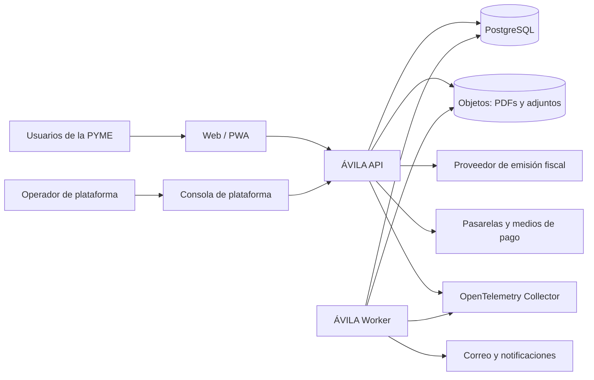
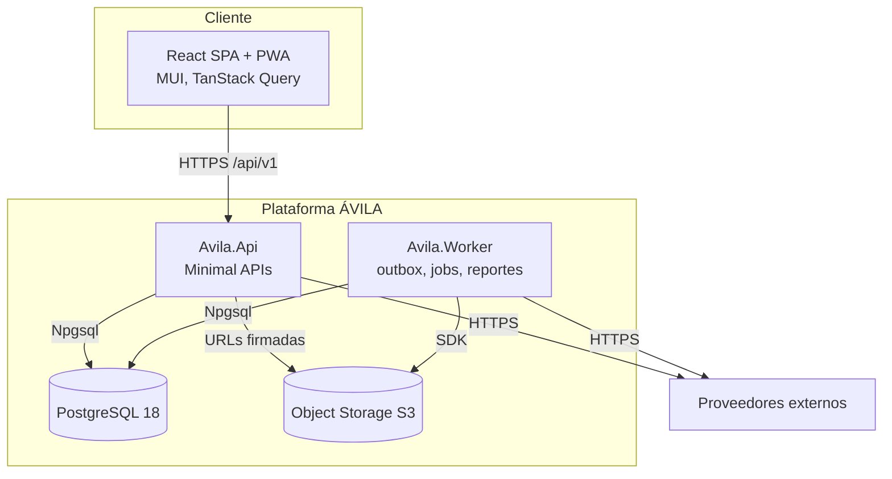
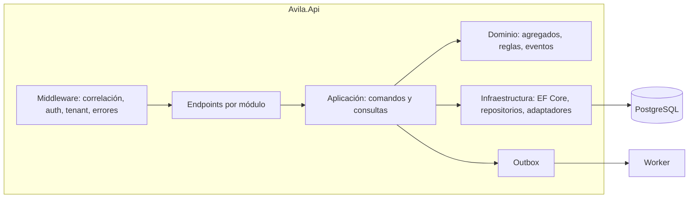
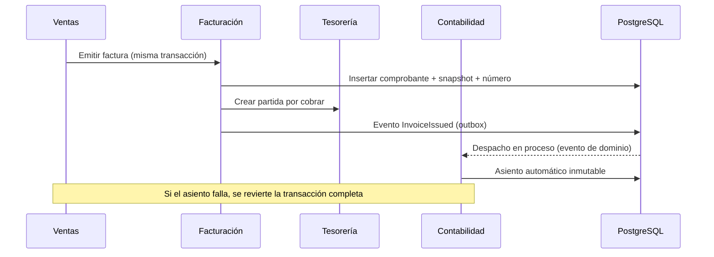
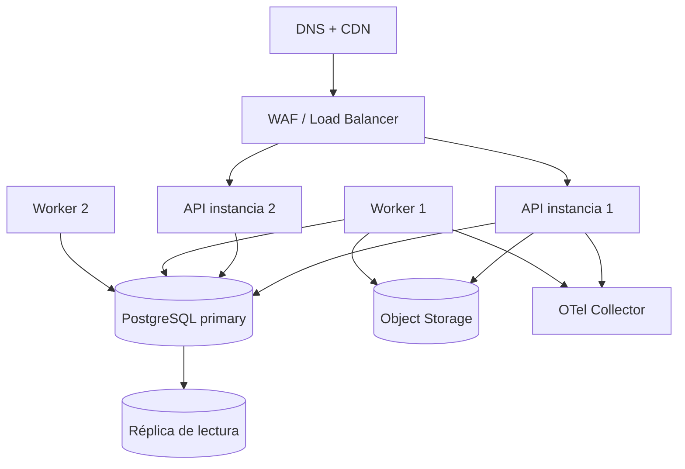

# Arquitectura — Visión general

**Versión:** 1.0 · **Fecha:** 2026-11-08 · **Estado:** línea base

## 1. Objetivos de arquitectura

| Atributo | Objetivo | Documento |
|---|---|---|
| Aislamiento multi-tenant | Imposible acceder a datos de otra organización | [multi-tenancy.md](multi-tenancy.md), [ADR-003](../decisions/ADR-003-multi-tenancy.md) |
| Modularidad | Módulos con límites verificables y evolución independiente | [modular-monolith.md](modular-monolith.md), [ADR-001](../decisions/ADR-001-modular-monolith.md) |
| Consistencia | Transacciones locales fuertes; efectos secundarios confiables | [ADR-005](../decisions/ADR-005-transactional-outbox.md) |
| Exactitud | Dinero, impuestos y stock correctos y reproducibles | [ADR-004](../decisions/ADR-004-money-and-rounding.md) |
| Seguridad | Mínimo privilegio, auditoría y trazabilidad | [security.md](security.md) |
| Operabilidad | Observabilidad, respaldos, recuperación y despliegue sin downtime | Este documento |
| Escalabilidad | 3× CO-1 sin cambio de arquitectura | Este documento |
| Cumplimiento | Reglas parametrizadas y auditables | [compliance](../compliance/venezuela-tax.md) |

## 2. Contexto del sistema



**Fuera del sistema:** ERP del cliente, bancos, SENIAT, proveedores fiscales, pasarelas de pago, servicios de correo y almacenamiento. Se integran por adaptadores y contratos.

## 3. Contenedores



| Contenedor | Responsabilidad | Escalado |
|---|---|---|
| `Avila.Web` | SPA responsive, PWA, POS offline (R4) | CDN + estáticos |
| `Avila.Api` | API REST, autenticación, autorización, casos de uso | Horizontal sin estado |
| `Avila.Worker` | Outbox, jobs programados, reportes, integraciones, sincronización | Horizontal por tipo de job con bloqueo |
| PostgreSQL | Datos transaccionales, RLS, outbox, auditoría | Vertical + réplica de lectura |
| Object Storage | PDFs, adjuntos, exportaciones | Servicio gestionado |
| OTel Collector | Trazas, métricas y logs | Servicio gestionado |

## 4. Componentes internos



Reglas:

- El endpoint valida entrada, autoriza y delega; no contiene reglas de negocio.
- La capa de aplicación orquesta una transacción y publica eventos.
- El dominio no conoce EF Core, HTTP ni PostgreSQL.
- La infraestructura implementa puertos del dominio/aplicación.
- Los contratos entre módulos viven en `Avila.Modules.<Módulo>.Contracts`.

## 5. Stack tecnológico

| Capa | Tecnología | Versión objetivo | Notas |
|---|---|---|---|
| Runtime backend | .NET | **10 (LTS)** | Soporte hasta noviembre de 2028 |
| Web framework | ASP.NET Core Minimal APIs | 10 | OpenAPI 3.1 |
| Persistencia | EF Core + Npgsql | 10 | Migraciones por módulo |
| Base de datos | PostgreSQL | **18** | RLS, PITR |
| Worker | .NET Worker Service | 10 | Jobs y outbox |
| Frontend | React + TypeScript | 19 / 5.x | SPA con code splitting |
| Build frontend | Vite | 7 | PWA con Workbox |
| UI | Material UI | 7 | Tema propio ÁVILA |
| Estado servidor | TanStack Query | 5 | Caché e invalidación |
| Formularios | React Hook Form + Zod | Últimas estables | Validación UX |
| i18n | i18next | Última estable | es-VE por defecto |
| Pruebas backend | xUnit v3 + Testcontainers | Últimas estables | PostgreSQL real |
| Pruebas frontend | Vitest + Testing Library + Playwright | Últimas estables | E2E de flujos críticos |
| Carga | k6 | Última estable | NFR de rendimiento |
| Observabilidad | OpenTelemetry + OTLP | Última estable | Trazas, métricas, logs |

**Sin MediatR ni bus de mediación:** los casos de uso se despachan con un dispatcher propio delgado para evitar dependencias con licencias cambiantes y mantener el control. Cualquier incorporación requiere ADR.

## 6. Flujos de ejecución

### 6.1 Petición HTTP

1. Entra por el balanceador/WAF con TLS.
2. Middleware asigna `correlation_id` y valida el token.
3. Se resuelve la membresía y el tenant activo; se abre transacción y se ejecuta `SET LOCAL app.tenant_id`.
4. Se autoriza la acción con permisos y alcance.
5. El endpoint invoca el caso de uso; el dominio valida invariantes.
6. Se persisten cambios y eventos de outbox en la misma transacción.
7. Se confirma y responde con el resultado y el `correlation_id`.

### 6.2 Contabilización de un documento



Los eventos que participan de una invariante crítica (contabilización) se manejan **en proceso y dentro de la transacción**. Los efectos externos van al outbox y se procesan después del commit. La autorización del proveedor fiscal **no** forma parte de la transacción: se ejecuta por outbox. La transacción local comprende numeración, persistencia, cartera y contabilización según el modo de emisión definido en [billing.md §5](../domain/billing.md#5-emisión).

### 6.3 Procesamiento asíncrono

- El worker reclama lotes del outbox con `FOR UPDATE SKIP LOCKED`.
- Aplica cuotas y fairness por tenant.
- Reintenta con backoff; agota a dead letter con alerta.
- Registra inbox para idempotencia.
- Emite métricas de antigüedad, tasa de error y reintentos.

## 7. Despliegue



- **Región única** con zonas de disponibilidad múltiples; proveedor y región pendientes (`DEC-001`).
- Contenedores inmutables con imagen versionada por commit.
- Migraciones en un job separado antes del despliegue de la aplicación, compatibles hacia atrás.
- Despliegue rolling o blue/green; sin downtime planificado.
- Secretos en el gestor del proveedor; nunca en imagen ni repositorio.

### Ambientes

| Ambiente | Propósito | Datos | Acceso |
|---|---|---|---|
| Local | Desarrollo | Sintéticos + contenedores | Desarrollador |
| CI | Pruebas automatizadas | Sintéticos efímeros | Automático |
| Staging | Validación y demos | Sintéticos o anonimizados | Equipo |
| Producción | Clientes | Reales | Operaciones con MFA |

## 8. Observabilidad

- **Trazas:** una por petición, con spans de base de datos, outbox, jobs y llamadas externas. Atributos `tenant.id` (seudónimo), `module`, `operation`; sin PII.
- **Métricas:** latencia, errores, saturación, antigüedad de outbox, duración de jobs, numeración, conciliación y reglas fiscales aplicadas (conteo).
- **Logs:** estructurados, JSON, con `correlation_id`, nivel y módulo; PII enmascarada.
- **SLOs iniciales:** disponibilidad 99,9 %; emisión de factura p95 ≤ 1,5 s; outbox pendiente < 5 min; conciliación diaria sin diferencias.
- **Alertas:** errores 5xx, latencia fuera de SLO, outbox atascado, dead letters, fallo de respaldo, intento de acceso cruzado.

Detalle en [security.md](security.md) y [testing-strategy.md](testing-strategy.md).

## 9. Escalabilidad

1. **API:** horizontal, sin sesión en memoria; estado en token y base de datos.
2. **Base de datos:** índices por tenant y consulta; particionado de tablas de alto volumen (`audit_log`, `stock_movements`, `journal_lines`, `outbox_messages`) por rango o hash cuando la métrica lo justifique.
3. **Lecturas analíticas:** réplica de lectura para reportes y BI (R6).
4. **Archivos:** almacenamiento de objetos con ciclo de vida.
5. **Jobs:** colas lógicas por tipo y cuotas por tenant; procesos idempotentes.
6. **Caché:** en memoria por instancia para catálogos; caché distribuida solo si se demuestra necesidad (ADR).

## 10. Recuperación ante fallos

| Fallo | Comportamiento esperado | Recuperación |
|---|---|---|
| Instancia API caída | Balanceador redirige; sin pérdida de transacciones confirmadas | Reemplazo automático |
| Base de datos primaria caída | Servicio en error controlado; se activa failover del proveedor | Failover + verificación |
| Worker caído | Outbox se acumula; nada se pierde | Reinicio; procesa pendientes |
| Proveedor fiscal caído | Emisión bloqueada o contingencia validada; alerta | Reintento y comunicación |
| Dead letter | Evento no procesado; alerta | Intervención manual documentada |
| Corrupción de datos | Restauración PITR a punto anterior | Ensayo trimestral |
| Región no disponible | Plan de recuperación documentado | Restauración en región secundaria (R6) |

**RPO ≤ 15 min, RTO ≤ 4 h** (NFR-AVA-002/003). Los respaldos se prueban, no solo se configuran.

## 11. CI/CD y calidad

```text
PR → build + lint + unitarias + integración (Testcontainers)
   → pruebas de arquitectura + migración en limpio
   → SAST + escaneo de dependencias + escaneo de imagen
   → despliegue a staging + E2E smoke
   → aprobación humana → producción (rolling) → smoke + verificación SLO
```

- `main` protegida, siempre verde.
- Migraciones versionadas y compatibles hacia atrás.
- Feature flags para activar por tenant/plan.
- Prohibido desplegar sin plan de reversión.

## 12. Decisiones y pendientes

- `DEC-001`: proveedor cloud y región.
- `DEC-003`: identidad (propuesta: propia con estándares abiertos).
- `DEC-004`: almacenamiento de objetos.
- `DEC-015`: BI y réplica de lectura.
- Ver [decisiones](../decisions/README.md).

## 13. Documentos relacionados

- [Monolito modular](modular-monolith.md)
- [Multi-tenancy](multi-tenancy.md)
- [Seguridad](security.md)
- [Base de datos](database-design.md)
- [Integraciones](integration-strategy.md)
- [Pruebas](testing-strategy.md)
