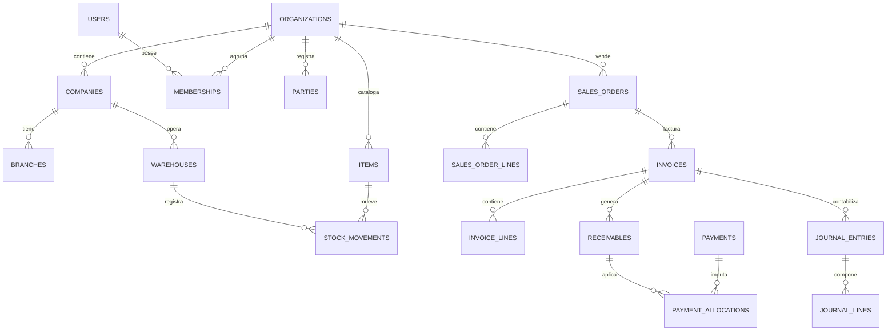

# Diseño de base de datos

**Versión:** 1.0 · **Fecha:** 2026-11-08 · **Estado:** línea base

Motor: **PostgreSQL 18**. Acceso: EF Core 10 / Npgsql. Un esquema por módulo, RLS en tablas de negocio y migraciones por módulo.

## 1. Principios

1. **El esquema refleja los límites del dominio.** Cada módulo es dueño de sus tablas.
2. **Integridad en la base, no solo en el código.** Constraints, FK compuestas y unicidad por tenant.
3. **Aislamiento por fila.** `tenant_id` obligatorio y RLS forzada.
4. **Tipos exactos.** `numeric` para dinero, `uuid` para IDs, `timestamptz` para tiempo.
5. **Historia inmutable.** Documentos fiscales y asientos no se actualizan ni se borran.
6. **Migraciones seguras.** Expand/contract, sin bloqueos largos, reproducibles.
7. **Rendimiento medido.** Índices por consulta real, no por intuición.

## 2. Esquemas

| Esquema | Propósito | Dueño |
|---|---|---|
| `platform` | Organizaciones, empresas, sucursales, usuarios, membresías, roles, permisos, planes, auditoría, numeración, idempotencia, outbox/inbox | Plataforma / Administración |
| `admin` | Terceros, perfiles fiscales, parámetros de administración | Administración |
| `inventory` | Artículos, UoM, almacenes, existencias, movimientos, lotes, seriales, reservas | Inventario |
| `sales` | Cotizaciones, pedidos, entregas, devoluciones, listas de precios, comisiones | Ventas |
| `purchasing` | Proveedores (perfil), órdenes, recepciones, facturas de compra, devoluciones | Compras |
| `billing` | Comprobantes fiscales, notas, libros, retenciones, intentos de emisión | Facturación |
| `treasury` | Cajas, sesiones, bancos, cobros, pagos, aplicaciones, CxC/CxP, conciliación | Tesorería |
| `accounting` | Plan de cuentas, períodos, asientos, reglas, centros de costo, cierres | Contabilidad |
| `payroll` | Empleados, contratos, conceptos, corridas, recibos, prestaciones, parámetros | RRHH/Nómina |
| `pos` | Terminales, turnos, transacciones de caja, sincronización | POS |
| `production` | BOM, órdenes, consumos, costos | Producción |
| `crm` | Prospectos, oportunidades, actividades | CRM |
| `integration` | Credenciales, webhooks, importaciones, adjuntos, mapeos externos | Integraciones |
| `shared` | Catálogos técnicos globales: monedas, versiones de moneda, tasas, países, feriados | Plataforma |
| `reporting` | Vistas de solo lectura para reportes | Plataforma |

**Prohibido:** FK hacia tablas transaccionales de otro módulo. Las referencias entre módulos se guardan como `uuid` + snapshot de los datos necesarios, o se resuelven por contrato. Las FK compuestas se permiten dentro del mismo esquema y hacia los maestros compartidos de `platform` y `admin`.

> Excepciones documentadas: `platform.companies`, `platform.branches` y `admin.parties` son maestros compartidos y pueden referenciarse por FK compuesta. No se permite FK a documentos, movimientos ni saldos de otro módulo.

## 3. Convenciones

| Elemento | Convención |
|---|---|
| Esquemas | Minúsculas, singular (`sales`, `inventory`) |
| Tablas | `snake_case`, plural (`sales_orders`, `invoice_lines`) |
| Columnas | `snake_case` (`tenant_id`, `created_at`) |
| PK | `id uuid` (UUIDv7 generado en aplicación) |
| FK | `<entidad>_id`; compuesta con `tenant_id` |
| Booleanos | `is_*` / `has_*`, `NOT NULL DEFAULT false` |
| Enumeraciones | `text` + `CHECK` (no `ENUM` de PostgreSQL, para evolucionar sin bloqueo) |
| Dinero | `numeric(19,4)` + `currency_code char(3)` |
| Precio unitario | `numeric(19,6)` |
| Cantidad | `numeric(19,6)` |
| Tasa | `numeric(19,8)` |
| Fechas de negocio | `date` |
| Marcas de tiempo | `timestamptz` en UTC |
| JSON | `jsonb` solo para metadatos acotados, nunca para reglas de negocio |
| Nombres de constraints | `pk_`, `fk_`, `ux_`, `ck_`, `ix_` + tabla + columnas |

### Columnas base

```sql
tenant_id    uuid        NOT NULL,
created_at   timestamptz NOT NULL DEFAULT now(),
created_by   uuid        NOT NULL,
updated_at   timestamptz NOT NULL DEFAULT now(),
updated_by   uuid        NOT NULL,
row_version  bigint      NOT NULL DEFAULT 0
```

`row_version` se incrementa en cada actualización y se usa para concurrencia optimista (`If-Match`/`ETag`).

## 4. Modelo de datos — núcleo



Las entidades de la figura son simplificadas; el detalle está en [docs/domain](../domain/domain-model.md).

## 5. Inventario de tablas por esquema

### `platform`
`organizations`, `companies`, `branches`, `users`, `memberships`, `roles`, `permissions`, `role_permissions`, `membership_roles`, `document_sequences`, `idempotency_records`, `audit_log`, `outbox_messages`, `inbox_messages`, `dead_letters`, `feature_flags`, `plans`, `plan_limits`, `subscriptions`, `usage_meters`, `support_access_grants`.

### `admin`
`parties`, `party_roles`, `party_addresses`, `party_contacts`, `company_fiscal_profiles`, `approval_rules`, `approval_requests`, `settings`.

### `inventory`
`items`, `item_variants`, `item_barcodes`, `uoms`, `uom_conversions`, `warehouses`, `stock_balances`, `stock_movements`, `stock_reservations`, `lots`, `serials`, `transfers`, `transfer_lines`, `adjustments`, `adjustment_lines`, `counts`, `count_lines`, `reorder_points`.

### `sales`
`price_lists`, `price_list_items`, `quotes`, `quote_lines`, `orders`, `order_lines`, `deliveries`, `delivery_lines`, `returns`, `return_lines`, `salespeople`, `commission_plans`, `commissions`.

### `purchasing`
`supplier_profiles`, `purchase_orders`, `purchase_order_lines`, `receipts`, `receipt_lines`, `purchase_invoices`, `purchase_invoice_lines`, `purchase_returns`, `purchase_return_lines`, `landed_costs`, `landed_cost_allocations`.

### `billing`
`invoices`, `invoice_lines`, `invoice_taxes`, `credit_notes`, `credit_note_lines`, `debit_notes`, `debit_note_lines`, `retention_certificates`, `fiscal_books`, `fiscal_book_entries`, `emission_attempts`, `fiscal_snapshots`.

### `treasury`
`cash_boxes`, `cash_sessions`, `cash_counts`, `bank_accounts`, `receipts`, `receipt_lines`, `payments`, `payment_lines`, `receivables`, `payables`, `payment_allocations`, `advances`, `transfers`, `bank_statements`, `bank_statement_lines`, `reconciliations`, `fx_differences`.

### `accounting`
`accounts`, `fiscal_years`, `periods`, `journal_entries`, `journal_lines`, `posting_rules`, `posting_rule_lines`, `cost_centers`, `account_balances`, `closing_runs`, `opening_balances`.

### `payroll`
`employees`, `employee_sensitive_data`, `contracts`, `positions`, `org_units`, `payroll_concepts`, `payroll_concept_rules`, `payroll_runs`, `payroll_run_lines`, `payroll_receipts`, `vacation_requests`, `severance_accounts`, `severance_movements`, `legal_parameters`, `payroll_provisions`.

### `pos`
`terminals`, `shifts`, `pos_transactions`, `pos_transaction_lines`, `pos_payments`, `sync_batches`, `sync_conflicts`.

### `production`
`boms`, `bom_lines`, `work_orders`, `work_order_components`, `consumptions`, `productions`, `production_costs`, `waste_records`.

### `crm`
`leads`, `opportunities`, `activities`, `pipelines`, `pipeline_stages`.

### `integration`
`api_clients`, `api_client_scopes`, `webhooks`, `webhook_deliveries`, `import_jobs`, `import_errors`, `attachments`, `external_mappings`.

### `shared`
`currencies`, `currency_versions`, `exchange_rates`, `exchange_rate_sources`, `countries`, `calendar_days`, `tax_codes` (catálogo técnico), `document_types`.

## 6. Tablas críticas

### Outbox / inbox

Ver [ADR-005](../decisions/ADR-005-transactional-outbox.md#3-esquema-mínimo). Índice parcial por `status` y `next_attempt_at`; archivado por antigüedad.

### Idempotencia

```sql
CREATE TABLE platform.idempotency_records (
  tenant_id uuid NOT NULL,
  idempotency_key text NOT NULL,
  operation text NOT NULL,
  request_hash text NOT NULL,
  status_code int,
  response_body jsonb,
  created_at timestamptz NOT NULL DEFAULT now(),
  expires_at timestamptz NOT NULL,
  PRIMARY KEY (tenant_id, idempotency_key, operation)
);
```

- Una clave no puede reutilizarse con un cuerpo distinto (409).
- Se conserva el resultado para devolverlo ante reintentos.
- Expiración configurable; limpieza por job.

### Auditoría

```sql
CREATE TABLE platform.audit_log (
  id uuid PRIMARY KEY,
  tenant_id uuid NOT NULL,
  actor_id uuid,
  actor_type text NOT NULL,
  action text NOT NULL,
  entity_type text NOT NULL,
  entity_id uuid,
  before jsonb,
  after jsonb,
  reason text,
  ip inet,
  user_agent text,
  correlation_id uuid NOT NULL,
  occurred_at timestamptz NOT NULL DEFAULT now()
);
```

Sin `UPDATE` ni `DELETE` para el rol de aplicación; solo `INSERT` y `SELECT`. Particionada por mes cuando el volumen lo justifique.

### Documentos y snapshots

- `billing.invoices` guarda totales, moneda, tasa, estado y número.
- `billing.invoice_lines` guarda snapshot de descripción, precio, impuesto y descuento.
- `billing.fiscal_snapshots` guarda emisor, receptor y configuración aplicada, para reconstruir el comprobante aunque cambien los maestros.
- `billing.emission_attempts` registra cada intento con proveedor, respuesta, error y `correlation_id`.

## 7. Índices y consultas

Reglas:

1. Todo índice de tabla de negocio comienza por `tenant_id`.
2. Índices compuestos según consulta real: `(tenant_id, company_id, status, document_date)`.
3. Índices parciales para estados activos (`WHERE status = 'pending'`).
4. Índices de búsqueda de texto con `pg_trgm` y `unaccent`, sobre columnas acotadas.
5. Sin índices redundantes: revisar `pg_stat_user_indexes`.
6. Los índices nuevos se crean con `CONCURRENTLY` en tablas grandes.

Consultas críticas a vigilar:

- Cartera por cliente y antigüedad.
- Kardex por artículo/almacén y rango de fechas.
- Facturas por período y estado.
- Asientos por cuenta y período.
- Outbox pendiente.

## 8. RLS y roles

- `avila_app`: DML, sin DDL, sin `BYPASSRLS`.
- `avila_migrator`: DDL controlado, usado solo por el job de migraciones.
- `avila_readonly`: réplica de lectura y reportes.
- `avila_platform_ops`: operaciones de plataforma auditadas.

Habilitar y forzar RLS en cada tabla de negocio; validar en CI que no exista tabla sin política. Las políticas se definen una vez por tabla y se replican en particiones cuando aplique.

## 9. Migraciones

1. Una carpeta por módulo; historial `__ef_migrations_history` en su esquema.
2. **Expand/contract:** agregar → escribir en ambos → migrar datos → dejar de usar → eliminar.
3. Sin `DROP COLUMN` en el mismo release en que se deja de usar.
4. Backfill por lotes con pausa; nunca en una sola transacción gigante.
5. Índices grandes con `CONCURRENTLY` fuera de transacción.
6. Prueba obligatoria: base vacía, base con datos, y despliegue desde la versión anterior.
7. Prohibido modificar una migración aplicada en producción; se corrige con una nueva.

## 10. Particionado y retención

| Tabla | Estrategia | Umbral |
|---|---|---|
| `platform.audit_log` | Rango mensual | > 50 M filas |
| `inventory.stock_movements` | Rango mensual o hash por tenant | > 100 M filas |
| `accounting.journal_lines` | Rango por año fiscal | > 100 M filas |
| `platform.outbox_messages` | Rango mensual + archivado | > 20 M filas |
| `integration.webhook_deliveries` | Rango mensual | > 20 M filas |

La retención de documentos fiscales y contables queda sujeta a validación legal (`DEC-008`). Hasta entonces, no se elimina información financiera.

## 11. Respaldos y recuperación

- PITR 35 días; snapshots diarios 30 días; mensuales 12 meses.
- Prueba de restauración trimestral con verificación de integridad y RLS.
- Cifrado de respaldos y acceso restringido.
- RPO ≤ 15 min, RTO ≤ 4 h.
- Los respaldos de producción no se restauran en ambientes de desarrollo.

## 12. Datos semilla y configuración

- Catálogos técnicos: monedas, países, tipos de documento, unidades de medida estándar.
- Reglas fiscales y laborales: **no** se siembran valores no validados; se cargan como parámetros versionados con fuente y estado.
- Planes y límites: seeds de desarrollo, no de producción.
- Ambientes de prueba usan datos sintéticos generados; nunca datos de clientes.

## 13. Vistas de reporte

- Esquema `reporting`, solo lectura.
- `security_invoker = true` para respetar RLS del usuario.
- Documentadas y versionadas como parte del módulo dueño.
- No se usan para escrituras ni para lógica de negocio.
- Las consultas pesadas se ejecutan en réplica de lectura (R6).

## 14. Antipatrones prohibidos

- Tabla sin `tenant_id`.
- FK simple a una tabla multi-tenant sin `tenant_id`.
- `float` para dinero.
- `text` libre para estados sin `CHECK`.
- Borrado físico de documentos fiscales o asientos.
- `SELECT *` en producción para reportes.
- JSONB para reglas de negocio.
- Migración destructiva sin fase previa.
- Secuencia de base de datos para numeración fiscal.

## 15. Verificación

- Introspección de esquema en CI: `tenant_id`, RLS, políticas, índices.
- Pruebas de aislamiento contra PostgreSQL real.
- Pruebas de concurrencia de numeración y stock.
- Prueba de migración desde la versión anterior.
- Revisión de planes de consulta de las consultas críticas.
- Restauración PITR documentada.

## 16. Documentos relacionados

- [ADR-002](../decisions/ADR-002-postgresql.md)
- [ADR-003](../decisions/ADR-003-multi-tenancy.md)
- [ADR-005](../decisions/ADR-005-transactional-outbox.md)
- [Multi-tenancy](multi-tenancy.md)
- [Modelo de dominio](../domain/domain-model.md)
