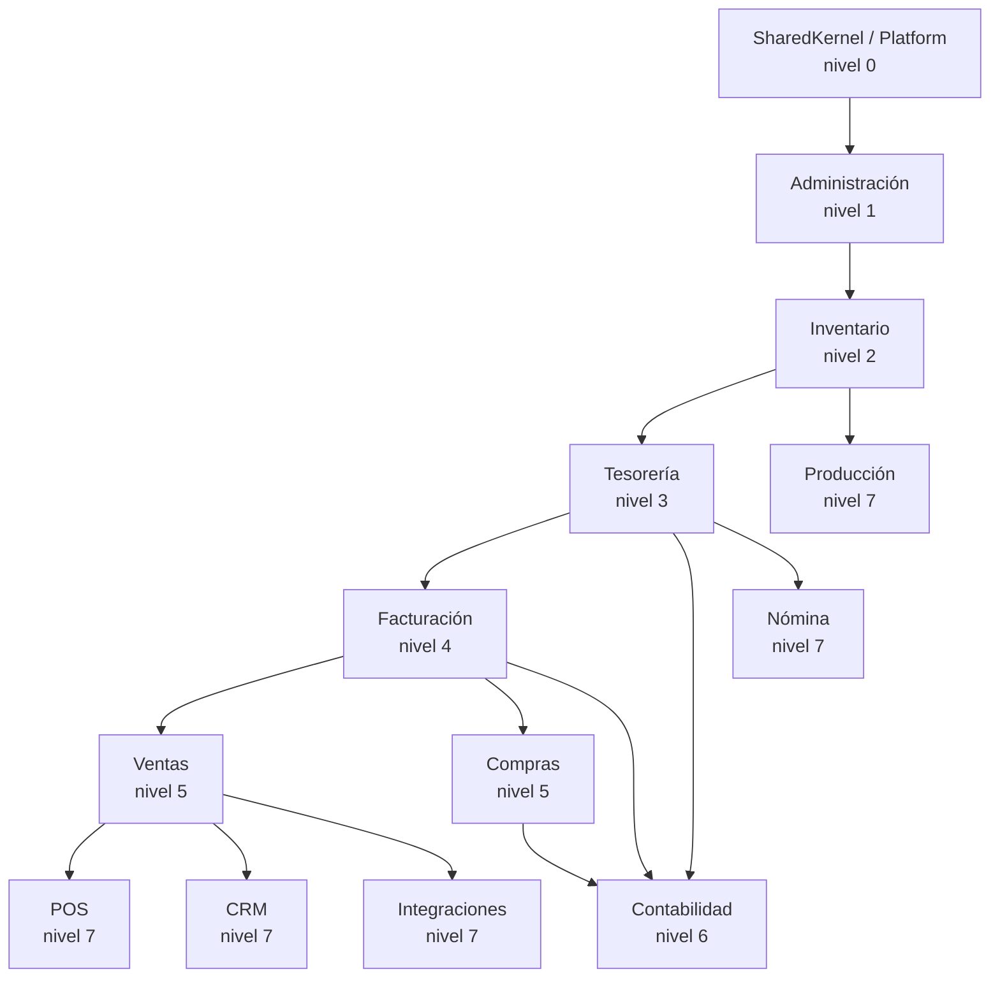

# Monolito modular — Límites, contratos y dependencias

**Versión:** 1.0 · **Fecha:** 2026-11-08 · **Estado:** línea base

## 1. Estructura de la solución

```text
src/
├── Avila.Api/                        # Host HTTP
├── Avila.Worker/                     # Host de procesos en segundo plano
├── Avila.SharedKernel/               # Tipos primitivos compartidos
├── Avila.Platform/                   # Tenancy, identidad, autorización, auditoría, numeración, outbox
├── Avila.Persistence/                # Convenciones EF, interceptores, RLS, migraciones
├── Avila.Observability/              # OpenTelemetry, logging, health checks
├── Modules/
│   ├── Administration/
│   │   ├── Avila.Modules.Administration/
│   │   └── Avila.Modules.Administration.Contracts/
│   ├── Inventory/
│   ├── Sales/
│   ├── Purchasing/
│   ├── Billing/
│   ├── Treasury/
│   ├── Accounting/
│   ├── POS/
│   ├── Payroll/
│   ├── Production/
│   ├── CRM/
│   └── Integration/
└── Tests/
    ├── Avila.Architecture.Tests/
    ├── Avila.Modules.<Módulo>.Tests/
    └── Avila.Integration.Tests/
web/
├── src/
│   ├── app/                          # Rutas y shell
│   ├── modules/                      # Un folder por módulo funcional
│   ├── shared/                       # UI, hooks, api client, permisos
│   └── lib/                          # Utilidades sin dominio
└── e2e/
```

> Esta estructura es la **referencia objetivo**. En la línea base documental no existe código.

## 2. Anatomía de un módulo

| Proyecto | Contenido | Visibilidad |
|---|---|---|
| `Avila.Modules.X` | Dominio, aplicación, infraestructura, endpoints internos | Interno al módulo |
| `Avila.Modules.X.Contracts` | DTOs, interfaces de casos de uso, eventos públicos, códigos de error | Público |

Reglas:

1. Solo `Contracts` es referenciable por otros módulos.
2. Las entidades, agregados, repositorios y `DbContext` son internos.
3. Los eventos públicos se definen en `Contracts/Events` con versión.
4. Los errores de negocio se exponen con códigos estables en `Contracts/Errors`.
5. El módulo registra sus dependencias en un único punto de composición (`AddSalesModule`).

## 3. Mapa de módulos y niveles



Las flechas de `CON` representan **suscripción a eventos**, no dependencia de código: Contabilidad referencia los contratos de eventos de los módulos que los publican, y ningún módulo de negocio referencia a Contabilidad.

## 4. Matriz de comunicación

| Origen → Destino | Mecanismo | Consistencia | Ejemplo |
|---|---|---|---|
| Ventas → Inventario | Contrato síncrono en la misma transacción | Fuerte | Reservar stock al confirmar pedido |
| Ventas → Facturación | Contrato síncrono en la misma transacción | Fuerte | Emitir factura y numerar |
| Facturación → Tesorería | Contrato síncrono en la misma transacción | Fuerte | Crear partida por cobrar |
| Compras → Inventario | Contrato síncrono | Fuerte | Registrar recepción |
| Facturación → Contabilidad | Evento de dominio en proceso | Fuerte (misma transacción) | Asiento de factura |
| Tesorería → Contabilidad | Evento de dominio en proceso | Fuerte | Asiento de cobro/pago |
| Cualquier módulo → notificaciones | Outbox | Eventual | Correo, PDF, webhook |
| Cualquier módulo → integraciones | Outbox | Eventual | Proveedor fiscal, e-commerce |
| Contabilidad → nadie | Solo lectura/reportes | — | — |

**Prohibido:** llamadas HTTP entre módulos, acceso directo a tablas, consultas SQL a esquemas ajenos, uso de transacciones distribuidas.

## 5. Transacciones

### 5.1 Unidad de trabajo

- Un caso de uso abre **una** transacción de base de datos.
- Todos los módulos participantes comparten la conexión y la transacción mediante `IUnitOfWork`/`ITransactionCoordinator` del shared kernel.
- Si un participante falla, se revierte todo.
- La transacción no incluye llamadas de red externas.

### 5.2 Contabilización

La contabilización de un documento es parte de la transacción del caso de uso cuando la regla lo exige. Se implementa con eventos de dominio en proceso:

```text
EmitirFactura
  → validar y persistir comprobante
  → crear partida por cobrar (Tesorería)
  → publicar InvoiceIssued (dominio)
  → handler de Contabilidad crea asiento
  → publicar InvoiceIssued (integración, outbox)
  → COMMIT
```

Si el asiento falla, la factura no se emite. Es deliberado: un documento fiscal no debe existir sin registro contable cuando la empresa exige contabilidad integrada.

### 5.3 Efectos secundarios

Correos, PDFs, webhooks, sincronización con proveedores y reportes **nunca** bloquean la transacción. Van al outbox y se procesan después.

## 6. Consultas entre módulos

- Un módulo no lee tablas de otro. Si necesita datos, usa:
  1. Su propio modelo de lectura alimentado por eventos (proyección), o
  2. Un contrato de consulta del módulo dueño (`IOrderSummaryQuery`), o
  3. Una vista de reporte explícita, definida y aprobada, que no se usa para escritura.
- Las vistas de reporte se documentan y se prueban contra el modelo transaccional.

## 7. Eventos

### 7.1 Convención

`<módulo>.<agregado>.<acción>.v<n>` en pasado:

- `sales.order.confirmed.v1`
- `billing.invoice.issued.v1`
- `treasury.payment.applied.v1`
- `inventory.stock.moved.v1`
- `accounting.entry.posted.v1`

### 7.2 Sobre del evento

```json
{
  "event_id": "018f...",
  "event_type": "billing.invoice.issued.v1",
  "event_version": 1,
  "tenant_id": "018f...",
  "occurred_at": "2026-11-08T14:00:00Z",
  "correlation_id": "018f...",
  "causation_id": "018f...",
  "aggregate_type": "Invoice",
  "aggregate_id": "018f...",
  "data": { }
}
```

### 7.3 Reglas

- Un evento es inmutable y versionado.
- Los cambios incompatibles crean `.v2`; no se modifica `.v1`.
- No incluye secretos ni PII innecesaria.
- Los consumidores toleran campos nuevos (evolución compatible).
- El orden se garantiza por agregado, no global.

## 8. Enforcement

| Mecanismo | Qué verifica | Dónde |
|---|---|---|
| Pruebas de arquitectura | Referencias permitidas entre ensamblados | `Avila.Architecture.Tests` |
| Convenciones de solución | Un `DbContext` por módulo | Revisión + prueba |
| Introspección de esquema | `tenant_id`, RLS, índices | CI |
| Revisión de PR | Límites, transacciones, eventos | Checklist |
| Análisis de dependencias | Ciclos y paquetes prohibidos | CI |

Ejemplo de regla: ningún tipo de `Avila.Modules.Sales` puede referenciar `Avila.Modules.Inventory` fuera de `Avila.Modules.Inventory.Contracts`.

## 9. Antipatrones prohibidos

- **Entidad compartida** entre módulos.
- **Repositorio genérico global** que consulta cualquier tabla.
- **Servicio "common"** que concentra reglas de varios dominios.
- **Evento como RPC** (esperar respuesta de un consumidor).
- **Transacción que incluye HTTP**.
- **Job que recorre todos los tenants sin cuota**.
- **Capa de "helpers"** con lógica de negocio.
- **Duplicar el cálculo de impuestos** en ventas, facturación y POS.

## 10. Criterios de extracción futura

Ver [ADR-001 §6](../decisions/ADR-001-modular-monolith.md#6-criterios-para-extraer-un-módulo-a-servicio). La extracción no se planifica en R1–R6; solo se deja preparada por los contratos.

## 11. Documentos relacionados

- [ADR-001](../decisions/ADR-001-modular-monolith.md)
- [Arquitectura general](architecture-overview.md)
- [Base de datos](database-design.md)
- [Integraciones](integration-strategy.md)
- [Modelo de dominio](../domain/domain-model.md)
