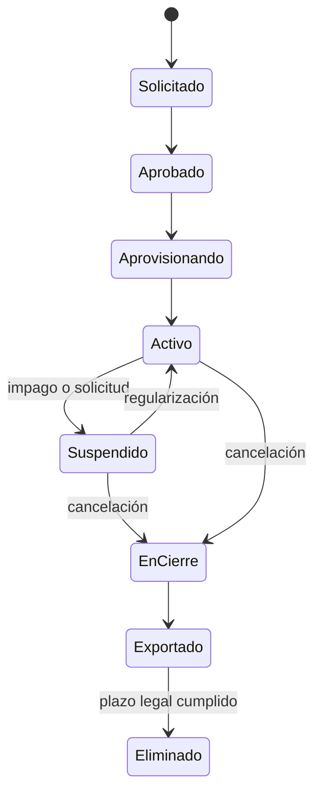

# Multi-tenancy — Modelo, aislamiento y ciclo de vida

**Versión:** 1.0 · **Fecha:** 2026-11-08 · **Estado:** línea base

## 1. Modelo

```text
Plataforma ÁVILA
└── Organización (tenant)            ← frontera de aislamiento y de contrato SaaS
    ├── Empresa (persona jurídica)   ← RIF, domicilio fiscal, moneda funcional, contabilidad
    │   ├── Sucursal                 ← establecimiento, numeración, caja
    │   │   └── Almacén / Caja       ← operación
    │   └── Almacén
    └── Membresías de usuarios       ← rol + alcance por empresa/sucursal
```

| Nivel | Identificador | Qué delimita |
|---|---|---|
| Organización | `tenant_id` | Aislamiento de datos, plan, límites, facturación SaaS |
| Empresa | `company_id` | Contabilidad, obligaciones fiscales, moneda funcional |
| Sucursal | `branch_id` | Operación, numeración, caja |
| Almacén | `warehouse_id` | Existencias y valoración |

Un usuario pertenece a una o varias organizaciones mediante **membresías**. No existe un usuario "global" con acceso implícito: cada acceso se deriva de una membresía activa y de sus permisos.

## 2. Contexto de tenant

### 2.1 Resolución

```mermaid
sequenceDiagram
  participant C as Cliente
  participant MW as TenantMiddleware
  participant ID as Identidad
  participant M as Membresía
  participant DB as PostgreSQL
  C->>MW: Token + solicitud
  MW->>ID: Validar firma, expiración, sesión
  ID-->>MW: sub, tid, sid
  MW->>M: Verificar membresía activa y permisos
  M-->>MW: alcance (empresas/sucursales)
  MW->>DB: BEGIN; SET LOCAL app.tenant_id = tid
  MW->>DB: Ejecutar caso de uso (RLS + filtro)
  DB-->>C: Resultado
```

Reglas:

1. `tid` debe corresponder a una membresía activa del usuario; si no, 403.
2. El cambio de organización requiere un token nuevo; no se acepta `X-Tenant-Id` como fuente de verdad.
3. La validación de membresía se cachea como máximo 60 segundos y se invalida al cambiar roles o suspender la membresía.
4. Operaciones sensibles (cambios de permisos, pagos, anulación) revalidan permisos sin caché.
5. Si falta `app.tenant_id`, RLS falla cerrado y no devuelve filas.

### 2.2 Contexto en segundo plano

- Todo mensaje de outbox incluye `tenant_id`.
- Todo job recibe el tenant explícito y abre su propio contexto.
- Prohibido usar `AsyncLocal` o variables globales para propagar tenant entre jobs concurrentes.
- Un job global (por ejemplo, métricas de plataforma) usa un contexto de plataforma explícito y no consulta tablas de negocio sin agregación autorizada.

## 3. Capas de aislamiento

| Capa | Control | Qué evita |
|---|---|---|
| Aplicación | Filtro obligatorio por `tenant_id` en repositorios y consultas | Consultas accidentales |
| Contratos | DTOs sin `tenant_id` manipulable; el servidor lo inyecta | Suplantación |
| Datos | FK compuestas `(tenant_id, id)`, unicidad con tenant | Referencias cruzadas |
| Base de datos | RLS `ENABLE` + `FORCE` con `app.tenant_id` | Fuga por consulta directa o error de código |
| Archivos | Prefijo `tenant/<tenant_id>/`, URLs firmadas | Acceso a documentos ajenos |
| Caché | Clave con prefijo de tenant y versión | Mezcla de datos en caché |
| Pruebas | Batería de acceso cruzado | Regresiones |

**Los filtros globales de EF Core no son suficientes.** Se usan como ayuda, pero la garantía incluye RLS, claves compuestas y pruebas.

## 4. Esquema de datos

### 4.1 Columnas obligatorias

Toda tabla de negocio incluye:

```sql
tenant_id uuid NOT NULL,
created_at timestamptz NOT NULL,
created_by uuid NOT NULL,
updated_at timestamptz NOT NULL,
updated_by uuid NOT NULL,
row_version bigint NOT NULL DEFAULT 0
```

`company_id`, `branch_id` y `warehouse_id` se agregan según el alcance del dato.

### 4.2 Claves y restricciones

```sql
-- Clave primaria compuesta lógica: el id es único global, pero la FK exige tenant
ALTER TABLE sales.orders
  ADD CONSTRAINT fk_orders_customer
  FOREIGN KEY (tenant_id, customer_id)
  REFERENCES admin.parties (tenant_id, id);

CREATE UNIQUE INDEX ux_orders_number
  ON sales.orders (tenant_id, company_id, branch_id, series, number);
```

Reglas:

- Las FK de negocio son compuestas e incluyen `tenant_id`.
- Los índices de consulta comienzan por `tenant_id` y luego las columnas de filtro.
- Las restricciones de unicidad incluyen el tenant.
- No se usan IDs autoincrementales visibles entre tenants.

### 4.3 RLS

```sql
ALTER TABLE billing.invoices ENABLE ROW LEVEL SECURITY;
ALTER TABLE billing.invoices FORCE ROW LEVEL SECURITY;

CREATE POLICY tenant_isolation ON billing.invoices
  USING (tenant_id = nullif(current_setting('app.tenant_id', true), '')::uuid)
  WITH CHECK (tenant_id = nullif(current_setting('app.tenant_id', true), '')::uuid);
```

- El rol `avila_app` no es dueño de las tablas y no tiene `BYPASSRLS`.
- Las migraciones usan un rol distinto (`avila_migrator`).
- Las políticas se crean en la misma migración que la tabla; una tabla sin política es un error de CI.
- Las vistas y funciones expuestas respetan RLS o usan `security_invoker`.

### 4.4 Implementación T-005

- `platform.tenants` es una tabla **global**: no tiene `tenant_id` y no se concede a `avila_app`; se protege por privilegios, no por política de tenant.
- `platform.tenant_settings` es tenant-scoped y tiene RLS forzada por `app.tenant_id`.
- `avila_app` recibe solo los permisos de las tablas de negocio y de `platform.tenant_settings`; no es owner y no tiene `BYPASSRLS`.
- El backfill se ejecuta **por tenant**, con una UoW y transacción por tenant; no usa estado ambiental compartido ni `BYPASSRLS`.
- El middleware `TenantUnitOfWorkMiddleware` abre la UoW de `/api`; la identidad (T-006) debe resolver `ITenantContext` antes de exponer endpoints de negocio.
- Evidencia: 19 pruebas de producción, introspección RLS, pool sin GUC residual y rollback inyectado.

## 5. Aislamiento en almacenamiento y caché

### Archivos
- Bucket privado; sin acceso público.
- Ruta: `tenant/<tenant_id>/<módulo>/<año>/<id>.<ext>`.
- URL firmada de corta duración (≤ 5 min) y validación de pertenencia antes de firmar.
- Antivirus y validación de tipo/tamaño en la carga.
- Retención y borrado según política (`DEC-008`).

### Caché
- Clave: `<tenant_id>:<entidad>:<id>:<versión>`.
- Invalidación por evento del módulo dueño.
- Prohibido cachear resultados agregados entre tenants.
- La caché nunca es fuente de verdad para saldos, stock o numeración.

## 6. Reportes y búsqueda

- Los reportes se ejecutan con el contexto del tenant y RLS activa.
- Las exportaciones incluyen solo el tenant solicitado y quedan auditadas.
- La búsqueda global se limita al tenant; los índices (si se usan) incluyen `tenant_id` como filtro obligatorio.
- Los reportes de plataforma usan datos agregados y anonimizados; nunca PII de clientes.

## 7. Ciclo de vida del tenant



| Etapa | Acciones | Datos |
|---|---|---|
| Aprovisionamiento | Crear organización, empresa, sucursal, admin, límites, auditoría | Iniciales |
| Activo | Operación normal | Completo |
| Suspendido | Bloquear escrituras; lectura/exportación según política | Conservado |
| En cierre | Exportación completa, comunicación | Conservado |
| Exportado | Entrega en formato abierto | Conservado hasta plazo |
| Eliminado | Borrado seguro según `DEC-008` | Irreversible |

**Regla:** la suspensión no borra datos ni impide la exportación. El borrado requiere autorización, verificación de obligaciones legales y auditoría.

## 8. Soporte y acceso de plataforma

- Roles de plataforma: `PlatformAdmin`, `Support`, `BillingOps` (mínimo privilegio).
- Acceso a un tenant: solo lectura por defecto, con ticket, justificación y ventana temporal.
- Toda acción de soporte queda registrada con actor, tenant, motivo y correlación.
- El acceso de escritura entre tenants es una excepción aprobada, auditada y notificada.
- Prohibido usar credenciales de un cliente o compartir sesiones.

## 9. Tenant dedicado (R6)

- Mismo código, configuración y migraciones.
- Base de datos o esquema exclusivo, con el mismo modelo de `tenant_id`.
- Aprovisionamiento automatizado y verificable.
- Costo y SLA diferenciados (`PLT-006`).
- No cambia la lógica de negocio ni los contratos.

## 10. Rendimiento y operación

| Tema | Práctica |
|---|---|
| Índices | Encabezados por `tenant_id`; revisar planes de consulta |
| Tablas grandes | Particionado por rango/hash cuando la métrica lo indique, sin romper RLS |
| Jobs | Cuotas por tenant; fairness en el despachador |
| Conexiones | Pool por instancia; `SET LOCAL` por transacción; cuidado con PgBouncer en modo transacción |
| Migraciones | Bloqueos cortos; índices `CONCURRENTLY`; expand/contract |
| Analítica | Réplica de lectura o exportación; nunca consultas pesadas contra primaria |

## 11. Antipatrones prohibidos

- Consultar sin `tenant_id` "porque el ID es único".
- Usar `IgnoreQueryFilters` sin contexto de plataforma explícito.
- Compartir un `DbContext` entre tenants.
- Cachear sin tenant.
- Guardar archivos en una ruta plana accesible por ID.
- Ejecutar jobs que recorran todos los tenants sin cuota ni paginación.
- Conceder `BYPASSRLS` al rol de aplicación.
- Aceptar `tenant_id` del cliente sin validar membresía.

## 12. Matriz de verificación

| Recurso | Intento de ataque | Resultado esperado |
|---|---|---|
| Pedido por ID | Usuario de otro tenant | 404, sin filtrar existencia, auditoría |
| Listado con filtro manipulado | `tenant_id` ajeno | Lista vacía o 403; nunca datos ajenos |
| Reporte/exportación | Cambio de tenant en query | 403; auditoría |
| Archivo PDF | URL de otro tenant | 403; sin URL firmada |
| Job | Evento con tenant manipulado | Rechazo; alerta |
| Token | `tid` alterado | 401/403 |
| Soporte | Acceso sin ticket | Rechazo y alerta |

## 13. Decisiones y pendientes

- `DEC-008`: aprobada técnicamente (retención por tipo de dato y jurisdicción); validación legal pendiente.
- `DEC-001`: DigitalOcean + Terraform aprobado; región y latencia pendientes.
- Tenant dedicado: `PLT-006` (R6).
- Ver [ADR-003](../decisions/ADR-003-multi-tenancy.md).

## 14. Documentos relacionados

- [ADR-003](../decisions/ADR-003-multi-tenancy.md)
- [Seguridad](security.md)
- [Base de datos](database-design.md)
- [Administración](../domain/administration.md)
