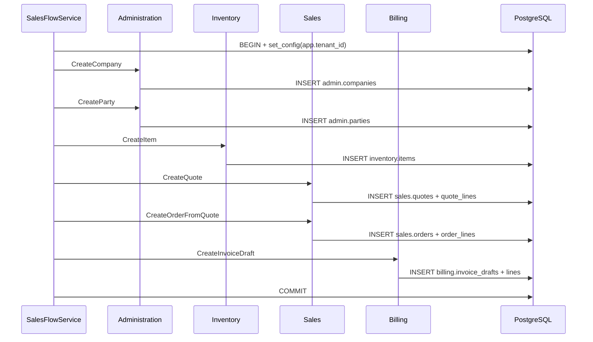

# R1 Production Skeleton and Vertical Slice — 2026-11-08

**Status:** Production skeleton verified for the first vertical slice. **Not a production release.**
**Scope:** `tenant → company → party → item → quote → order → invoice draft`
**Evidence:** 2 integration tests pass against PostgreSQL 18 with all module migrations and RLS applied.

---

## 1. Result

```text
Avila.ProductionTests
Passed! - Failed: 0, Passed: 2, Skipped: 0, Total: 2
```

API smoke test:

```text
GET /health  -> 200 Healthy
GET /        -> 200 {"product":"ÁVILA ERP","status":"production-skeleton",...}
```

Full solution:

```text
Avila.IntegrationTests  19/19 passed
Avila.ProductionTests    2/2 passed
Total                   21/21 passed
```

---

## 2. Production structure

```text
src/
├── Avila.Api/                         Minimal API host + health
├── Avila.Application/                 SalesFlowService (use-case orchestration)
├── Avila.Platform/                    IUnitOfWork, TenantUnitOfWork, tenant context
├── Avila.SharedKernel/                DomainException, TenantId
└── Modules/
    ├── Administration/
    │   ├── Avila.Modules.Administration
    │   └── Avila.Modules.Administration.Contracts
    ├── Inventory/
    ├── Sales/
    └── Billing/
```

Module boundaries:

- Each module has its own project and `Contracts` project.
- Application depends on contracts only.
- Module services create their own `DbContext`, enlist it into the shared unit of work, and never commit.
- No cross-module EF navigation or cross-schema foreign key.

---

## 3. Per-module migrations and RLS

| Module | Schema | Migration history | Tables |
|---|---|---|---|
| Administration | `admin` | `admin.__ef_migrations_history` | `companies`, `parties` |
| Inventory | `inventory` | `inventory.__ef_migrations_history` | `items` |
| Sales | `sales` | `sales.__ef_migrations_history` | `quotes`, `quote_lines`, `orders`, `order_lines` |
| Billing | `billing` | `billing.__ef_migrations_history` | `invoice_drafts`, `invoice_draft_lines` |

Each migration:

- creates its schema and tables;
- adds unique indexes scoped by `tenant_id`;
- enables and forces RLS;
- creates the `tenant_isolation` policy using `current_setting('app.tenant_id', true)`.

The test fixture provisions the `avila_app` role with no `BYPASSRLS` and only the required schema/table grants. Production role provisioning remains a deployment concern.

---

## 4. Vertical slice



The two integration tests verify:

1. The complete flow creates one company, party, item, quote, order and invoice draft with the expected totals (`20 + 3.20 = 23.20`).
2. Two tenants run the same flow; a tenant-scoped query through RLS returns only its own quote.

---

## 5. What is intentionally not implemented yet

| Area | Status |
|---|---|
| Authentication and tenant resolution from a real token | Not implemented; tests pass the tenant explicitly |
| Business API endpoints | Not implemented; API exposes health and metadata only |
| Fiscal invoice numbering/emission | Not implemented; the invoice is a draft without fiscal number |
| Stock reservation, credit limit and order confirmation rules | Not implemented |
| Domain events/outbox in the production slice | Not wired |
| Production role provisioning and deployment | Not implemented |
| Quote/order numbers | Placeholder GUID-based numbers, not the fiscal numbering service |
| Migrations against a real environment | Not applied; only Testcontainers |
| Architecture tests | Not implemented yet |

These are deliberate boundaries of this slice, not claims of completeness.

---

## 6. Next steps

1. Add authentication/tenant-resolution middleware and do not expose business endpoints until it exists.
2. Wire the production `TenantUnitOfWork` into API request scope.
3. Add inventory stock reservation and credit validation before order confirmation.
4. Add quote/order numbering using the approved numbering design.
5. Add domain events/outbox for invoice issuance.
6. Add architecture tests for module dependency rules.
7. Add production deployment/role migration automation.

---

## 7. Evidence

- `src/Avila.Application/SalesFlowService.cs`
- `src/Avila.Platform/Tenancy/TenantUnitOfWork.cs`
- `src/Avila.Api/Program.cs`
- `src/Modules/*/Migrations/*_Initial.cs`
- `tests/Avila.ProductionTests/ProductionFixture.cs`
- `tests/Avila.ProductionTests/SalesFlowTests.cs`

No commits, pushes or deployments were made. This is a local scaffold verified with Testcontainers.
