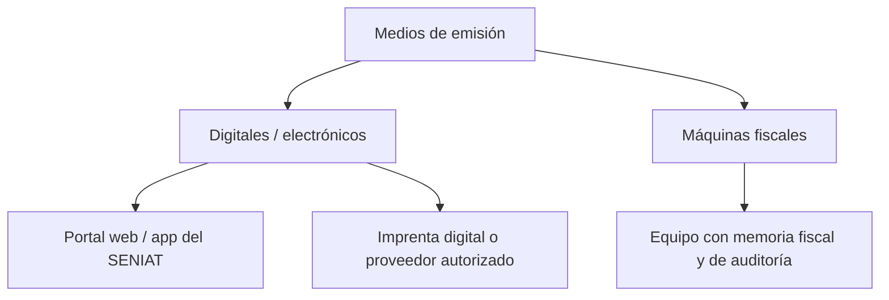

# Facturación e emisión de documentos fiscales

**Versión:** 1.0 · **Fecha:** 2026-11-08 · **Estado:** **requiere validación externa**

> **Aviso:** este documento resume el contexto normativo identificado y define cómo se prepara el producto. **No sustituye asesoría legal.** Los requisitos exactos de contenido, formato y homologación están `PENDIENTE DE VALIDACIÓN LEGAL / CONTABLE`.

## 1. Contexto identificado

| Dato | Valor | Fuente | Estado |
|---|---|---|---|
| Norma | Providencia Administrativa del SENIAT sobre normas generales y medios de emisión de facturas y otros documentos fiscales (identificada como PA-0093) | `SRC-001` | `CONSULTADA` |
| Publicación | Gaceta Oficial N.º 43.484 del 21/10/2026 | `SRC-001` | `CONSULTADA` |
| Vigencia | 180 días continuos después de la publicación; vencimiento aproximado **2027-04-19** | `SRC-001` + cálculo propio | `HIPÓTESIS` |
| Efecto principal | La máquina fiscal deja de ser obligatoria; el sujeto pasivo elige el medio de emisión | `SRC-001` | `CONSULTADA` |
| Medios previstos | Medios digitales/electrónicos (portal web/app del SENIAT, imprenta digital o proveedor autorizado) y máquinas fiscales | `SRC-001` | `CONSULTADA` |
| Formas libres | Podrán usarse hasta agotar existencia o hasta la entrada en vigencia; luego se anulan/desincorporan, conservando talonarios de contingencia | `SRC-001` | `CONSULTADA` |

**No se afirma** que la providencia elimine todos los requisitos de facturación: cambia los medios y su obligatoriedad. El texto oficial debe revisarse completo.

## 2. Medios de emisión (según la fuente)

- La adopción es libre elección del sujeto pasivo, según la fuente consultada.
- La operación con máquina fiscal existente puede continuar; no es requisito para facturar.
- La implementación concreta de cada medio requiere validación con el proveedor y con el SENIAT.

## 3. Consecuencias para ÁVILA ERP

1. **No construir emisión propia homologada.** ÁVILA integra un medio autorizado mediante un adaptador (`FAC-011`).
2. **Abstraer el medio de emisión.** El dominio de facturación no conoce al proveedor: define un puerto `IFiscalEmitter` con implementaciones (proveedor digital, imprenta, máquina fiscal legada).
3. **Preparar la transición.** El producto debe soportar series y configuraciones por empresa, sucursal y fecha, para convivir con el esquema anterior y el nuevo.
4. **Conservar evidencia.** Cada intento de emisión, autorización y representación se almacena y se puede reconstruir.
5. **No prometer cumplimiento.** La interfaz y el contrato indican el estado de validación de la configuración.

## 4. Contenido de los documentos

Los campos obligatorios, leyendas y formatos deben validarse. El modelo de datos prevé, como mínimo, las siguientes **categorías** (no una lista normativa cerrada):

| Categoría | Datos previstos |
|---|---|
| Emisor | Razón social, RIF, domicilio, datos de contacto, régimen |
| Receptor | Razón social, RIF/cédula, domicilio, condición |
| Documento | Tipo, número, serie, fecha, hora, moneda, tasa |
| Líneas | Descripción, cantidad, UoM, precio, descuento, base, impuesto |
| Totales | Base por alícuota, impuesto, total, moneda |
| Pago | Condición, medios, referencia |
| Leyendas | Las que exija la norma vigente (`PENDIENTE`) |
| Representación | Formato gráfico y datos de autorización cuando aplique (`PENDIENTE`) |

**Estado:** `PENDIENTE DE VALIDACIÓN LEGAL / CONTABLE`.

## 5. Numeración

- Por empresa, sucursal, tipo de documento, serie y año ([ADR-006](../decisions/ADR-006-document-numbering.md)).
- Sin duplicados ni huecos no justificados.
- Un número anulado no se reutiliza.
- La política de reinicio anual y de series especiales está **PENDIENTE**.
- Las series de contingencia, si se usan, se concilian y documentan. **PENDIENTE DE VALIDACIÓN**.

## 6. Corrección y anulación

- La factura emitida no se edita ni se borra.
- La corrección se realiza con nota de crédito (total o parcial) o nota de débito.
- La anulación requiere un procedimiento validado y conserva el número y el registro.
- Los documentos relacionados se enlazan (factura → nota → asiento).
- La política exacta de anulación y sus efectos fiscales: `PENDIENTE`.

## 7. Contingencia

- Debe existir un procedimiento aprobado para fallas del medio de emisión.
- El producto puede bloquear la emisión con mensaje claro o usar un mecanismo validado; **no inventa** un comprobante.
- Los talonarios o series de contingencia se conservan según la norma.
- La regularización posterior debe ser trazable.
- **PENDIENTE DE VALIDACIÓN LEGAL / CONTABLE** (`FAC-009`, `DEC-010`).

## 8. Representación gráfica

- Se genera desde el snapshot del comprobante, no desde datos actuales.
- Formato PDF reproducible y almacenado en el gestor documental.
- Datos de autorización/QR/código cuando la norma lo exija: `PENDIENTE`.
- Reimpresión permitida con marca de copia y auditoría.
- Envío al cliente por correo o portal, con registro de entrega.

## 9. Libros y reportes

- Libro de ventas y compras por período (`FAC-004`).
- Resúmenes por alícuota y retenciones (`FAC-005`).
- Exportación en formatos abiertos y, cuando se validen, en los formatos oficiales.
- Conciliación con contabilidad y con comprobantes.
- **Formatos y plazos: `PENDIENTE`.**

## 10. Reglas de implementación

1. Ningún valor fiscal en código; todo por parámetro versionado.
2. La regla aplicada se guarda en el documento.
3. La emisión es transaccional con la numeración.
4. El fallo del proveedor no deja comprobantes a medias.
5. La interfaz informa el estado de validación de la configuración.
6. Las pruebas usan casos dorados revisados por especialista.

## 11. Checklist de validación con especialista

- [ ] Texto completo de la PA-0093 y su vigencia exacta.
- [ ] Medios autorizados y requisitos por tipo de contribuyente.
- [ ] Datos y leyendas obligatorias de cada documento.
- [ ] Reglas de numeración, series, anulación y contingencia.
- [ ] Formato de libros y reportes.
- [ ] Requisitos de conservación y exportación.
- [ ] Tratamiento de operaciones en divisas y tasas.
- [ ] Requisitos técnicos del proveedor de emisión.
- [ ] Validez de la emisión offline (POS).
- [ ] Procedimiento de transición desde el esquema anterior.

## 12. Decisiones abiertas

`DEC-002` (medio de emisión), `DEC-007` (retenciones), `DEC-010` (offline), `DEC-013` (hardware fiscal legado). Ver [decisiones](../decisions/README.md).

## 13. Documentos relacionados

- [regulatory-sources.md](regulatory-sources.md)
- [venezuela-tax.md](venezuela-tax.md)
- [billing.md](../domain/billing.md)
- [ADR-006](../decisions/ADR-006-document-numbering.md)
- [point-of-sale.md](../domain/point-of-sale.md)
