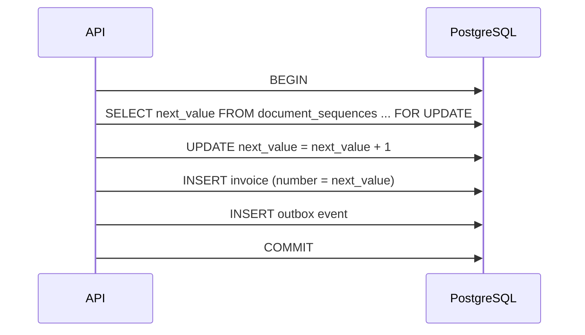

# ADR-006 — Numeración documental segura y concurrente

- **Estado:** Aceptado
- **Fecha:** 2026-11-08
- **Decisores:** Arquitectura, Fiscal, Producto
- **Reemplaza a:** —

## 1. Contexto

Los comprobantes fiscales requieren numeración controlada, única y auditable. Varias cajas o usuarios pueden emitir simultáneamente en la misma sucursal. La numeración debe sobrevivir reintentos, caídas y concurrencia sin duplicados ni huecos no justificados. Además, los documentos internos (cotizaciones, pedidos, notas de entrega) también necesitan numeración legible, aunque no tengan el mismo rigor fiscal.

## 2. Decisión

1. Toda numeración se gestiona en la tabla `platform.document_sequences`:

```sql
CREATE TABLE platform.document_sequences (
  tenant_id uuid NOT NULL,
  company_id uuid NOT NULL,
  branch_id uuid,
  document_type text NOT NULL,
  series text NOT NULL,
  fiscal_year int NOT NULL,
  next_value bigint NOT NULL,
  allow_gaps boolean NOT NULL DEFAULT false,
  updated_at timestamptz NOT NULL,
  PRIMARY KEY (tenant_id, company_id, branch_id, document_type, series, fiscal_year)
);
```

2. El número se obtiene **dentro de la transacción de emisión** con `SELECT ... FOR UPDATE` y se incrementa en la misma operación. La fila se crea si no existe, con manejo de conflicto de concurrencia.
3. La asignación y la inserción del documento ocurren en la **misma transacción**. Si la transacción se revierte, el número no se consume (comportamiento sin huecos).
4. Para documentos fiscales, `allow_gaps = false`. Para documentos internos puede ser `true` y usar una secuencia de base de datos, siempre que el tipo lo permita.
5. Restricción única `(tenant_id, company_id, branch_id, document_type, series, fiscal_year, number)` en cada tabla documental.
6. Prohibido usar `SEQUENCE` de PostgreSQL, `MAX(number) + 1` o numeración en el cliente para comprobantes fiscales.
7. Un comprobante anulado conserva su número y no se reutiliza; se registra el motivo y la referencia.
8. La serie y el año fiscal son configurables por empresa/sucursal. La política de reinicio anual queda sujeta a validación legal (`DEC-002`).
9. Si un documento requiere un rango de contingencia, se aprovisiona como serie separada y se concilia al regularizar; **PENDIENTE DE VALIDACIÓN LEGAL / CONTABLE**.

## 3. Flujo



## 4. Consecuencias

### Positivas
- Sin duplicados ni huecos no justificados en documentos fiscales.
- Trazabilidad de serie, año y sucursal.
- La transacción garantiza consistencia entre número y documento.
- Compatible con RLS y multi-tenant.

### Negativas
- Contención en series de alto volumen (se mitiga con series por caja/sucursal y reintentos).
- La transacción es más larga; hay que minimizar trabajo dentro de ella.
- Los huecos por contingencias requieren procedimiento validado.

## 5. Alternativas consideradas

| Alternativa | Motivo de descarte |
|---|---|
| `SEQUENCE` de PostgreSQL | No es transaccional: deja huecos ante rollback |
| `MAX(number) + 1` | Condición de carrera y riesgo de duplicados |
| Numeración en el cliente | Insegura y no auditable |
| Bloque de números preasignado | Deja huecos ante caída; solo con procedimiento validado |

## 6. Verificación

- Prueba de 10.000 emisiones concurrentes sin duplicados ni huecos.
- Prueba de rollback: el número no se consume.
- Prueba de reinicio del proceso a mitad de emisión.
- Prueba de aislamiento: dos tenants con la misma serie no colisionan.
- Auditoría: consulta de todos los números emitidos, anulados y su estado.

## 7. Referencias

- [billing.md](../domain/billing.md)
- [database-design.md](../architecture/database-design.md)
- [invoicing.md](../compliance/invoicing.md)
