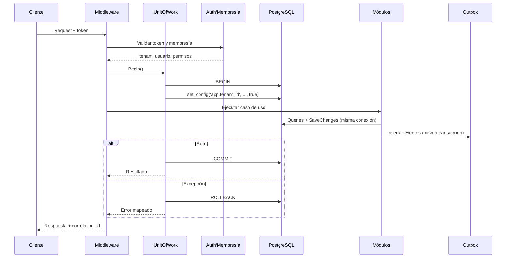

# ADR-007 — Modelo transaccional y contexto de tenant

- **Estado:** **Aceptado** — aprobación técnica 2026-11-08. Implementación y verificación pendientes. La validación contable de `D-02`, `D-03` y `D-14` sigue condicionada a especialista.
- **Fecha:** 2026-11-08
- **Decisores propuestos:** Arquitectura, Backend, DBA, Seguridad, Operaciones
- **Complementa:** ADR-001 (monolito modular), ADR-002 (PostgreSQL), ADR-003 (multi-tenancy). **No modifica** los ADR originales.
- **Hallazgos que aborda:** `AUD-P1-03`, `AUD-P1-05`, `AUD-P1-06`, `AUD-P2-10`, `AUD-P2-11`; soporte a `AUD-P1-04` y `AUD-P1-09`.

---

## 1. Contexto

La auditoría independiente encontró que la documentación afirma una consistencia que no está definida técnicamente:

- “Todos los módulos participantes comparten la conexión y la transacción mediante `IUnitOfWork`/`ITransactionCoordinator`” ([modular-monolith.md §5.1](../architecture/modular-monolith.md#51-unidad-de-trabajo)).
- Pero la solución define un `DbContext` por módulo, un esquema por módulo y migraciones independientes ([database-design.md §2](../architecture/database-design.md#2-esquemas)).
- El contexto RLS se establece con `SET LOCAL` “al inicio de la transacción”, sin definir qué ocurre en lecturas, en autocommit, en conexiones reutilizadas del pool ni en tablas `platform` ([ADR-003](ADR-003-multi-tenancy.md), [multi-tenancy.md §4.3](../architecture/multi-tenancy.md#43-rls)).

El resultado es que la consistencia fuerte es una **intención documental**, no un mecanismo. Este ADR define el mecanismo propuesto.

## 2. Decisión propuesta

### 2.1 Propiedad y ciclo de vida de la transacción

1. **Una unidad de trabajo (UoW) por solicitud o mensaje.** El middleware de la API o el despachador del worker crea un `IUnitOfWork` con scope de solicitud. Ningún endpoint, controlador, handler de dominio o repositorio abre, confirma o revierte transacciones por su cuenta.
2. **Un comando = una transacción.** El caso de uso declara `Begin`, ejecuta, y el coordinador hace un único `Commit`. Una consulta puede usar una transacción de solo lectura (ver §2.7). No hay transacciones anidadas ni `TransactionScope` distribuido.
3. **Ciclo de vida:**

```text
Request/Message
  → autenticación y resolución de membresía
  → UoW.Begin()
  → set_config('app.tenant_id', ..., true)
  → handler(es) de módulo + SaveChanges
  → UoW.Commit()
  → outbox dispatcher (fuera de la transacción)
  → respuesta
```

Si cualquier paso falla antes del `Commit`, el UoW hace `Rollback` y libera la conexión. Si el `Commit` tiene resultado incierto, no se reintenta dentro del mismo UoW; se resuelve por idempotencia.

4. **Prohibido:** llamadas HTTP, correo, generación remota de PDF o llamadas al proveedor fiscal dentro de la transacción. Esos efectos van por outbox ([ADR-005](ADR-005-transactional-outbox.md)).
5. **Prohibido:** un módulo que reciba un `DbContext` de otro módulo o que abra su propia conexión. Solo recibe contratos.
6. **Un mensaje de worker = una UoW.** El worker no comparte conexión ni transacción entre mensajes. Cada mensaje abre su propia UoW con el tenant del evento.

### 2.2 Uso de `DbContext` y conexiones

1. **Una conexión física por UoW.** El UoW es dueño de un `NpgsqlConnection` abierto y de un `NpgsqlTransaction`. Los `DbContext` de los módulos participantes se construyen con esa misma conexión y se asocian a la misma transacción.
2. **Los contextos no son dueños de la conexión.** No abren ni cierran conexiones; no usan connection string propia; no ejecutan `BeginTransaction` propio.
3. **Transacciones implícitas deshabilitadas.** EF Core se configura con `AutoTransactionBehavior.Never` (o equivalente) para que `SaveChanges` no cree una transacción propia. La única transacción es la del UoW.
4. **Un `SaveChanges` por contexto participante.** El coordinador invoca los `SaveChanges` en el orden explícito del caso de uso (por dependencias de datos), y luego hace un único `Commit`. Si un `SaveChanges` falla, no hay commit parcial: se revierte la transacción completa.
5. **Contextos no compartidos.** Cada módulo conserva su `DbContext` y su modelo; compartir conexión y transacción no significa compartir entidades ni tablas.
6. **Sin conexiones adicionales.** Si un handler necesita datos de otro módulo, usa un contrato o una consulta dentro de la misma conexión/transacción; no abre una segunda conexión.

> **Nota de implementación:** la forma exacta de asociar varios `DbContext` a una conexión/transacción compartida se decidirá en el spike de Sprint 0. Las opciones son configurar `UseNpgsql(sharedConnection)` y `Database.UseTransaction(sharedTransaction)` por contexto, o un `DbContext` de unidad de trabajo explícito por caso de uso. El ADR fija el contrato, no la clase concreta.

### 2.3 Contexto de tenant en PostgreSQL

1. El middleware autentica el token, resuelve la **membresía activa** y el alcance (empresa/sucursal). No acepta `tenant_id` del body, query o header.
2. El UoW ejecuta, dentro de la transacción y antes de cualquier consulta:

```sql
SELECT set_config('app.tenant_id', $1, true);
SELECT set_config('app.user_id', $2, true);
SELECT set_config('app.correlation_id', $3, true);
```

`set_config(..., true)` es equivalente transaccional a `SET LOCAL` y evita interpolación de SQL. Al terminar la transacción, PostgreSQL descarta los valores automáticamente.

3. **Prohibido `SET` a nivel de sesión** para `app.tenant_id` o cualquier GUC de seguridad. Si se usa `SET`, una conexión puede volver al pool con el tenant anterior.
4. **Fail closed:** si `app.tenant_id` no está definido, la política RLS no devuelve filas y rechaza escrituras. No existe un “tenant cero” implícito para la aplicación.
5. **Operaciones de plataforma:** no usan el contexto de tenant. Usan un rol y una ruta separados; no consultan tablas de negocio sin una función autorizada y auditada.
6. **Autenticación previa al tenant:** la lista de membresías de un usuario es una operación de plataforma. Se resuelve mediante un servicio/función de autenticación con rol restringido, no con una consulta de `avila_app` sin tenant.
7. **Jobs:** cada mensaje lleva `tenant_id` explícito; el worker abre una UoW y ejecuta `set_config` antes de tocar datos. No se propaga tenant por `AsyncLocal` entre mensajes concurrentes.

### 2.4 `SET LOCAL` y connection pooling

1. **Modelo elegido:** transacción por solicitud/mensaje + `set_config(..., true)`. La conexión se mantiene cautiva durante la transacción y vuelve al pool al terminar; el estado local desaparece con la transacción.
2. **Npgsql pooling** es el modo inicial. No se requiere PgBouncer para R1.
3. **PgBouncer en modo transacción** es compatible *si y solo si* se cumplen estas condiciones: no hay `SET` de sesión, todas las consultas están dentro de una transacción explícita, y se ejecuta la prueba T-07b. En modo sesión no se necesita para este diseño y no se adopta por defecto.
4. **Prohibido** usar `SET` de sesión, `DISCARD ALL` como mecanismo de seguridad o confiar en que “el pool lo limpia”. La seguridad debe venir del alcance transaccional.
5. **Límites:** `lock_timeout` y `statement_timeout` por transacción (valores propuestos: 3 s y 30 s, configurables). Un `lock_timeout` no debe convertirse en un 500; se mapea a 409/503 con código de negocio.
6. **Lecturas:** toda lectura de tablas de negocio se ejecuta dentro de una transacción, aunque sea de solo lectura, para que `set_config` y RLS estén activos. Un endpoint que no toca base de datos no abre UoW.

### 2.5 RLS en tablas de negocio y `platform`

#### Clasificación propuesta

| Grupo | Ejemplos | Acceso de `avila_app` | RLS |
|---|---|---|---|
| Negocio por tenant | `sales.*`, `inventory.*`, `billing.*`, `treasury.*`, `accounting.*` | DML normal | Sí, política por `tenant_id` |
| Plataforma por tenant | `platform.organizations` (policy por `id`), `companies`, `branches`, `document_sequences`, `idempotency_records`, `audit_log`, `subscriptions`, `usage_meters`, `support_access_grants` | DML acotado | Sí |
| Identidad global | `platform.users` | Solo self/membership a través de auth | Acceso restringido; no consulta cross-tenant |
| Catálogo global | `platform.plans`, `plan_limits`, `permissions`, catálogo de monedas | Solo lectura | Sin RLS de tenant; escritura solo plataforma |
| Infraestructura | `outbox_messages`, `inbox_messages`, `dead_letters` | `INSERT`; sin `SELECT` cross-tenant | Sin RLS de tenant; rol `avila_dispatcher` |
| Soporte | `platform.support_access_grants` | Solo a través de función auditada | Sí; lectura de soporte con rol separado |

#### Política base

```sql
ALTER TABLE billing.invoices ENABLE ROW LEVEL SECURITY;
ALTER TABLE billing.invoices FORCE ROW LEVEL SECURITY;

CREATE POLICY tenant_isolation ON billing.invoices
  USING (tenant_id = nullif(current_setting('app.tenant_id', true), '')::uuid)
  WITH CHECK (tenant_id = nullif(current_setting('app.tenant_id', true), '')::uuid);
```

- `avila_app` no es propietario de las tablas y no tiene `BYPASSRLS`.
- `organizations` usa `id = app.tenant_id` como política, porque su PK es el tenant.
- Las tablas `platform` con `tenant_id` reciben la misma política, salvo las excepciones de la tabla anterior.
- Las vistas y funciones expuestas usan `security_invoker` o una función `SECURITY DEFINER` mínima y auditada.
- Las políticas se crean en la misma migración que la tabla; CI falla si una tabla clasificada como tenant-scoped no tiene política.
- La introspección de CI cubre **también** el esquema `platform`.

#### Roles propuestos

| Rol | Propósito | RLS / privilegios |
|---|---|---|
| `avila_app` | API y handlers de negocio | RLS, sin DDL, sin `BYPASSRLS` |
| `avila_migrator` | Migraciones y backfills | DDL controlado; sin tráfico de aplicación |
| `avila_dispatcher` | Outbox/inbox | Solo tablas de infraestructura; sin tablas de negocio |
| `avila_platform_ops` | Soporte y operaciones | Acceso acotado, auditado, con aprobación |
| `avila_readonly` | Reportes/réplica | `SELECT`, RLS, sin escritura |

`avila_dispatcher` no procesa reglas de negocio: reclama el mensaje, abre una UoW de tenant y delega en el handler correspondiente. El handler usa `avila_app` con `set_config`. Esto evita que un rol de infraestructura tenga acceso transversal a datos de negocio.

### 2.6 Rollback, excepciones y reintentos

1. Cualquier excepción no controlada dentro de la UoW produce `Rollback`. No se intenta “guardar lo anterior”.
2. Los errores de dominio se mapean a Problem Details con código estable: `TENANT_REQUIRED`, `FORBIDDEN`, `CONFLICT`, `STOCK_INSUFFICIENT`, `PAYMENT_OVER_ALLOCATED`, `CREDIT_LIMIT_EXCEEDED`, `PERIOD_CLOSED`, `SEQUENCE_BUSY`.
3. `40P01` (deadlock), `40001` (serialization) y `55P03` (lock timeout) se reintentan **solo** en el límite exterior, con la misma `Idempotency-Key`, máximo 2 reintentos y backoff corto. Nunca se reintenta un error de validación.
4. Si el `Commit` es incierto (timeout de red después de enviar `COMMIT`), no se repite la operación a ciegas: se consulta la idempotencia y el estado del documento. La respuesta al cliente debe ser determinista.
5. La cancelación (`CancellationToken`) revierte la transacción y no deja efectos parciales.
6. Después del `Commit`, se despacha el outbox. Un fallo del despacho no revierte el negocio; se reintenta y alerta.

### 2.7 Lecturas, reportes y migraciones

- **Lecturas transaccionales:** `BEGIN; SET TRANSACTION READ ONLY; set_config(...); ...; COMMIT;` para consultas de negocio. Esto mantiene RLS y evita escrituras accidentales.
- **Reportes pesados:** no usan la conexión de la API. Usan `avila_readonly` sobre réplica o ejecución asíncrona; siempre con `app.tenant_id`. Las vistas respetan RLS.
- **Migraciones:** `avila_migrator`, sin tráfico de aplicación. Los backfills que recorren tenants se ejecutan por tenant con `set_config(..., true)` y verificación de conteos. Si se usa `BYPASSRLS`, debe ser una decisión explícita, auditada y limitada al job de migración; nunca al rol de aplicación.
- **Health checks:** no tocan tablas de negocio; usan una consulta técnica sin tenant y sin RLS.

### 2.8 Outbox y eventos

- El outbox se escribe en la misma transacción del negocio ([ADR-005](ADR-005-transactional-outbox.md)).
- Los eventos de integración se publican después del `Commit`.
- Los eventos de dominio críticos (contabilidad) se despachan **en proceso, antes del `Commit`**, según [ADR-009](ADR-009-accounting-and-cutover.md). No se confunden con el outbox.
- El contrato de eventos se versiona y se prueba; el dispatcher no hace llamadas de red dentro de la UoW.
- **Implicación de niveles (propuesta separada):** ADR-001 ubica Contabilidad en nivel 6 y Nómina/Producción en nivel 7, pero Contabilidad consume sus eventos. Para no violar la regla “solo dependencias hacia abajo”, se propone mover Contabilidad a nivel 8 o crear contratos de integración neutrales. Es `D-05` y requiere aprobación de Arquitectura.

## 3. Flujo propuesto



## 4. Consecuencias

### Positivas

- Consistencia fuerte real entre módulos que participan de la misma transacción.
- Aislamiento RLS verificable en lecturas y escrituras.
- Pooling seguro sin depender de reset de sesión.
- Un solo lugar donde se decide commit/rollback.
- Base para probar factura + cartera + asiento como una unidad.

### Negativas

- Una transacción abierta por solicitud aumenta la contención y el tiempo de conexión.
- Exige disciplina: cualquier `SaveChanges` fuera de la UoW es un defecto.
- Un error en un módulo participante revierte todo; hay que decidir qué efectos son realmente críticos.
- Requiere pruebas de integración con conexión real y pool; el proveedor en memoria no sirve.
- La lectura transaccional añade overhead; se mitiga con solo lectura y timeouts.

### Riesgos residuales

- Si un handler hace una llamada externa lenta, retiene la transacción; se prohíbe por regla y se detecta en revisión.
- Si se usa `SET` de sesión por conveniencia, se rompe el modelo; se detecta por grep y prueba.
- Si el pooler no respeta transacciones, se detecta en T-07b.

## 5. Alternativas consideradas

| Alternativa | Por qué no se elige |
|---|---|
| Un `DbContext` por módulo con su propia conexión y transacción | No permite rollback conjunto; es el defecto que la auditoría señaló |
| `TransactionScope` distribuido | No aplica a una sola base; añade complejidad y bloqueos |
| `SET` de sesión + reset en el pool | Frágil; una conexión mal devuelta filtra tenant |
| RLS solo con filtros de EF Core | No protege consultas SQL, jobs ni errores de repositorio |
| Una transacción por módulo con compensación | Aceptable para efectos eventuales, no para factura+cartera+asiento |
| `SERIALIZABLE` global | Reintentos y contención innecesarios; se usan bloqueos explícitos |

## 6. Verificación propuesta

| Prueba | Qué demuestra |
|---|---|
| T-04 | Fallo forzado en Tesorería/Contabilidad revierte factura, cartera y número |
| T-07 | Dos tenants secuenciales sobre una conexión pooled no se mezclan |
| T-07b | PgBouncer en modo transacción conserva el aislamiento (si se adopta) |
| T-08 | Lectura sin `set_config` no devuelve filas; lectura con contexto devuelve solo el tenant |
| T-09 | Tablas `platform` con `tenant_id` respetan RLS o están fuera del acceso de `avila_app` |
| T-16 | Backfill por tenant no mezcla filas |

## 7. Decisiones aprobadas y condiciones de implementación

> Las decisiones `D-01`…`D-18` fueron aprobadas técnicamente el 2026-11-08. Esta tabla registra las condiciones de implementación; no implica que estén implementadas o verificadas.

| ID propuesto | Decisión | Recomendación | Bloquea |
|---|---|---|---|
| `D-01` | ¿Transacción por solicitud o solo por comando? | Por comando y por consulta de negocio; no para health checks | ADR-007 |
| `D-06` | Clasificación final de tablas `platform` y roles | Tabla de §2.5; `avila_dispatcher` separado | ADR-007 |
| `D-07` | ¿PgBouncer en R1? | No; Npgsql pooling y evaluar después | ADR-007 |
| `D-08` | Timeouts y reintentos | `lock_timeout` 3 s, 2 reintentos, solo idempotente | ADR-007 |
| `D-11` | Backfill con `BYPASSRLS` o por tenant | Por tenant; `BYPASSRLS` excepcional y auditado | ADR-007 |

## 8. Referencias

- [Auditoría independiente](../architecture/independent-architecture-audit.md)
- [Plan de hardening](../architecture/architecture-hardening-plan.md)
- [ADR-001](ADR-001-modular-monolith.md), [ADR-002](ADR-002-postgresql.md), [ADR-003](ADR-003-multi-tenancy.md), [ADR-005](ADR-005-transactional-outbox.md)
- [modular-monolith.md](../architecture/modular-monolith.md), [multi-tenancy.md](../architecture/multi-tenancy.md), [database-design.md](../architecture/database-design.md)
