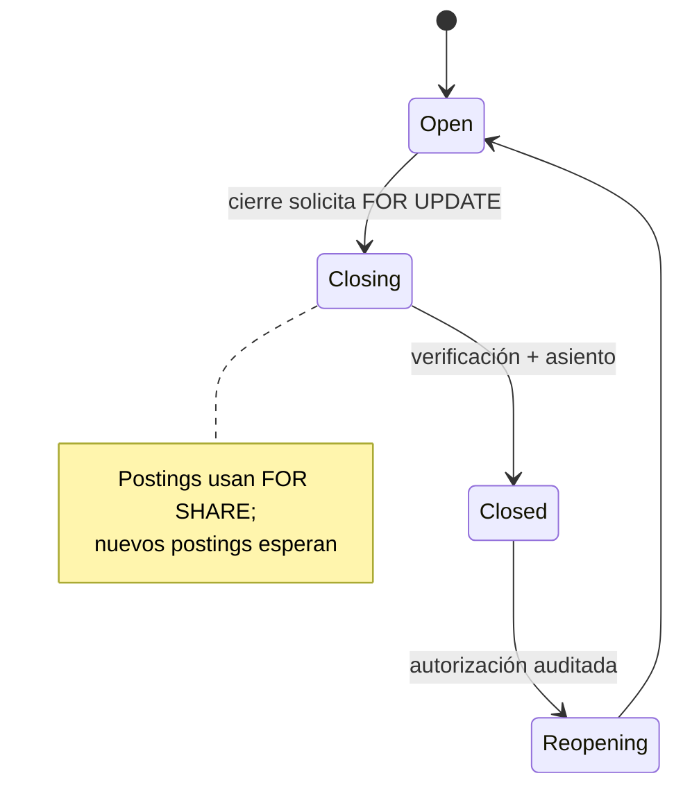

# ADR-008 — Concurrencia por agregado

- **Estado:** **Aceptado** — aprobación técnica 2026-11-08. Implementación y verificación pendientes.
- **Fecha:** 2026-11-08
- **Decisores propuestos:** Arquitectura, Backend, DBA, Contabilidad (para efectos financieros)
- **Complementa:** ADR-006 (numeración), ADR-004 (dinero). **No modifica** los ADR originales.
- **Hallazgos que aborda:** `AUD-P1-01`, `AUD-P1-02`, `AUD-P1-07`, `AUD-P2-12`, `AUD-P2-13`, `AUD-P2-14`.

---

## 1. Contexto

La auditoría encontró una brecha sistemática: los documentos enuncian invariantes correctas, pero no el mecanismo que las hace ciertas bajo concurrencia.

Ejemplos textuales:

- Inventario: “el sistema nunca deja saldos inconsistentes” y `INV-R-05` “la salida no puede exceder la disponibilidad”, sin bloqueo ni actualización condicional ([inventory.md §6/§11](../domain/inventory.md#6-existencias-y-reservas)).
- Tesorería: “no se aplica más que el saldo (validación transaccional para evitar concurrencia)”, sin definir el bloqueo ([treasury.md §6](../domain/treasury.md#6-cobros-y-pagos)).
- Crédito: `saldo_abierto + pedido_pendiente ≤ límite`, sin serialización ([sales.md §6](../domain/sales.md#6-crédito-y-reservas)).
- Cierre: verifica y luego bloquea, sin cutoff ([accounting.md §7](../domain/accounting.md#7-períodos-y-cierre)).

Este ADR elige un mecanismo por agregado y justifica la elección.

## 2. Decisión propuesta

### 2.1 Principios

1. **Nivel de aislamiento:** `READ COMMITTED` (el predeterminado de PostgreSQL) más bloqueos explícitos para las invariantes que cruzan filas o requieren cálculo. No se adopta `SERIALIZABLE` global porque multiplica reintentos y no elimina la necesidad de diseñar la operación.
2. **Bloqueo pesimista para agregados de saldo/estado:** stock, cartera, crédito, numeración y período. Son operaciones de alta criticidad, baja duración y contención localizada por clave; el coste de un reintento optimista es mayor que el de esperar un bloqueo corto.
3. **Optimistic concurrency para maestros y edición de datos:** artículos, clientes, proveedores, precios y configuraciones. Se usa `row_version` + `If-Match`; el usuario recibe 409 y decide.
4. **Restricciones de base de datos como red de seguridad:** unicidad, `CHECK`, FK compuestas y claves de idempotencia. No sustituyen el bloqueo de cálculo, pero impiden duplicados y estados imposibles.
5. **Orden de bloqueo determinista:** todo caso de uso bloquea filas en un orden documentado para evitar deadlocks. Si dos operaciones necesitan varias filas, ambas usan el mismo orden.
6. **Bloqueos cortos:** prohibido llamar a un proveedor externo, generar un PDF remoto o esperar input humano dentro de la transacción.
7. **Timeouts:** `lock_timeout = 3 s` y `statement_timeout = 30 s` por transacción (configurables). Un timeout se traduce a 409/503 con código accionable; no a un 500 genérico.
8. **Reintento:** solo para deadlock (`40P01`), serialización (`40001`) y timeout de bloqueo (`55P03`), máximo 2, con la misma `Idempotency-Key` y solo si la operación no tuvo efectos externos.

### 2.2 Estrategia por agregado

| Agregado / operación | Mecanismo | Clave de bloqueo | Restricción de seguridad | Reintento |
|---|---|---|---|---|
| Existencias y movimientos | Pesimista: `SELECT ... FOR UPDATE` sobre `stock_balances` | `(tenant_id, warehouse_id, item_id[, lot_id])` | `reserved >= 0`; `quantity >= 0 OR allow_negative`; movimiento único por origen | Deadlock/timeout |
| Reservas | Pesimista sobre el mismo balance | Igual que stock | `reserved` no negativo; reserva única por documento/línea | Deadlock |
| Transferencias | Pesimista sobre origen y destino, en orden de `warehouse_id` | Dos balances | Movimiento único por transferencia | Deadlock |
| Aplicación de pagos | Pesimista sobre `receivables`/`payables` | `(tenant_id, open_item_id)` | `amount > 0`; aplicación única por cobro/partida; suma ≤ saldo (aplicación + trigger) | Deadlock |
| Límite de crédito | Pesimista sobre `sales.customer_credit` | `(tenant_id, company_id, customer_id)` | `limit >= 0`; compromiso calculado bajo bloqueo | Deadlock |
| Numeración | Pesimista sobre `platform.document_sequences` | `(tenant, company, scope_type, scope_id, doc_type, series, year)` | Único por documento; sin huecos | Deadlock/timeout |
| Idempotencia | Restricción única + inserción al inicio de la transacción | `(tenant_id, idempotency_key, operation)` | PK única; estado `in_progress/completed` | Conflicto 23505 se resuelve leyendo |
| Cierre de período | Pesimista sobre `periods` (`FOR UPDATE`); postings usan `FOR SHARE` | `(tenant_id, company_id, period_id)` | Estado `open/closing/closed`; no posting en cerrado | Timeout |
| Maestros (artículo, cliente, precio) | Optimista `row_version` / `If-Match` | `id` + tenant | Unicidad de SKU/RIF por tenant | 409 al usuario |

### 2.3 Existencias y movimientos

#### Algoritmo propuesto

```text
1. Resolver claves de bloqueo: (warehouse_id, item_id, lot_id?) ordenadas ascendentemente.
2. BEGIN (UoW del ADR-007).
3. SELECT ... FROM inventory.stock_balances
   WHERE tenant_id = :tenant AND warehouse_id = :wh AND item_id = :item
   FOR UPDATE;
4. Si no existe, INSERT ... ON CONFLICT DO NOTHING y repetir SELECT FOR UPDATE.
5. Calcular disponible = quantity - reserved (y lote, si aplica).
6. Validar:
   - salida: quantity - cantidad >= 0 OR allow_negative = true (con permiso);
   - reserva: reserved + cantidad <= quantity (o política de sobregiro).
7. Calcular nuevo costo promedio con el costo de entrada (solo entradas).
8. UPDATE stock_balances SET quantity = ..., reserved = ..., average_cost = ...;
9. INSERT stock_movements (cantidad, costo snapshot, documento origen, idempotency key).
10. INSERT stock_reservations si aplica.
11. COMMIT.
```

Reglas:

- **Nunca** se calcula el saldo en el cliente ni con `MAX(id)`.
- El costo promedio se recalcula **bajo el mismo bloqueo** que la cantidad; así no hay actualización perdida.
- El movimiento es inmutable; una corrección es otro movimiento, no un `UPDATE`.
- El movimiento lleva una clave de origen única (`source_type`, `source_id`, `source_line_id`, `movement_type`) para que un reintento no duplique la salida.
- Las salidas por venta, compra, producción, transferencia y ajuste pasan por el mismo puerto de inventario; no hay escrituras directas a `stock_balances` desde otros módulos.
- La reserva no mueve cantidad física; actualiza `reserved` en la misma fila bloqueada.
- La transferencia bloquea origen y destino en orden de `warehouse_id` (y `item_id`) para evitar deadlock entre dos transferencias cruzadas.

#### Restricciones propuestas

```sql
CHECK (reserved >= 0);
CHECK (quantity >= 0 OR allow_negative);
CREATE UNIQUE INDEX ux_stock_movement_source
  ON inventory.stock_movements
  (tenant_id, source_type, source_id, source_line_id, movement_type);
```

`allow_negative` es una instantánea de la política del almacén; si la política cambia, se actualiza de forma auditada. La validación de permiso y política sigue en el dominio.

#### Por qué no optimistic aquí

Con `row_version`, dos ventas leen la misma fila, una gana y la otra recibe 409; el usuario tendría que reintentar una venta que ya cobró. En mostrador y en un ERP, eso es peor que esperar milisegundos por un bloqueo. La contención es por artículo/almacén, no global.

#### Por qué no solo un `CHECK`

Un `CHECK (quantity >= 0)` no evita que dos transacciones lean 10 y ambas inserten −8: ambas actualizan a 2 o a −6, y el `CHECK` puede pasar en la primera actualización. La restricción es una red de seguridad, no el mecanismo de serialización.

### 2.4 Aplicación de pagos

```text
1. BEGIN; set_config tenant.
2. SELECT ... FROM treasury.receivables
   WHERE tenant_id = :tenant AND id = :receivable
   FOR UPDATE;
3. SELECT COALESCE(SUM(amount),0) FROM treasury.payment_allocations
   WHERE tenant_id = :tenant AND receivable_id = :receivable AND reversed_at IS NULL;
4. Validar allocated + nuevo <= original_amount.
5. INSERT payment_allocations (amount, payment_id, receivable_id).
6. UPDATE receivables SET status = ...;
7. COMMIT.
```

Reglas:

- Se bloquea la partida, no el cobro. El cobro puede crearse antes; la aplicación es la operación crítica.
- Si un pago se aplica a varias partidas, se bloquean en orden ascendente de `receivable_id` para evitar deadlock.
- `UNIQUE (tenant_id, payment_id, receivable_id, allocation_type)` impide aplicar dos veces el mismo pago a la misma partida por reintento.
- La reversión crea una fila de signo contrario o un registro de reversión con referencia; no borra la aplicación original (inmutabilidad).
- El saldo del cliente (CxC) se deriva de las partidas y aplicaciones; no se mantiene un campo “saldo” editable a mano.
- Si hay multimoneda, el cálculo de la diferencia cambiaria ocurre bajo el mismo bloqueo y en la misma transacción ([ADR-009](ADR-009-accounting-and-cutover.md)).

#### Restricciones propuestas

```sql
CHECK (amount > 0);
CREATE UNIQUE INDEX ux_allocation_once
  ON treasury.payment_allocations
  (tenant_id, payment_id, receivable_id, allocation_type);
```

Un trigger diferido o una función de aplicación puede verificar `SUM(amount) <= original_amount`; el bloqueo de la partida ya serializa, pero el trigger protege contra SQL directo.

### 2.5 Límite de crédito

- Se crea una fila `sales.customer_credit` por `(tenant, company, customer)` con `limit_amount`, `is_blocked` y `row_version`.
- Al confirmar un pedido:

```text
BEGIN;
SELECT ... FROM sales.customer_credit
  WHERE tenant_id = :tenant AND company_id = :company AND customer_id = :customer
  FOR UPDATE;
-- suma de CxC abiertas + pedidos pendientes (excluyendo el pedido actual)
-- validar <= limit_amount o aprobación con permiso
INSERT/UPDATE order...
COMMIT;
```

- La fila de crédito es el **punto de serialización** por cliente; no se recalcula el límite desde cero sin bloqueo.
- Si no existe la fila, se crea con `ON CONFLICT` y se reintenta el bloqueo.
- La aprobación de sobregiro se registra con actor, motivo y vigencia; no cambia el límite silenciosamente.
- El crédito disponible se calcula en el servidor; el cliente no lo envía.

#### Por qué no un `CHECK`

El límite depende de varias tablas (CxC, pedidos, notas de crédito) y de una decisión de negocio. Un `CHECK` de fila no puede validarlo. La serialización por cliente + validación de dominio + prueba concurrente es la opción correcta.

### 2.6 Numeración documental

Se mantiene el mecanismo de [ADR-006](ADR-006-document-numbering.md): fila de secuencia, `SELECT ... FOR UPDATE`, incremento y documento en la misma transacción.

Se propone resolver la ambigüedad de `branch_id` con un **ámbito explícito**:

```sql
scope_type text NOT NULL CHECK (scope_type IN ('company','branch')),
scope_id   uuid NOT NULL,
PRIMARY KEY (tenant_id, company_id, scope_type, scope_id, document_type, series, fiscal_year)
```

- Para `scope_type = 'branch'`, `scope_id = branch_id`.
- Para `scope_type = 'company'`, `scope_id = company_id`.
- La tabla documental guarda `document_scope_type`/`document_scope_id` y un índice único sobre esa combinación + serie + número.
- Esto elimina el `NULL` en la clave y permite numeración de empresa sin un UUID sentinel.

**Esta es una propuesta que requiere aprobación de negocio (`D-09`).** Si se decide que todo documento fiscal tiene sucursal, la alternativa es `branch_id NOT NULL` y prohibir documentos de empresa. No se puede dejar `branch_id` nullable en una PK.

El lock se adquiere después de crear la fila con `INSERT ... ON CONFLICT DO NOTHING`; no se hace `SELECT FOR UPDATE` de una fila inexistente. La transacción no incluye la llamada al proveedor fiscal.

### 2.7 Idempotencia de operaciones en vuelo

#### Problema

La tabla de idempotencia no define qué pasa si dos solicitudes con la misma clave llegan simultáneamente. Si la segunda no ve la primera (aún no commiteada), puede duplicar el efecto.

#### Decisión propuesta

1. La clave se inserta **al inicio de la misma transacción** del comando:

```sql
INSERT INTO platform.idempotency_records
  (tenant_id, idempotency_key, operation, request_hash, status, created_at, expires_at)
VALUES (:tenant, :key, :operation, :hash, 'in_progress', now(), now() + interval '24 hours');
```

2. La PK `(tenant_id, idempotency_key, operation)` serializa a los competidores. El segundo `INSERT` espera a que el primero confirme o revierta:
   - si el primero **commitea**, el segundo recibe `23505`; hace `ROLLBACK`, lee el registro completado y devuelve la misma respuesta;
   - si el primero **revierte**, el segundo inserta y ejecuta su propia operación.
3. Antes de ejecutar el comando se valida `request_hash`; una clave reutilizada con otro cuerpo devuelve 409.
4. Al completar, se actualiza el registro a `completed` con `status_code` y cuerpo de respuesta (o referencia si es grande), en la misma transacción.
5. Si el primer proceso queda colgado, `lock_timeout`/`statement_timeout` lo interrumpe; el registro queda `in_progress` y un job lo marca `expired`. Una solicitud con `in_progress` vencido puede reintentar.
6. No se usa una tabla de idempotencia separada con “insertar y luego actualizar fuera de la transacción”: eso rompe la atomicidad.

#### Consecuencia

La segunda solicitud puede esperar hasta que la primera termine. Es el comportamiento correcto para un pago/factura: es preferible esperar a duplicar.

### 2.8 Cierre de períodos

- `accounting.periods` tiene estado `open`, `closing`, `closed`, `reopening`.
- Un posting bloquea la fila del período con `FOR SHARE` y verifica `status = 'open'`.
- El cierre bloquea la fila con `FOR UPDATE`, cambia a `closing`, verifica asientos pendientes, conciliación y documentos, crea el asiento de cierre y cambia a `closed`.
- Un posting que llega después del bloqueo espera; al liberarse, ve `closed` y se rechaza. Uno que ya tiene `FOR SHARE` hace esperar al cierre; el cierre lo incluye.
- La reapertura usa `FOR UPDATE`, exige permiso y auditoría, y cambia a `reopening` mientras se ajusta.
- El cierre no llama a servicios externos dentro de la transacción; la generación de PDFs/reportes va después.



## 3. Comparación de estrategias

| Necesidad | Optimistic (`row_version`) | Pessimistic (`FOR UPDATE`) | Restricción DB | Elección |
|---|---|---|---|---|
| Stock | 409 y reintento del usuario; mala UX en mostrador | Serializa por artículo/almacén; predecible | `CHECK`, unique source | **Pesimista + constraints** |
| Pago | Reintento si dos cobros compiten | Serializa por partida; evita sobre-aplicación | unique allocation | **Pesimista + unique** |
| Crédito | Reintento en cliente “caliente” | Serializa por cliente; justo y determinista | `CHECK limit >= 0` | **Pesimista** |
| Numeración | No aplica: dos números no pueden ganar | Serializa por serie; sin huecos | unique number | **Pesimista** (ADR-006) |
| Idempotencia | No aplica: el conflicto es el mecanismo | La unique insert ya espera | PK única | **Restricción única** |
| Cierre | Dos cierres podrían pisarse | Serializa el período | state check | **Pesimista** |
| Maestros | Edición concurrente editable | Bloquearía al usuario | unique SKU/RIF | **Optimista** |

## 4. Consecuencias

### Positivas

- Invariantes de stock, cartera, crédito, numeración y cierre con un mecanismo explícito.
- Comportamiento predecible bajo concurrencia: uno gana, el otro recibe un error de negocio, no un dato corrupto.
- Las restricciones de base de datos protegen ante SQL directo o bugs.
- La UX de mostrador no depende de reintentos silenciosos.

### Negativas

- Contención localizada: un artículo muy vendido o un cliente con muchas operaciones puede esperar.
- Requiere orden de bloqueo disciplinado; un orden distinto puede producir deadlocks.
- Transacciones más largas si se abusa del trabajo dentro del lock.
- Los tests de concurrencia son más lentos y deben usar PostgreSQL real.

### Mitigaciones

- `lock_timeout` para no esperar indefinidamente.
- Series de numeración por sucursal/caja para reducir contención.
- Reintento solo para deadlock/timeout, no para errores de negocio.
- Monitoreo de `pg_locks`, duración de transacción y deadlocks.
- Pruebas T-01, T-02, T-03, T-10, T-11, T-17, T-18, T-19.

## 5. Alternativas consideradas

| Alternativa | Motivo de descarte |
|---|---|
| `SERIALIZABLE` en todos los comandos | Reintentos y contención; no elimina el diseño de la operación |
| Optimistic en stock/pagos | UX de reintento y riesgo de doble efecto si el cliente reintenta mal |
| Solo `CHECK`/unique | No serializa cálculos multi-fila (stock, crédito, cierre) |
| Cola por agregado en memoria | No distribuida, se pierde al reiniciar; no es fuente de verdad |
| Locks distribuidos (Redis) | Complejidad y nueva dependencia; el dato ya está en PostgreSQL |
| `SELECT` sin lock + trigger | El trigger puede rechazar, pero no evita la lectura obsoleta ni da un error de negocio claro |

## 6. Verificación propuesta

| Prueba | Escenario | Resultado esperado |
|---|---|---|
| T-01 | Stock 10, dos ventas de 8 concurrentes | Una confirma, otra `STOCK_INSUFFICIENT`; saldo 2 |
| T-02 | Dos transferencias cruzadas A→B y B→A | Sin deadlock no manejado; ambos o uno con reintento controlado |
| T-03 | Partida 100, dos cobros de 60 | Uno confirma, otro `PAYMENT_OVER_ALLOCATED`; saldo 40 |
| T-10 | Documentos de empresa y sucursal | Numeración independiente, sin duplicados |
| T-11 | 10.000 emisiones concurrentes | Sin duplicados ni huecos |
| T-17 | Dos pedidos que exceden crédito | No se excede el límite |
| T-18 | Misma clave de idempotencia concurrente | Un solo efecto; segunda respuesta igual |
| T-19 | Cierre y posting concurrentes | Cierre incluye todo o el posting se rechaza |

## 7. Decisiones aprobadas y condiciones de implementación

> Las decisiones `D-09`, `D-10`, `D-12` y `D-13` fueron aprobadas técnicamente el 2026-11-08. La implementación y las pruebas siguen pendientes.

| ID propuesto | Decisión | Recomendación | Bloquea |
|---|---|---|---|
| `D-09` | Ámbito de numeración: `scope_type/scope_id` vs. sucursal obligatoria | `scope_type/scope_id` no nulo | ADR-008 / ADR-006 |
| `D-10` | ¿Trigger de suma de aplicaciones o solo bloqueo? | Bloqueo + trigger diferido como red | ADR-008 |
| `D-12` | Monitoreo de locks/deadlocks y umbrales | `pg_locks`, duración de transacción, alerta de deadlocks | ADR-008 |
| `D-13` | ¿Negative stock permitido? | Ya es política configurable; no cambiar la regla de negocio | ADR-008 |

## 8. Referencias

- [Auditoría independiente](../architecture/independent-architecture-audit.md)
- [Plan de hardening](../architecture/architecture-hardening-plan.md)
- [ADR-006](ADR-006-document-numbering.md), [ADR-007](ADR-007-transaction-and-tenant-context.md), [ADR-009](ADR-009-accounting-and-cutover.md)
- [inventory.md](../domain/inventory.md), [treasury.md](../domain/treasury.md), [sales.md](../domain/sales.md), [accounting.md](../domain/accounting.md)
