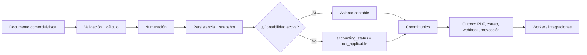
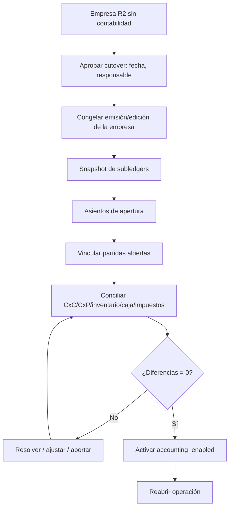

# ADR-009 — Contabilización y cutover R2 → R3

- **Estado:** **Aceptado técnicamente** — 2026-11-08. Implementación pendiente. `D-02`, `D-03`, `D-14` y la política de reconocimiento requieren validación contable antes de R3.
- **Fecha:** 2026-11-08
- **Decisores propuestos:** Arquitectura, Contabilidad, Producto, Backend
- **Complementa:** ADR-005 (outbox), ADR-004 (dinero). **No modifica** los ADR originales.
- **Hallazgos que aborda:** `AUD-P1-04`, `AUD-P1-08`, `AUD-P1-09`, `AUD-P2-02`, `AUD-P2-03`, `AUD-P2-04`, `AUD-P2-14`.

---

## 1. Contexto

La auditoría encontró dos problemas conectados:

1. **Ambigüedad de posting:** la documentación dice que la contabilización es un evento de dominio en proceso y, a la vez, que `billing.invoice.issued.v1` es un evento de integración en outbox. No queda claro si el asiento se crea antes del `Commit` o después, ni qué pasa si falla.
2. **Cutover no diseñado:** R2 se vende sin Contabilidad; R3 la activa. El modelo afirma que “al activarse se genera el asiento de apertura y se concilia el histórico”, pero no hay proceso, requisito ni criterio de aceptación.

Este ADR separa tres conceptos que la documentación mezclaba:

- **Confirmación operativa:** el documento comercial/fiscal queda emitido y es inmutable.
- **Contabilización:** el asiento se crea y queda vinculado al documento.
- **Integración:** notificaciones, PDFs, webhooks y proyecciones se procesan después.

## 2. Decisión propuesta

### 2.1 Principios

1. **La contabilización crítica no va por outbox.** Cuando una empresa tiene contabilidad activa, el asiento se crea **en la misma transacción** que el documento que lo origina. Si el asiento falla, el documento no se confirma.
2. **El outbox es para efectos posteriores al commit.** PDF, correo, webhooks, proyecciones, reportes y autorización del proveedor fiscal. No es el mecanismo de posting contable.
3. **Una sola fuente de verdad por documento.** Cada documento tiene un `posting_key` único e idempotente; un reintento no crea un segundo asiento.
4. **La contabilidad es una capacidad por empresa, no por tenant.** Una empresa puede operar R2 sin contabilidad y activarla después; otra puede tenerla desde el inicio. El flag es `accounting_enabled` por empresa.
5. **No se inventa la política de reconocimiento de ingresos.** La confirmación operativa se define aquí; el momento de reconocimiento contable (emisión vs. entrega) se valida con contador (`D-14`).

### 2.2 Confirmación operativa vs. contabilización

| Operación | Se considera confirmada cuando… | Participantes atómicos | ¿Asiento? |
|---|---|---|---|
| Pedido de venta | Se confirma, reserva stock y valida crédito | VEN + INV + crédito | No (solo compromiso) |
| Factura (rango autorizado) | Se emite localmente: número, snapshot, CxC | FAC + TES + CON (si activa) + INV si hay salida | Sí, si `accounting_enabled` |
| Factura (autorización por documento) | El proveedor autoriza y se confirma el comprobante | FAC + TES + CON (si activa) | Sí, al confirmar |
| Nota de crédito | Se emite y revierte CxC, IVA, comisión y stock | FAC + TES + VEN + INV + CON | Sí, si activa |
| Cobro | Se registra el movimiento de caja/banco, la aplicación y el asiento | TES + CON | Sí, si activa |
| Pago | Se registra el movimiento, la aplicación y el asiento | TES + CON | Sí, si activa |
| Factura de compra | Se valida contra recepción y se registra CxP/costo | COM + INV + TES + CON | Sí, si activa |
| Movimiento de inventario | Se aplica el movimiento y el costo | INV + CON | Sí, si activa |
| Ajuste de inventario | Se aprueba y aplica | INV + CON | Sí, si activa |
| Nómina | Se aprueba la corrida y se provisiona | NOM + CON | Sí, si activa |
| Cierre de período | Se crea el asiento de cierre y se bloquea | CON | Sí |
| Reversión | Se emite contraasiento con referencia | CON + módulo origen | Sí |

**Regla:** si `accounting_enabled = false`, el documento se confirma igual, pero `accounting_status = not_applicable`; no hay asiento y no se bloquea la operación. Si `accounting_enabled = true`, no existe un estado “emitido sin asiento”: si el posting falla, la transacción se revierte.

### 2.3 Estado contable del documento

Propuesta de estados:

| Estado | Significado | Cuándo |
|---|---|---|
| `not_applicable` | La empresa no tiene contabilidad activa | R2 / empresa sin CON |
| `opening_linked` | Documento abierto antes del cutover, incluido en asiento de apertura | Cutover R2→R3 |
| `legacy_not_posted` | Documento histórico cerrado, resumido en apertura; no tiene asiento individual | Cutover |
| `posted` | Asiento original creado y vinculado | Operación normal |
| `reversed` | Existe contraasiento que referencia el original | Reversión |

No se usa `pending` en una empresa con contabilidad activa: o hay asiento, o la operación no se confirma.

### 2.4 Operaciones atómicas y efectos asíncronos



- **Atómico:** documento, líneas, impuestos, snapshot, número, CxC/CxP, inventario/costo y asiento.
- **Asíncrono:** PDF, envío al cliente, webhook, proyección de reportes, autorización del proveedor fiscal cuando el medio lo permite, notificaciones, liquidación de comisiones al vendedor (el devengo es atómico; el pago es posterior).
- **No atómico por diseño:** conciliación bancaria (se confirma por etapa), importaciones masivas (por lote) y reportes.

### 2.5 Outbox y eventos

Se separan dos capas:

| Capa | Mecanismo | Cuándo | Ejemplo |
|---|---|---|---|
| Evento de dominio crítico | Despacho en proceso, antes del `Commit` | Contabilidad, invariantes | `InvoiceIssuedDomainEvent` → asiento |
| Evento de integración | Outbox, después del `Commit` | PDF, correo, webhook, proyección | `billing.invoice.issued.v1` |

Reglas:

1. El handler de contabilidad se registra como **suscriptor síncrono** del evento de dominio; no consume el outbox.
2. Si el handler falla, la transacción se revierte; el evento no se publica.
3. El evento de integración se escribe en el outbox en la misma transacción, pero se despacha después del commit.
4. El consumidor de integración es idempotente por `event_id`; el posting contable es idempotente por `posting_key`.
5. Un reintento del worker no puede crear un segundo asiento: la clave única lo impide.
6. La autorización del proveedor fiscal ocurre fuera de la transacción, pero **antes** de marcar la factura como `Issued` cuando el modo es `AutorizacionPorDocumento`. En modo `RangoAutorizado`, la emisión local es la confirmación y el reporte al proveedor es posterior.

### 2.6 Evitar facturas sin asiento y asientos duplicados

#### Clave de posting

```sql
ALTER TABLE accounting.journal_entries
  ADD COLUMN posting_key text NOT NULL,
  ADD COLUMN source_type text NOT NULL,
  ADD COLUMN source_id uuid NOT NULL,
  ADD COLUMN source_version int NOT NULL DEFAULT 1,
  ADD COLUMN entry_type text NOT NULL,     -- original, reversal, opening, closing, adjustment
  ADD COLUMN reverses_entry_id uuid,
  ADD COLUMN cutover_id uuid;

CREATE UNIQUE INDEX ux_journal_posting_key
  ON accounting.journal_entries (tenant_id, posting_key);
```

`posting_key` propuesto:

```text
<tenant>:<source_type>:<source_id>:<source_version>:<entry_type>
```

- Factura: `tenant:invoice:<id>:1:original`.
- Nota de crédito: `tenant:credit_note:<id>:1:original` (no es una reversión del asiento de la factura; es su propio documento).
- Contraasiento de corrección: `tenant:journal:<entry_id>:1:reversal`.
- Apertura: `tenant:cutover:<cutover_id>:1:opening`.

#### Defensas

1. **Aplicación:** el comando de emisión exige `IAccountingPoster` cuando `accounting_enabled=true`; no hay rama “seguir sin asiento”.
2. **Documento:** `invoice.journal_entry_id` se setea en la misma transacción; el estado `posted` exige el vínculo.
3. **Base de datos:** índice único por `posting_key` y trigger diferido que, si la empresa tiene contabilidad activa y el documento está `Issued`, exige `journal_entry_id NOT NULL`. El trigger es una red de seguridad; la lógica de negocio sigue en el dominio.
4. **Conciliación:** job diario que detecta documentos `Issued` sin asiento y asientos sin documento; alerta y bloquea cierre.
5. **Reintentos:** si el handler recibe un `23505` en `posting_key`, trata el asiento como ya creado y no duplica; si el cuerpo difiere, alerta.

#### Por qué no un simple `CHECK`

Un `CHECK` de fila no puede consultar `company.accounting_enabled` ni el estado del documento en otra tabla. Se necesita trigger diferido o validación de aplicación + conciliación. El ADR propone ambos: aplicación como fuente, trigger como red.

### 2.7 Apertura contable al activar R3

#### Opciones

| Opción | Ventaja | Coste | Riesgo |
|---|---|---|---|
| Replay completo de documentos R2 | Trazabilidad documento→asiento | Alto; millones de eventos; duplicados | Errores de replay, cierre bloqueado |
| Solo saldos de apertura agregados | Simple y rápido | Pierde detalle por documento | Auditoría limitada |
| **Híbrido (recomendado)** | Apertura + detalle de partidas abiertas | Medio | Requiere conciliación estricta |

#### Proceso propuesto (híbrido)



1. **Aprobación:** `cutover_id`, fecha de corte, empresa, responsable y evidencia.
2. **Congelación:** durante la ventana, la empresa no emite documentos ni registra pagos; sí puede leer. Es una ventana de mantenimiento por empresa, no global.
3. **Snapshot:** CxC abiertas por factura, CxP abiertas por factura, inventario valorizado por artículo/almacén, caja/bancos, IVA por pagar/crédito, retenciones y patrimonio.
4. **Apertura:** asiento(s) `entry_type=opening` con `cutover_id`, creados en estado **draft (no contabilizados)**; las partidas abiertas se vinculan a sus documentos (`opening_links`). Los documentos históricos cerrados se marcan `legacy_not_posted` y se resumen; los abiertos, `opening_linked`.
5. **Conciliación obligatoria:** control accounts vs. subledgers; cero diferencias o excepciones aprobadas. Sin esto no se activa.
6. **Activación:** en una sola transacción se contabilizan los asientos de apertura en draft, se vincula el `cutover_id`, se establece `accounting_enabled=true` y se publica el evento de activación.
7. **Rollback:** si falla antes de activar, se descartan los asientos en draft y se vuelve a R2; si falla después de activar, se revierte con contraasientos y aprobación. No se edita un asiento contabilizado.

#### Reglas

- El asiento de apertura es inmutable una vez contabilizado; mientras está en draft puede descartarse sin afectar el libro.
- Un documento anterior al corte no se contabiliza individualmente si está cerrado; se resume en apertura.
- Una partida abierta conserva vínculo con su documento y con la línea de apertura.
- Los documentos emitidos después de la fecha de corte se contabilizan normalmente.
- La fecha de corte no puede ser retroactiva sin aprobación y reproceso.
- El proceso es idempotente: un `cutover_id` no puede generar dos aperturas.

**Esta es una propuesta; la elección híbrida vs. replay completo requiere aprobación de Contabilidad (`D-02`).**

### 2.8 Reconciliación subledger ↔ libro mayor

| Control | Subledger | Cuenta mayor | Frecuencia |
|---|---|---|---|
| Clientes | Suma de partidas CxC abiertas | Cuenta de clientes | Diaria |
| Proveedores | Suma de partidas CxP abiertas | Cuenta de proveedores | Diaria |
| Inventario | Valor del kardex por almacén | Cuenta de inventario | Diaria/semanal |
| Caja/bancos | Saldo de cajas/cuentas | Cuenta de efectivo/banco | Diaria |
| IVA | Libro/ventas-compras | IVA por pagar/crédito | Por período |
| Nómina | Provisión y aportes | Cuentas de personal | Por corrida |
| Retenciones | Comprobantes | Retenciones por pagar | Por período |

Reglas:

1. Un job diario (`ReconciliationRun`) compara y registra diferencias.
2. Una diferencia mayor al umbral configurado alerta y **bloquea el cierre**.
3. La corrección es un asiento de ajuste aprobado, no una edición del subledger.
4. El reporte conserva evidencia: período, cuentas, montos, diferencia, responsable.
5. La conciliación es requisito de cierre (`CON-012`).

### 2.9 Fallos y comportamiento esperado

| Fallo | Comportamiento | Evidencia |
|---|---|---|
| Asiento falla al emitir factura | Rollback total; no hay factura ni número consumido | T-06 |
| Asiento duplicado por reintento | `posting_key` único; se trata como ya posteado | T-05 |
| Contabilidad activa pero período cerrado | Emisión rechazada; se elige período abierto | T-19 |
| Proveedor fiscal caído en modo autorización | Factura queda `pending_authorization`; no hay CxC ni asiento | Prueba de proveedor |
| Cutover falla antes de activar | `accounting_enabled=false`; se revierte apertura | T-12 |
| Cutover activa con diferencias | No se permite; se resuelve o aborta | T-12 |
| Outbox caído tras commit | Negocio confirmado; reintento y alerta | T-15 |
| Evento de integración duplicado | Inbox lo descarta; no afecta asiento | T-15 |

### 2.10 Diferencias cambiarias (modelo propuesto)

> **Política contable pendiente de validación (`D-14`).** Esta sección define un modelo técnico verificable, no una regla fiscal ni contable aprobada.

#### Datos que se conservan

- Documento: moneda de transacción, importe en moneda de transacción, tasa del documento, importe funcional, fuente y fecha de la tasa.
- Aplicación: moneda del cobro/pago, importe aplicado en moneda del documento, tasa del cobro/pago, importe funcional del cobro/pago.
- Saldo: importe pendiente en moneda del documento y su equivalente funcional a la tasa del documento.
- Revaluación: tasa de cierre, fecha, fuente y asiento de diferencia no realizada.

#### Fórmula propuesta para diferencia realizada

Para una aplicación de `A` unidades de moneda extranjera contra un documento con tasa `Td`, y una tasa de cobro/pago `Tp`:

```text
importe_funcional_documento = A × Td
importe_funcional_cobro     = A × Tp
diferencia                  = importe_funcional_cobro − importe_funcional_documento
```

- Si `diferencia > 0`: ganancia cambiaria (crédito a cuenta de ganancia).
- Si `diferencia < 0`: pérdida cambiaria (débito a cuenta de pérdida).
- La diferencia es una línea de balanceo del asiento de cobro/pago; no se modifica el documento original.
- Si el cobro es en una tercera moneda, se convierte a moneda funcional con la tasa del cobro y se compara contra el importe funcional del documento.

#### Ejemplo

Factura USD 100 con tasa 30 (VES 3.000). Cobro parcial USD 60 con tasa 40 (VES 2.400):

| Concepto | Moneda extranjera | Tasa | Moneda funcional |
|---|---|---|---|
| Documento | 100 | 30 | 3.000 |
| Aplicación | 60 | 30 (documento) | 1.800 |
| Cobro | 60 | 40 | 2.400 |
| Diferencia realizada | — | — | **600 ganancia** |
| Saldo pendiente | 40 | 30 | 1.200 |

Al cierre, si la tasa es 45, el saldo de 40 USD se revalúa a 1.800; la diferencia no realizada de 600 se registra en el asiento de revaluación, con cuenta configurable y política aprobada.

#### Reglas técnicas

1. La diferencia se calcula **bajo el mismo bloqueo** de la partida ([ADR-008](ADR-008-concurrency-by-aggregate.md)) y en la misma transacción del cobro/pago.
2. Las cuentas de ganancia/pérdida cambiaria son configurables por empresa; no se codifican.
3. El redondeo se aplica a la escala de la moneda funcional; la línea de diferencia es el importe de balanceo.
4. La revaluación es un proceso explícito, auditado y con fecha de cierre; no se recalcula al consultar.
5. No se modifica el importe original ni la tasa del documento.
6. La política de reconocimiento (realizada al pago, no realizada al cierre, o ambas) se valida con contador.

### 2.11 Frontera con Ventas (propuesta)

Para eliminar la ambigüedad de `VEN-006`/`VEN-007` frente a `FAC-003`:

- **Ventas** es dueña de cotización, pedido, entrega, devolución comercial y solicitud de emisión. **No emite numeración fiscal ni comprobantes fiscales.**
- **Facturación** es dueña del comprobante fiscal, la nota de crédito y la nota de débito. Una devolución comercial y su nota de crédito fiscal son un **mismo caso de uso orquestado**, no dos documentos independientes.
- Si existe un documento no fiscal (nota de entrega/remito), se nombra explícitamente y no se confunde con factura.
- La comisión se acumula/revierte en el mismo caso de uso que la factura/nota; su pago es posterior y asíncrono.
- Esta frontera requiere aprobación de Producto (`D-17`).

## 3. Consecuencias

### Positivas

- No hay facturas sin asiento cuando la contabilidad está activa.
- No hay asientos duplicados por reintentos.
- El cutover R2→R3 tiene un proceso verificable.
- La conciliación es parte del cierre, no un reporte opcional.
- La separación dominio/outbox elimina la ambigüedad.

### Negativas

- La emisión de factura se vuelve más pesada (posting en la misma transacción).
- El cutover requiere una ventana por empresa y trabajo contable.
- Los documentos históricos cerrados no tienen asiento individual; se resumen.
- Un fallo contable bloquea la operación, que es intencional pero exige buena UX y monitoreo.

### Mitigaciones

- Mantener la transacción corta; no generar PDF dentro.
- Precálculo de cuentas y reglas cacheado por empresa.
- Monitor de “documentos emitidos sin asiento” y “asientos huérfanos”.
- Pruebas T-05/T-06/T-12/T-14/T-19.

## 4. Alternativas consideradas

| Alternativa | Motivo de descarte |
|---|---|
| Posting solo por outbox | Permite factura sin asiento y retrasa el cierre; la auditoría lo señaló |
| Posting solo por trigger de base de datos | Reglas de negocio en SQL, difícil de versionar y probar |
| Replay completo de R2 | Costoso y propenso a duplicados; se ofrece como opción, no default |
| Empezar R3 con saldos agregados sin detalle | Rápido, pero pierde trazabilidad de partidas abiertas |
| No permitir activar contabilidad a clientes R2 | Rompe la propuesta comercial de la suite |
| Cada módulo crea su propio asiento | Duplica reglas y descuadra; Contabilidad es el único dueño del asiento |

## 5. Verificación propuesta

| Prueba | Qué demuestra |
|---|---|
| T-05 | Factura con contabilidad activa crea exactamente un asiento y lo vincula |
| T-06 | Fallo del asiento revierte factura, cartera y número |
| T-12 | Cutover R2→R3 genera apertura, concilia y activa; no duplica |
| T-14 | Inserción directa de asiento desbalanceado es rechazada |
| T-15 | Evento duplicado no duplica asiento; outbox no es posting |
| T-19 | Cierre y posting concurrentes no dejan asientos fuera del cierre |
| T-20 | Pago con diferencia cambiaria produce asiento y saldo correctos |

## 6. Decisiones aprobadas y condiciones de implementación

> Las decisiones `D-02`, `D-03`, `D-04` y `D-14`…`D-18` fueron aprobadas técnicamente el 2026-11-08. `D-02`, `D-03` y `D-14` requieren validación contable antes de R3. La implementación y las pruebas siguen pendientes.

| ID propuesto | Decisión | Recomendación | Bloquea |
|---|---|---|---|
| `D-02` | Cutover híbrido vs. replay completo | Híbrido con detalle de partidas abiertas | ADR-009 |
| `D-03` | Punto de confirmación operativa: emisión vs. entrega | Emisión (factura) como confirmación operativa; reconocimiento de ingresos según política contable | ADR-009 |
| `D-04` | Dependencia R5→R3 | Añadir R3; o retirar `NOM-008` de R5 | Roadmap |
| `D-14` | Política de FX y cuentas de diferencia | Validar con contador; modelo técnico en §2.10 | ADR-009 |
| `D-15` | Trigger de integridad de asiento | Trigger diferido + validación de dominio | ADR-009 |
| `D-16` | Ventana de cutover por empresa | Mantenimiento por empresa; evaluar cero downtime después | ADR-009 |
| `D-17` | Frontera Ventas/Facturación | Ventas solicita; Facturación emite; una sola nota de crédito fiscal | ADR-009 |
| `D-18` | ¿Se permite contabilidad activa sin cutover? | No; activación solo por cutover aprobado | ADR-009 |

## 7. Referencias

- [Auditoría independiente](../architecture/independent-architecture-audit.md)
- [Plan de hardening](../architecture/architecture-hardening-plan.md)
- [billing.md](../domain/billing.md), [accounting.md](../domain/accounting.md), [treasury.md](../domain/treasury.md), [inventory.md](../domain/inventory.md), [sales.md](../domain/sales.md)
- [ADR-005](ADR-005-transactional-outbox.md), [ADR-007](ADR-007-transaction-and-tenant-context.md), [ADR-008](ADR-008-concurrency-by-aggregate.md)
- [invoicing.md](../compliance/invoicing.md)
