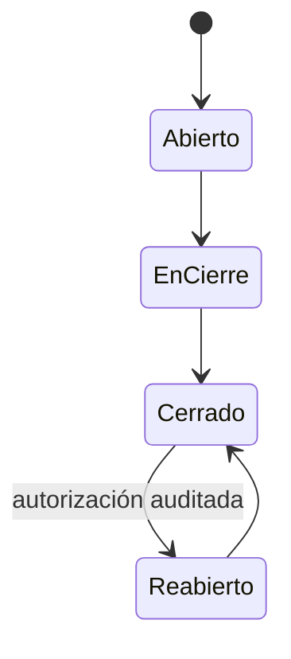

# Módulo de Contabilidad (`CON`)

**Release:** R3 · **Requisitos:** `CON-001`…`CON-012`

## 1. Propósito y límites

**Responsable de:** plan de cuentas, períodos, asientos, libros, estados financieros, reglas de contabilización, auxiliares, centros de costo, cierres y conciliación.

**No responsable de:** capturar documentos operativos (los recibe por eventos o asientos manuales autorizados), emitir comprobantes, mover inventario o cobrar.

## 2. Agregados y entidades

| Agregado | Entidades | Responsabilidad |
|---|---|---|
| `Account` | `AccountBalance` | Plan de cuentas jerárquico y saldos |
| `FiscalYear` | `Period` | Ejercicio y períodos |
| `JournalEntry` | `JournalLine` | Asiento de partida doble |
| `PostingRule` | `PostingRuleLine` | Mapeo documento → cuentas |
| `CostCenter` | — | Dimensión analítica |
| `ClosingRun` | — | Cierre y bloqueo |
| `OpeningBalance` | — | Saldos iniciales |

## 3. Value objects

`AccountCode`, `AccountType` (activo, pasivo, patrimonio, ingreso, gasto, orden), `Debit`, `Credit`, `Money`, `PeriodRef`, `PostingSource`, `Dimension`, `EntryNumber`.

## 4. Plan de cuentas

- Jerárquico por código (por ejemplo `1.1.01.001`), con cuentas de detalle imputables y cuentas de agrupación no imputables.
- Tipo, naturaleza (deudora/acreedora), moneda, requiere auxiliar por tercero, requiere centro de costo.
- No se elimina una cuenta con movimientos; se inactiva.
- Cambios de nombre no alteran asientos históricos.

## 5. Asientos

```text
Asiento = fecha + período + descripción + líneas (cuenta, debe, haber, tercero, centro de costo, referencia)
Invariantes:
  Σ debe = Σ haber
  cada línea > 0 en un solo lado
  cuenta imputable
  período abierto
  moneda funcional
```

- Asiento manual: requiere permiso y motivo.
- Asiento automático: generado por regla a partir de un evento.
- Asiento de reversión: contrapartida con referencia al original.
- Asiento contabilizado: inmutable.
- Numeración por empresa y año, transaccional ([ADR-006](../decisions/ADR-006-document-numbering.md)).

## 6. Reglas de contabilización

| Documento | Débito | Crédito | Observación |
|---|---|---|---|
| Factura de venta | CxC / Caja | Ingresos + IVA por pagar | Según condición de pago |
| Nota de crédito | Ingresos + IVA por pagar | CxC / Caja | Referencia a factura |
| Cobro | Caja/Banco | CxC | Diferencia cambiaria si aplica |
| Factura de compra | Inventario/Gasto + IVA crédito | CxP | Costo según recepción |
| Pago | CxP | Caja/Banco | Retenciones si aplica |
| Costo de venta | Costo de ventas | Inventario | Desde movimiento de salida |
| Ajuste de inventario | Inventario / Gasto | Gasto / Inventario | Según signo y motivo |
| Nómina | Gasto de personal | Sueldos por pagar + aportes | R5 |
| Cierre | Resultados | Patrimonio | Proceso auditado |

Las cuentas son configurables por empresa. La regla y su vigencia quedan registradas; un cambio no altera asientos previos.

## 7. Períodos y cierre

- Ejercicio fiscal con 12 períodos (configurable).
- Un período abierto admite asientos; cerrado los rechaza.
- El cierre verifica: asientos pendientes, conciliación de subledgers, diferencias y documentos sin contabilizar.
- El cierre genera el asiento de resultado y bloquea el período.
- La reapertura requiere permiso especial y auditoría.
- Los asientos de ajuste se registran antes del cierre.

## 8. Reportes

- Libro diario, mayor y balanza de comprobación.
- Estado de situación financiera y estado de resultados.
- Auxiliares por tercero, cuenta y centro de costo.
- Comparativos por período.
- Conciliación subledger vs contabilidad.
- Exportación a CSV/XLSX/PDF.

## 9. Comandos

| Comando | Descripción |
|---|---|
| `CreateAccount` / `DeactivateAccount` | Plan de cuentas |
| `PostJournalEntry` | Asiento manual |
| `ReverseJournalEntry` | Contraasiento |
| `ConfigurePostingRule` | Regla automática |
| `OpenPeriod` / `ClosePeriod` / `ReopenPeriod` | Períodos |
| `RunClosing` | Cierre |
| `ImportOpeningBalances` | Apertura |

## 10. Eventos

| Evento | Consumidores |
|---|---|
| `accounting.entry.posted.v1` | Reportes, integraciones |
| `accounting.period.closed.v1` | Reportes, alertas |
| `accounting.period.reopened.v1` | Auditoría |
| `accounting.reconciliation.completed.v1` | Reportes |

## 11. Invariantes

| ID | Regla |
|---|---|
| CON-R-01 | Todo asiento cumple partida doble. |
| CON-R-02 | No se contabiliza en período cerrado. |
| CON-R-03 | Un asiento contabilizado no se edita ni se borra. |
| CON-R-04 | La reversión referencia el asiento original. |
| CON-R-05 | Toda línea usa una cuenta imputable. |
| CON-R-06 | El asiento automático usa la regla vigente a la fecha del documento. |
| CON-R-07 | El auxiliar de tercero se registra cuando la cuenta lo exige. |
| CON-R-08 | La moneda del asiento es la funcional de la empresa. |
| CON-R-09 | La balanza cuadra siempre. |
| CON-R-10 | Un período no se cierra con asientos pendientes. |
| CON-R-11 | La numeración de asientos es única por empresa/año. |
| CON-R-12 | La reapertura de período requiere permiso y auditoría. |

## 12. Estados



Asiento: `Borrador → Contabilizado → Revertido`.

## 13. Casos de uso

1. Configurar plan de cuentas y reglas.
2. Contabilizar factura, cobro y pago automáticamente.
3. Registrar asiento manual de ajuste.
4. Revertir un asiento.
5. Cerrar el mes (`UC-13`).
6. Emitir estados financieros.
7. Conciliar subledger con contabilidad.

## 14. Dependencias

- Depende de `Platform` y `ADM` (empresa, moneda funcional).
- Consume eventos de `FAC`, `TES`, `COM`, `INV`, `NOM`.
- Ningún módulo de negocio depende de `CON`.

## 15. Pendientes

- Ajuste por inflación: `DEC-012`, **PENDIENTE DE VALIDACIÓN LEGAL / CONTABLE**.
- Consolidación multiempresa: R6.
- Contabilidad de sucursales como libros separados: fuera de alcance.
- Plan de cuentas base: a validar con contador venezolano.

## 16. Referencias

- [domain-model.md](domain-model.md)
- [treasury.md](treasury.md)
- [billing.md](billing.md)
- [database-design.md](../architecture/database-design.md)
