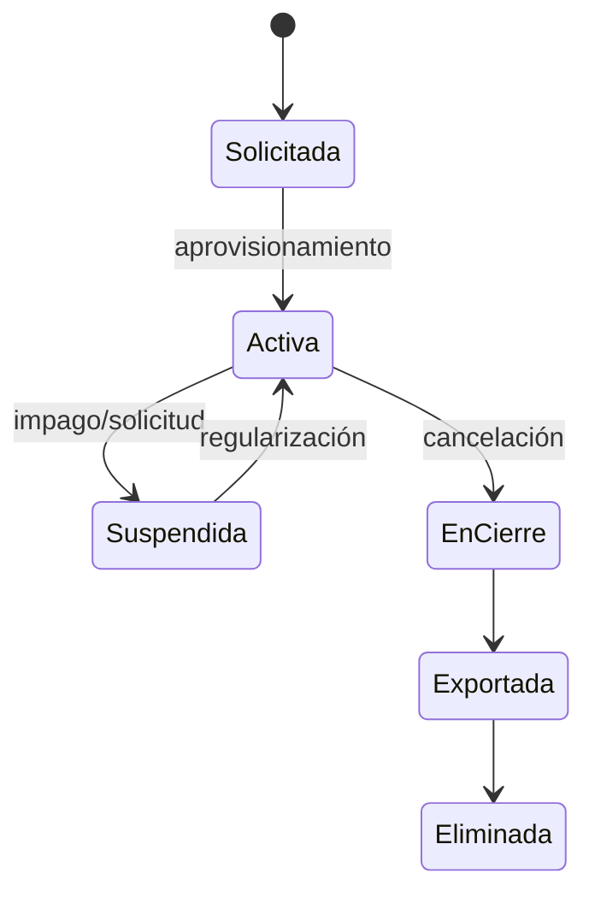

# Módulo de Administración (`ADM`) y Plataforma (`PLT`)

**Release:** R1 · **Requisitos:** `ADM-001`…`ADM-021`, `PLT-001`…`PLT-006` · **Documento de dominio:** [domain-model.md](domain-model.md)

> Implementación inicial en R1. `PLT-004` (facturación de suscripción) corresponde a R2 y `PLT-006` (tenant dedicado) a R6.

## 1. Propósito y límites

**Responsable de:** organizaciones, empresas, sucursales, usuarios, membresías, roles, permisos, terceros, perfiles fiscales, aprobaciones, configuración versionada, numeración (administración), auditoría, planes y límites.

**No responsable de:** movimientos de inventario, precios de venta, emisión fiscal, asientos, pagos, cálculo de nómina.

## 2. Agregados y entidades

| Agregado | Entidades | Responsabilidad |
|---|---|---|
| `Organization` | — | Tenant, plan, estado, límites |
| `Company` | `Branch` | Persona jurídica, perfil fiscal, moneda funcional |
| `User` | `Membership`, `Session` | Identidad global y membresías |
| `Role` | `RolePermission` | Plantilla de permisos |
| `Party` | `PartyRole`, `Address`, `Contact` | Tercero único con roles de cliente/proveedor |
| `ApprovalRule` | `ApprovalRequest` | Umbrales y aprobaciones |
| `Setting` | `SettingVersion` | Parámetros versionados con vigencia |
| `SupportAccessGrant` | — | Acceso temporal auditado |
| `Plan` | `PlanLimit`, `Subscription`, `UsageMeter` | Comercial SaaS |

## 3. Value objects

`TenantId`, `CompanyId`, `BranchId`, `TaxId` (RIF), `EmailAddress`, `PhoneNumber`, `Address`, `Money`, `CurrencyCode`, `PermissionCode`, `RoleCode`, `ApprovalThreshold`, `Period`.

## 4. Comandos relevantes

| Comando | Descripción | Requisito |
|---|---|---|
| `ProvisionOrganization` | Crea organización, empresa, sucursal y admin | `ADM-001` |
| `CreateCompany` / `CreateBranch` | Alta de empresa y sucursal | `ADM-002` |
| `InviteMember` / `AcceptInvitation` / `RevokeMembership` | Ciclo de membresía | `ADM-003`, `ADM-004` |
| `AssignRole` / `UpdateRolePermissions` | Roles y permisos | `ADM-005` |
| `SetDataScope` | Alcance por empresa/sucursal/almacén | `ADM-006` |
| `EnableMfa` / `RevokeSession` | Seguridad de cuenta | `ADM-007`, `ADM-008` |
| `RegisterParty` / `UpdateParty` | Terceros | `ADM-010` |
| `UpdateFiscalProfile` | Datos fiscales de empresa | `ADM-011` |
| `ConfigureSeries` | Series y numeración | `ADM-012` |
| `PublishSettingVersion` | Nueva versión de parámetro | `ADM-013` |
| `GrantSupportAccess` | Acceso de soporte | `ADM-014` |
| `SuspendTenant` / `ReactivateTenant` | Ciclo de vida | `ADM-015` |
| `RequestDataExport` | Exportación completa | `ADM-016` |
| `ChangePlan` | Plan y límites | `ADM-017`, `PLT-001` |

## 5. Consultas relevantes

- Usuarios y membresías por organización.
- Permisos efectivos por usuario y alcance.
- Terceros con saldo, condición de crédito y estado.
- Configuración vigente por empresa y tipo.
- Historial de auditoría por entidad y actor.
- Consumo del plan y límites.

## 6. Eventos

| Evento | Consumidores |
|---|---|
| `admin.organization.created.v1` | PLT, notificaciones |
| `admin.membership.invited.v1` | Notificaciones |
| `admin.membership.revoked.v1` | Seguridad, notificaciones |
| `admin.role.changed.v1` | Seguridad, auditoría |
| `admin.party.updated.v1` | Ventas, Compras (solo proyección) |
| `admin.setting.version-published.v1` | Módulos afectados |
| `tenant.plan.changed.v1` | ADM, INT |

## 7. Reglas e invariantes

| ID | Regla |
|---|---|
| ADM-R-01 | Toda organización tiene al menos una empresa y una sucursal activa. |
| ADM-R-02 | El RIF es único por organización entre empresas activas. |
| ADM-R-03 | Un usuario no puede tener dos membresías activas en la misma organización. |
| ADM-R-04 | Una membresía revocada invalida sesiones y permisos en ≤ 60 s. |
| ADM-R-05 | Los permisos efectivos son la intersección de rol, alcance y estado de la membresía. |
| ADM-R-06 | Un tercero es único por tenant y documento fiscal; sus roles no duplican el maestro. |
| ADM-R-07 | Un parámetro publicado no se modifica: se crea una versión nueva con vigencia. |
| ADM-R-08 | No se elimina una empresa con documentos emitidos; se inactiva. |
| ADM-R-09 | El acceso de soporte requiere ticket, motivo, alcance y expiración. |
| ADM-R-10 | La suspensión bloquea escrituras y conserva lectura/exportación según política. |
| ADM-R-11 | Los límites del plan se evalúan antes de crear el recurso y se registran. |
| ADM-R-12 | Un usuario no puede modificar sus propios permisos ni elevar privilegios. |

## 8. Estados

Membresía: `Invitada → Activa → Suspendida → Revocada`.

## 9. Casos de uso

1. Aprovisionar organización y verificar aislamiento (`UC-01`).
2. Invitar usuario y asignar alcance (`UC-02`).
3. Configurar empresa y perfil fiscal (`UC-03`).
4. Registrar tercero y condiciones comerciales.
5. Crear rol personalizado y revisar permisos.
6. Cambiar de plan y verificar límites.
7. Exportar datos de la organización.
8. Acceder como soporte con justificación.

## 10. Dependencias

- Depende de `Platform` (tenancy, identidad, auditoría, numeración).
- Es dependido por todos los módulos de negocio para maestros y configuración.
- No depende de módulos de negocio.

## 11. Pendientes

- `DEC-003` identidad/MFA/SSO.
- `DEC-008` retención y exportación.
- Catálogo definitivo de permisos (se congela al iniciar R1).
- Política de contraseñas validada por seguridad.

## 12. Referencias

- [functional-requirements.md](../requirements/functional-requirements.md)
- [multi-tenancy.md](../architecture/multi-tenancy.md)
- [security.md](../architecture/security.md)
