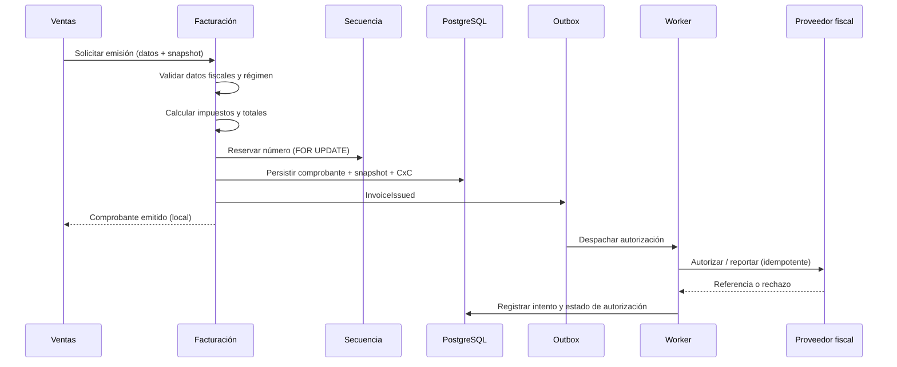
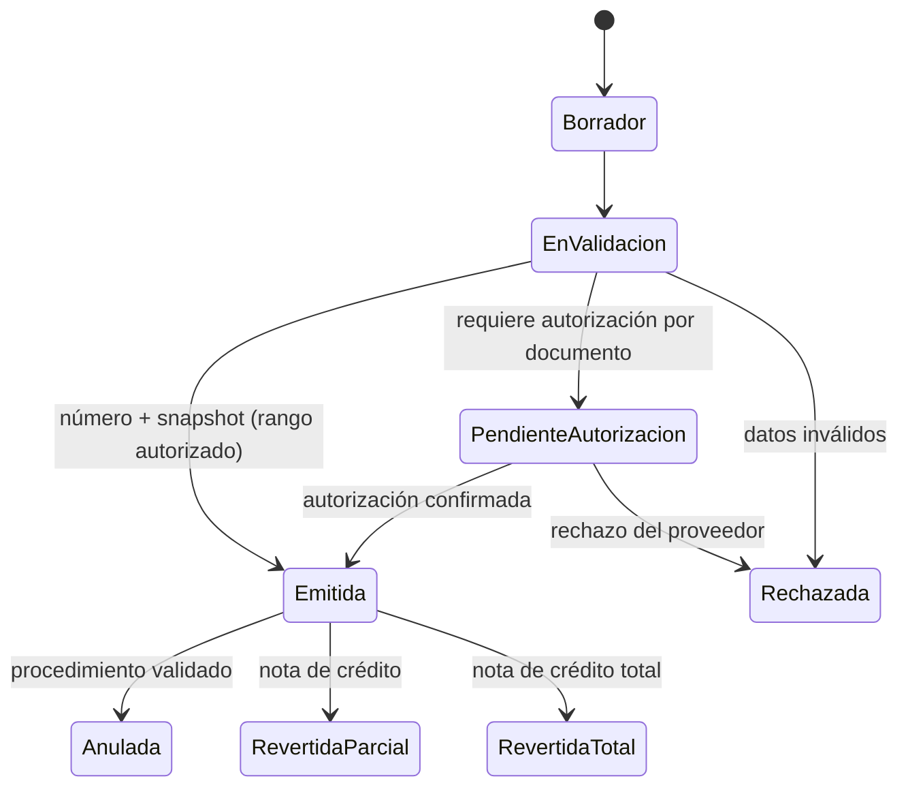

# Módulo de Facturación (`FAC`)

**Release:** R2 (base), R3 (libros y retenciones) · **Requisitos:** `FAC-001`…`FAC-014`

## 1. Propósito y límites

**Responsable de:** comprobantes fiscales, numeración, cálculo de impuestos, snapshot fiscal, notas de crédito/débito, representación gráfica, anulación por reversión, libros y retenciones.

**No responsable de:** precios comerciales (Ventas), stock (Inventario), cobros (Tesorería), asientos (Contabilidad). **Es el único módulo que emite comprobantes fiscales.**

> La distinción con Ventas es deliberada: Ventas decide **qué** se vende y a qué precio; Facturación decide **cómo se documenta fiscalmente** y con qué número.

## 2. Agregados y entidades

| Agregado | Entidades | Responsabilidad |
|---|---|---|
| `FiscalProfile` | — | Datos del emisor y configuración aplicada |
| `Invoice` | `InvoiceLine`, `InvoiceTax`, `FiscalSnapshot` | Comprobante de venta |
| `CreditNote` | `CreditNoteLine` | Reversión total/parcial |
| `DebitNote` | `DebitNoteLine` | Cargo adicional |
| `RetentionCertificate` | — | Retención practicada (R3) |
| `FiscalBook` | `FiscalBookEntry` | Libro de ventas/compras (R3) |
| `EmissionAttempt` | — | Intento con proveedor/autorización |
| `Series` | — | Serie, sucursal, año |

## 3. Value objects

`DocumentNumber`, `DocumentType`, `FiscalSnapshot`, `TaxLine`, `TaxRate`, `TaxBase`, `CurrencyCode`, `ExchangeRate`, `EmissionStatus`, `ProviderReference`, `VoidReason`.

## 4. Determinación de impuestos

```text
base_linea      = (cantidad × precio_unitario) − descuento_linea
impuesto_linea  = round(base_linea × alicuota_vigente, escala_moneda)
total_linea     = base_linea + impuesto_linea
total_documento = Σ total_linea
```

- La alícuota se resuelve por **regla vigente** según fecha del documento, tipo de artículo, condición del cliente y jurisdicción.
- Los valores de alícuotas **no se fijan en este documento**: se configuran y validan (ver [venezuela-tax.md](../compliance/venezuela-tax.md)).
- El documento conserva snapshot de impuestos, base, tasa, moneda y tasa de cambio.
- Los descuentos globales se distribuyen por línea de forma determinista antes de calcular impuestos.
- Las líneas exentas, no sujetas y de exportación se identifican con su código y se excluyen de la base cuando corresponda.

## 5. Emisión

La emisión se compone de una **fase local transaccional** y una **fase de autorización/reporte externo** que nunca se ejecuta dentro de la transacción.



> El diagrama representa el modo `RangoAutorizado`. En `AutorizacionPorDocumento`, la CxC y el asiento se crean en la transacción de confirmación de la autorización.

### 5.1 Modos de emisión

| Modo | Condición | Efecto |
|---|---|---|
| `RangoAutorizado` | El medio autoriza series o rangos con antelación | El comprobante es válido al emitirse localmente; el reporte al proveedor es asíncrono |
| `AutorizacionPorDocumento` | El medio exige autorización por documento | El comprobante queda `PendienteAutorizacion`; la cartera y la contabilización se crean al confirmar |

La elección depende de `DEC-002` y del medio validado. El producto no asume un modo por defecto.

### 5.2 Reglas

1. La numeración se asigna dentro de la transacción local ([ADR-006](../decisions/ADR-006-document-numbering.md)).
2. La llamada al proveedor se realiza **fuera** de la transacción, por outbox, con timeout, reintentos e idempotencia.
3. Un fallo del proveedor no deja comprobantes a medias: deja un intento registrado y un estado de autorización.
4. En `AutorizacionPorDocumento`, la CxC y el asiento se crean al confirmar; si el proveedor rechaza, se aplica la contingencia o la reversión validada.
5. El comprobante emitido es inmutable; su estado de autorización es un dato de cumplimiento, no una edición del documento.
6. La representación gráfica se genera desde el snapshot.
7. El envío al cliente y el PDF se procesan por outbox.
8. **No se inventa** un comprobante válido si el medio falla.

## 6. Reversión y anulación

- Una factura no se borra ni se edita.
- La corrección se hace con **nota de crédito** (total o parcial) que referencia la factura.
- La nota de débito agrega un cargo con su propio número.
- Una factura puede marcarse como **anulada** solo mediante un procedimiento validado que conserve el número y el registro; la política exacta está **PENDIENTE DE VALIDACIÓN LEGAL / CONTABLE**.
- Los números anulados no se reutilizan.

## 7. Libros y retenciones (R3)

- Libro de ventas y de compras por período, con totales por alícuota y base.
- Comprobantes de retención de IVA e ISLR: cálculo, numeración y representación. Los porcentajes y condiciones están **PENDIENTE DE VALIDACIÓN LEGAL / CONTABLE**.
- Exportación en formatos abiertos y, cuando se validen, en los formatos requeridos por el SENIAT.
- Conciliación entre libros, comprobantes y contabilidad.

## 8. Comandos

| Comando | Descripción |
|---|---|
| `IssueInvoice` | Emitir factura |
| `IssueCreditNote` | Emitir nota de crédito |
| `IssueDebitNote` | Emitir nota de débito |
| `VoidInvoice` | Anulación controlada |
| `RetryEmission` | Reintento con proveedor |
| `IssueRetentionCertificate` | Retención (R3) |
| `GenerateFiscalBook` | Libro (R3) |
| `ExportFiscalDocuments` | Exportación |

## 9. Consultas

- Comprobantes por período, cliente, estado y serie.
- Detalle de impuestos y totales.
- Libros y resúmenes por alícuota.
- Comprobantes con error de emisión.
- Correlación factura → nota de crédito → asiento.

## 10. Eventos

| Evento | Consumidores |
|---|---|
| `billing.invoice.issued.v1` | Tesorería, Contabilidad, Ventas, INT |
| `billing.invoice.voided.v1` | Tesorería, Contabilidad, INT |
| `billing.credit-note.issued.v1` | Tesorería, Contabilidad, Ventas |
| `billing.debit-note.issued.v1` | Tesorería, Contabilidad |
| `billing.retention.issued.v1` | Tesorería, Contabilidad |
| `billing.emission.failed.v1` | Alertas, soporte |

## 11. Invariantes

| ID | Regla |
|---|---|
| FAC-R-01 | Todo comprobante tiene número, serie, empresa, sucursal y fecha. |
| FAC-R-02 | El número es único por tenant/empresa/sucursal/tipo/serie/año. |
| FAC-R-03 | El comprobante emitido no se modifica ni se borra. |
| FAC-R-04 | La nota de crédito referencia una factura existente y la suma de notas no excede su monto. |
| FAC-R-05 | El total es la suma de líneas redondeadas. |
| FAC-R-06 | El snapshot conserva emisor, receptor, ítems, impuestos y tasa. |
| FAC-R-07 | No se emite sin perfil fiscal completo. |
| FAC-R-08 | La moneda y la tasa quedan registradas y no se recalculan. |
| FAC-R-09 | El número anulado no se reutiliza. |
| FAC-R-10 | Los libros cuadran con los comprobantes del período. |
| FAC-R-11 | La retención se calcula con la regla vigente y queda documentada. |
| FAC-R-12 | Toda emisión fallida deja rastro y permite reintento idempotente. |
| FAC-R-13 | La representación gráfica se genera desde el snapshot. |
| FAC-R-14 | El comprobante pertenece a una sola empresa y sucursal. |
| FAC-R-15 | Los datos fiscales dudosos se rechazan con error accionable. |

## 12. Estados



## 13. Casos de uso

1. Emitir factura desde pedido (`UC-07`).
2. Emitir factura de venta directa.
3. Emitir nota de crédito por devolución (`UC-09`).
4. Reintentar emisión tras fallo del proveedor.
5. Generar libro de ventas (R3).
6. Emitir comprobante de retención (R3).
7. Exportar comprobantes.

## 14. Dependencias

- `ADM`: perfil fiscal, empresa, sucursal, series.
- `VEN`/`COM`: documentos de origen.
- `TES`: partida por cobrar/pagar.
- `CON`: asiento.
- Proveedor externo de emisión (`DEC-002`).

## 15. Pendientes

- Medio de emisión y requisitos exactos: **PENDIENTE DE VALIDACIÓN LEGAL / CONTABLE** (ver [invoicing.md](../compliance/invoicing.md)).
- Formatos de representación gráfica y libros: **PENDIENTE**.
- Política de anulación: **PENDIENTE**.
- Retenciones: `DEC-007`.
- Contingencia: `FAC-009`, validación legal.
- Máquina fiscal legada: `DEC-013`.

## 16. Referencias

- [invoicing.md](../compliance/invoicing.md)
- [venezuela-tax.md](../compliance/venezuela-tax.md)
- [ADR-006](../decisions/ADR-006-document-numbering.md)
- [ADR-004](../decisions/ADR-004-money-and-rounding.md)
- [treasury.md](treasury.md)
