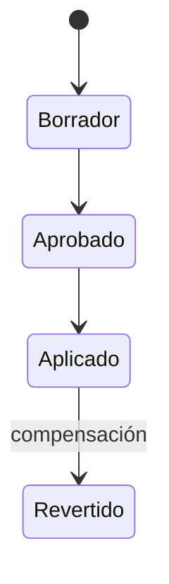

# Módulo de Inventario (`INV`)

**Release:** R2 (seriales en R4) · **Requisitos:** `INV-001`…`INV-014`

## 1. Propósito y límites

**Responsable de:** catálogo de artículos y servicios, variantes, unidades de medida, almacenes, existencias, movimientos, kardex, reservas, lotes, vencimientos, seriales, transferencias, ajustes, conteos, costos y valoración.

**No responsable de:** precios de venta (Ventas), emisión fiscal (Facturación), asientos (Contabilidad), compras (Compras). Acepta movimientos originados por ventas, compras, producción y ajustes.

## 2. Agregados y entidades

| Agregado | Entidades | Responsabilidad |
|---|---|---|
| `Item` | `ItemVariant`, `Barcode`, `ItemTax` | Catálogo, SKU, UoM, impuesto por defecto |
| `Warehouse` | — | Ubicación de custodia |
| `StockBalance` | — | Saldo y costo por artículo/almacén |
| `StockMovement` | `MovementLine` | Registro inmutable de entrada/salida |
| `StockReservation` | — | Compromiso de stock por documento |
| `Lot` | — | Trazabilidad y vencimiento |
| `Serial` | — | Unidad física única |
| `Transfer` | `TransferLine` | Movimiento entre almacenes |
| `Adjustment` | `AdjustmentLine` | Corrección aprobada |
| `Count` | `CountLine` | Conteo físico y diferencias |
| `ReorderPoint` | — | Mínimo, máximo y sugerencia |

## 3. Value objects

`Sku`, `Quantity`, `UnitOfMeasure`, `ConversionFactor`, `Money`, `UnitCost`, `LotNumber`, `SerialNumber`, `ExpiryDate`, `WarehouseId`, `MovementType`, `ReservationRef`.

## 4. Tipos de movimiento

| Tipo | Efecto | Origen |
|---|---|---|
| `PurchaseReceipt` | + stock, actualiza costo | Compras |
| `SaleIssue` | − stock, costo de venta | Ventas |
| `SaleReturn` | + stock | Ventas |
| `TransferOut` / `TransferIn` | − / + entre almacenes | Inventario |
| `AdjustmentIn` / `AdjustmentOut` | ± stock | Ajuste aprobado |
| `ProductionConsumption` | − componentes | Producción |
| `ProductionOutput` | + producto terminado | Producción |
| `InitialBalance` | + stock de apertura | Migración |

Cada movimiento es **inmutable**, tiene documento de origen, fecha de negocio, cantidad, costo unitario, costo total, lote/serial cuando aplique y `correlation_id`.

## 5. Valoración: costo promedio ponderado

Método por defecto: **promedio ponderado móvil por empresa y almacén**.

```text
costo_promedio_nuevo = (existencia_previa × costo_promedio_previo + cantidad_entrada × costo_entrada)
                       / (existencia_previa + cantidad_entrada)
```

Reglas:

1. Las entradas recalculan el costo promedio; las salidas usan el costo vigente.
2. El costo se almacena con 6 decimales; el valor de inventario se redondea a la escala de la moneda.
3. Si la existencia previa es cero o negativa, el costo de entrada define el nuevo promedio (política documentada).
4. El costo de venta se registra en el movimiento de salida (snapshot), no se recalcula retroactivamente.
5. Las devoluciones reingresan al costo registrado en la salida original cuando sea trazable; si no, al costo vigente.
6. El recosteo retroactivo **no** se hace por defecto. Si se requiere, es un proceso explícito, auditado y con aprobación (R3+), `PENDIENTE` de decisión.
7. El flete y gastos asignables de compra forman parte del costo de entrada (`COM-007`).

**Ejemplo**

| Movimiento | Cantidad | Costo unitario | Existencia | Costo promedio | Valor |
|---|---|---|---|---|---|
| Entrada | 10 | 10,00 | 10 | 10,000000 | 100,00 |
| Entrada | 10 | 20,00 | 20 | 15,000000 | 300,00 |
| Salida | 5 | 15,00 | 15 | 15,000000 | 225,00 |

## 6. Existencias y reservas

```text
disponible = existencia_física − reservado
```

- La reserva se crea al confirmar un pedido y se libera al cancelarlo o al facturarlo (la factura genera la salida).
- La reserva no mueve stock ni costo; solo compromete disponibilidad.
- La política de stock negativo se configura por empresa/almacén y requiere permiso para sobregirar.
- La venta sin stock puede bloquearse o permitirse según política; el sistema nunca deja saldos inconsistentes.

## 7. Lotes y seriales

- **Lotes:** número, fabricación, vencimiento, proveedor y costo. La salida puede ser FEFO (primero en vencer) configurable.
- **Vencimientos:** alertas y bloqueo de venta de lotes vencidos según política.
- **Seriales (R4):** unidad única con estado (disponible, vendido, devuelto, en garantía), asociada a movimientos y documentos.
- La trazabilidad permite responder: qué se vendió, a quién, con qué lote/serial y a qué costo.

## 8. Comandos

| Comando | Descripción |
|---|---|
| `CreateItem` / `UpdateItem` / `AddVariant` | Catálogo |
| `CreateWarehouse` | Alta de almacén |
| `RegisterMovement` | Movimiento interno (no expuesto directamente al usuario) |
| `ReserveStock` / `ReleaseReservation` | Reservas |
| `TransferStock` | Transferencia con aprobación |
| `AdjustStock` | Ajuste con motivo y aprobación |
| `StartCount` / `RecordCount` / `CloseCount` | Conteo físico |
| `SetReorderPoint` | Reposición |
| `AssignSerial` | Seriales (R4) |

## 9. Consultas

- Existencias por artículo, almacén, lote y estado.
- Kardex por artículo/almacén y rango de fechas.
- Disponibilidad para venta (física − reservada).
- Costo vigente y valor de inventario.
- Artículos bajo mínimo.
- Movimientos por documento de origen.

## 10. Eventos

| Evento | Consumidores |
|---|---|
| `inventory.stock.moved.v1` | Contabilidad (costo), reportes, integraciones |
| `inventory.stock.below-reorder.v1` | Compras, notificaciones |
| `inventory.lot.expiring.v1` | Notificaciones |
| `inventory.stock.adjusted.v1` | Auditoría, contabilidad |
| `inventory.transfer.completed.v1` | Reportes |

## 11. Invariantes

| ID | Regla |
|---|---|
| INV-R-01 | El SKU es único por tenant. |
| INV-R-02 | Todo movimiento pertenece a una empresa y almacén válidos. |
| INV-R-03 | La existencia es la suma de movimientos del artículo/almacén. |
| INV-R-04 | Un movimiento emitido no se edita ni se borra; se compensa. |
| INV-R-05 | La salida no puede exceder la disponibilidad salvo política y permiso. |
| INV-R-06 | La reserva no puede exceder la existencia física. |
| INV-R-07 | El costo promedio se recalcula solo con entradas. |
| INV-R-08 | El costo de salida se registra como snapshot. |
| INV-R-09 | Una transferencia aplica salida y entrada en una sola transacción; el estado de tránsito es informativo y no representa un saldo físico. |
| INV-R-10 | Un ajuste requiere motivo, permiso y aprobación si supera el umbral. |
| INV-R-11 | Un lote vencido no se vende si la política lo prohíbe. |
| INV-R-12 | Un serial no puede estar en dos lugares a la vez. |
| INV-R-13 | La UoM de compra puede diferir de la de inventario; la conversión es explícita. |
| INV-R-14 | El stock negativo, si se permite, se regulariza con un ajuste documentado. |
| INV-R-15 | Toda operación es idempotente por documento de origen. |

## 12. Estados



Transferencia: `Borrador → Aprobada → EnTránsito → Recibida → Cerrada`.
Conteo: `Abierto → EnConteo → Revisado → Aprobado → Cerrado`.

## 13. Casos de uso

1. Registrar artículo con impuesto y costo (`UC-04`).
2. Recibir compra y actualizar costo.
3. Vender y descontar stock.
4. Transferir entre almacenes (`AC-INV-03`).
5. Ajustar por conteo (`UC-11`).
6. Consultar kardex y valor de inventario.
7. Configurar mínimo y recibir sugerencia.

## 14. Dependencias

- Depende de `ADM` (empresa, sucursal, terceros) y `Platform`.
- Es dependido por `VEN`, `COM`, `PRO`, `POS`.
- Emite eventos a `CON` para costo de venta y ajustes.

## 15. Pendientes

- Política de recosteo retroactivo (decisión de producto/contabilidad).
- Costeo FIFO/LIFO: fuera de alcance.
- Tratamiento de inventario en consignación: fuera de alcance.
- FEFO por defecto o configurable: a validar con clientes.

## 16. Referencias

- [ADR-004](../decisions/ADR-004-money-and-rounding.md)
- [database-design.md](../architecture/database-design.md)
- [Requisitos INV](../requirements/functional-requirements.md)
