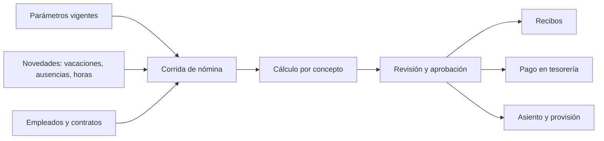

# Módulo de RRHH y Nómina (`RRH` / `NOM`)

**Release:** R5 · **Requisitos:** `RRH-001`…`RRH-004`, `NOM-001`…`NOM-010`

> **Advertencia:** todas las fórmulas, porcentajes, bases y obligaciones de este documento están **PENDIENTE DE VALIDACIÓN LEGAL / CONTABLE**. El producto implementa un motor parametrizable; **no** publica valores legales sin fuente y revisión de un especialista. Ver [labor-regulations.md](../compliance/labor-regulations.md).

## 1. Propósito y límites

**Responsable de:** expediente del empleado, contratos, cargos, estructura, vacaciones y permisos, conceptos salariales, corridas de nómina, deducciones y aportes, utilidades, prestaciones, liquidaciones, recibos, provisiones y parámetros legales.

**No responsable de:** pago bancario (Tesorería), asientos (Contabilidad), reclutamiento, desempeño, capacitación ni marcaje biométrico.

## 2. Agregados y entidades

| Agregado | Entidades | Responsabilidad |
|---|---|---|
| `Employee` | `EmployeeSensitiveData`, `EmployeeDocument` | Identidad laboral y datos restringidos |
| `Contract` | `ContractAmendment` | Tipo, vigencia, salario, jornada |
| `Position` | `OrgUnit` | Cargo y estructura |
| `VacationRequest` | — | Solicitud, aprobación y saldo |
| `PayrollConcept` | `PayrollConceptRule` | Concepto y regla de cálculo |
| `PayrollRun` | `PayrollRunLine`, `PayrollReceipt` | Corrida periódica |
| `SeveranceAccount` | `SeveranceMovement` | Prestaciones e intereses |
| `ProfitShare` | — | Utilidades |
| `Termination` | — | Liquidación |
| `LegalParameter` | `LegalParameterVersion` | Parámetros por vigencia |
| `PayrollProvision` | — | Provisión contable |

## 3. Value objects

`EmployeeId`, `Salary`, `SalaryBase`, `ConceptCode`, `PayrollPeriod`, `AttendanceDays`, `Seniority`, `SeveranceBalance`, `LegalRate`, `ContractType`, `Workday`.

## 4. Flujo de nómina

## 5. Parametrización

Todo valor legal es un **parámetro versionado** con:

- Código y descripción.
- Valor (numérico, porcentaje, tabla o fórmula referenciada).
- `effective_from` / `effective_to`.
- Fuente (`SRC-*`) y estado de validación.
- Responsable de aprobación.

Cambiar un parámetro **no recalcula** corridas aprobadas. Un recálculo genera una nueva versión de la corrida y queda auditado.

## 6. Conceptos y cálculo

Un concepto tiene:

- Tipo: ingreso, deducción, aporte patronal, provisión, informativo.
- Base: salario base, salario normal, salario integral, días, horas, monto fijo u otra.
- Fórmula: expresión determinista con parámetros.
- Vigencia y ámbito (empresa, categoría, contrato).
- Tratamiento contable y de reporte.

**Regla:** el motor no contiene fórmulas legales codificadas; las recibe como configuración validada. Las fórmulas concretas de prestaciones, utilidades, vacaciones y liquidación están **PENDIENTE DE VALIDACIÓN LEGAL / CONTABLE**.

## 7. Prestaciones y utilidades

- Cuenta individual por empleado con movimientos (abonos, intereses, retiros, anticipos).
- La antigüedad y los días se calculan según la norma vigente, parametrizada.
- Utilidades: base, días y proporcionalidad por parámetro.
- La liquidación consolida salarios pendientes, vacaciones, utilidades y prestaciones.
- Cada movimiento conserva el parámetro y la versión usados.

## 8. Comandos

| Comando | Descripción |
|---|---|
| `RegisterEmployee` / `UpdateEmployee` | Expediente |
| `CreateContract` / `AmendContract` | Contrato |
| `RequestVacation` / `ApproveVacation` | Vacaciones |
| `DefineConcept` / `PublishParameterVersion` | Configuración |
| `RunPayroll` / `RecalculatePayroll` | Corrida |
| `ApprovePayroll` | Aprobación |
| `IssueReceipts` | Recibos |
| `RegisterProfitShare` | Utilidades |
| `RegisterSeveranceMovement` | Prestaciones |
| `TerminateEmployee` | Liquidación |
| `ProvisionPayroll` | Provisión |

## 9. Consultas

- Nómina por período y centro de costo.
- Recibo por empleado.
- Saldo de vacaciones y prestaciones.
- Costo laboral por empresa.
- Parámetros vigentes y su fuente.
- Diferencias entre corridas.

## 10. Eventos

| Evento | Consumidores |
|---|---|
| `payroll.run.approved.v1` | Tesorería, Contabilidad |
| `payroll.receipt.issued.v1` | Notificaciones |
| `payroll.termination.completed.v1` | Tesorería, Contabilidad |
| `payroll.parameter.published.v1` | Auditoría |

## 11. Invariantes

| ID | Regla |
|---|---|
| NOM-R-01 | Toda corrida usa parámetros con vigencia aplicable. |
| NOM-R-02 | Una corrida aprobada es inmutable; se corrige con otra corrida. |
| NOM-R-03 | Un concepto no se elimina si tiene movimientos. |
| NOM-R-04 | El cálculo es determinista: mismos datos y parámetros → mismo resultado. |
| NOM-R-05 | Los datos sensibles solo son visibles para roles autorizados. |
| NOM-R-06 | El pago se realiza solo sobre corrida aprobada. |
| NOM-R-07 | La liquidación referencia todos los conceptos aplicables. |
| NOM-R-08 | Todo cambio de parámetro queda auditado con fuente. |
| NOM-R-09 | El asiento de nómina cuadra con el total de la corrida. |
| NOM-R-10 | Un empleado no puede tener dos corridas activas en el mismo período. |

## 12. Estados

Corrida: `Borrador → Calculada → EnRevisión → Aprobada → Pagada → Cerrada`.
Vacaciones: `Solicitada → Aprobada → Disfrutada → Cerrada`.
Contrato: `Borrador → Vigente → Suspendido → Terminado`.

## 13. Casos de uso

1. Registrar empleado y contrato.
2. Configurar conceptos y parámetros.
3. Procesar nómina (`UC-14`).
4. Aprobar y pagar.
5. Registrar utilidades.
6. Liquidar empleado.
7. Emitir recibo.

## 14. Dependencias

- `ADM`: empresa, sucursal, usuarios y permisos.
- `TES`: pago de nómina.
- `CON`: asientos y provisiones.
- Especialista laboral: validación de fórmulas y parámetros.

## 15. Pendientes legales

- Fórmulas de prestaciones, intereses, vacaciones, utilidades y liquidación: **PENDIENTE DE VALIDACIÓN LEGAL / CONTABLE**.
- Aportes de seguridad social y paro forzoso: **PENDIENTE**.
- Retenciones de ISLR sobre salarios: **PENDIENTE**.
- Salario integral y base de cálculo: **PENDIENTE**.
- Tratamiento de salarios en divisas: **PENDIENTE**.

Ver [labor-regulations.md](../compliance/labor-regulations.md) y `DEC-011`, `DEC-014`.

## 16. Referencias

- [labor-regulations.md](../compliance/labor-regulations.md)
- [treasury.md](treasury.md)
- [accounting.md](accounting.md)
- [regulatory-sources.md](../compliance/regulatory-sources.md)
