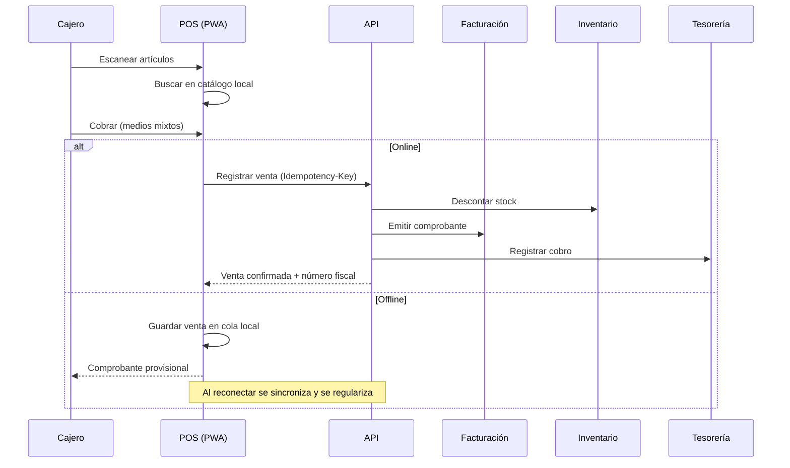

# Módulo de Punto de Venta (`POS`)

**Release:** R4 · **Requisitos:** `POS-001`…`POS-010`

## 1. Propósito y límites

**Responsable de:** terminales, turnos de caja, venta rápida, medios de pago, impresión, gaveta, operación offline, sincronización, cierres X/Z y devoluciones de mostrador.

**No responsable de:** precios (Ventas), stock (Inventario), numeración fiscal (Facturación), arqueo contable (Tesorería). Orquesta esos módulos mediante contratos.

## 2. Agregados y entidades

| Agregado | Entidades | Responsabilidad |
|---|---|---|
| `Terminal` | `TerminalDevice` | Identidad del dispositivo, sucursal, configuración |
| `Shift` | `ShiftCashMovement` | Turno del cajero y caja |
| `PosTransaction` | `PosTransactionLine`, `PosPayment` | Venta de mostrador |
| `SyncBatch` | `SyncItem` | Sincronización offline |
| `SyncConflict` | — | Conflicto y resolución |
| `ZReport` | — | Cierre de turno |

## 3. Value objects

`TerminalId`, `ShiftId`, `LocalSequence`, `Barcode`, `PosPaymentMethod`, `CashDrawerEvent`, `SyncStatus`, `DeviceFingerprint`.

## 4. Flujo de venta

## 5. Operación offline

- La PWA mantiene catálogo, precios, impuestos y clientes frecuentes en almacenamiento local (IndexedDB), con versión y vigencia.
- Cada terminal tiene identidad propia y un número de secuencia local.
- Las ventas offline se encolan con `transaction_id` generado en el dispositivo (UUIDv7) y se sincronizan al reconectar.
- La API es idempotente: un `transaction_id` repetido no duplica la venta.
- Los conflictos (precio cambiado, stock insuficiente, turno cerrado) se registran en `SyncConflict` y requieren resolución.
- El comprobante emitido offline es **provisional** hasta la regularización fiscal. **La validez fiscal de la emisión offline está PENDIENTE DE VALIDACIÓN LEGAL / CONTABLE** (`DEC-010`).
- Los datos locales se cifran cuando la plataforma lo permita; el acceso requiere PIN del cajero y token de dispositivo.
- Al cerrar turno con ventas pendientes, se advierte y se bloquea el cierre hasta sincronizar o resolver.

## 6. Hardware

| Dispositivo | Integración | Estado |
|---|---|---|
| Impresora térmica ESC/POS | Comandos ESC/POS vía servicio local o WebUSB/WebSerial | A validar (`DEC-013`) |
| Gaveta de efectivo | Apertura por pulso de impresora | A validar |
| Lector de código de barras | Entrada de teclado (HID) | Soportado |
| Pantalla de cliente | Extensión futura | Fuera de alcance |
| Báscula | Extensión futura | Fuera de alcance |

La matriz de hardware soportado se publica y se prueba antes de R4.

## 7. Caja y cierres

- Apertura de turno con monto inicial y cajero.
- Movimientos de caja: venta en efectivo, retiro, ingreso, devolución.
- Cierre X (parcial, no cierra) y Z (cierre).
- Arqueo: efectivo contado vs sistema; diferencia con autorización.
- El cierre genera el resumen por medio de pago y lo envía a Tesorería.
- Un turno cerrado no admite ventas; se abre uno nuevo.

## 8. Comandos

| Comando | Descripción |
|---|---|
| `EnrollTerminal` | Alta y vinculación |
| `OpenShift` / `CloseShift` | Turno |
| `RegisterSale` | Venta con idempotencia |
| `RegisterPayment` | Medio de pago |
| `VoidSale` | Anulación |
| `RegisterReturn` | Devolución |
| `SyncOfflineBatch` | Sincronización |
| `ResolveConflict` | Resolución |
| `PrintZReport` | Cierre |

## 9. Consultas

- Ventas del turno.
- Ventas por medio de pago.
- Diferencias de arqueo.
- Estado de sincronización.
- Catálogo local y versión.

## 10. Eventos

| Evento | Consumidores |
|---|---|
| `pos.sale.completed.v1` | Ventas, Inventario, Facturación, Tesorería |
| `pos.shift.closed.v1` | Tesorería, reportes |
| `pos.sync.conflict.v1` | Soporte, alertas |
| `pos.offline.detected.v1` | Monitoreo |

## 11. Invariantes

| ID | Regla |
|---|---|
| POS-R-01 | Toda venta pertenece a un turno abierto. |
| POS-R-02 | El `transaction_id` es único y la venta es idempotente. |
| POS-R-03 | Los precios se validan contra el servidor al sincronizar. |
| POS-R-04 | El stock se descuenta una sola vez por venta. |
| POS-R-05 | El comprobante fiscal se emite con numeración válida. |
| POS-R-06 | Una venta anulada conserva su registro y su referencia. |
| POS-R-07 | El cierre Z cuadra con las ventas y los medios de pago. |
| POS-R-08 | Una diferencia de arqueo requiere autorización. |
| POS-R-09 | No se sincroniza una venta dos veces. |
| POS-R-10 | El turno cerrado no admite operaciones. |
| POS-R-11 | El dispositivo no puede operar sin enrolamiento. |
| POS-R-12 | Al cerrar la sesión del dispositivo no persisten datos de usuario; la cola de sincronización pendiente se cifra y se conserva hasta reconciliar. |

## 12. Estados

Turno: `Abierto → EnCierre → Cerrado`.
Venta: `Local → Sincronizando → Confirmada → Anulada / Devuelta`.
Sincronización: `Pendiente → EnProceso → Completada → Conflicto`.

## 13. Casos de uso

1. Vender con código de barras (`AC-POS-01`).
2. Cobrar con medios mixtos y dar vuelto.
3. Imprimir y abrir gaveta.
4. Vender sin conexión y sincronizar (`UC-15`).
5. Cerrar turno con arqueo.
6. Anular o devolver una venta.

## 14. Dependencias

- `VEN`: precios y reglas comerciales.
- `INV`: stock y reservas.
- `FAC`: comprobante fiscal.
- `TES`: caja y cobros.
- `ADM`: terminal, cajero, permisos.

## 15. Pendientes

- `DEC-010`: validez fiscal de la emisión offline.
- `DEC-013`: hardware soportado.
- `DEC-004`: almacenamiento local de comprobantes.
- Estrategia de resolución de conflictos de stock y precio: definir con pilotos.
- Comprobante provisional: formato y leyenda **PENDIENTE DE VALIDACIÓN LEGAL / CONTABLE**.

## 16. Referencias

- [sales.md](sales.md)
- [invoicing.md](../compliance/invoicing.md)
- [treasury.md](treasury.md)
- [sales.md](sales.md)
