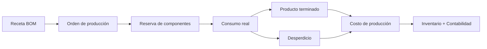

# Módulo de Producción (`PRO`)

**Release:** R6 · **Requisitos:** `PRO-001`…`PRO-006`

## 1. Propósito y límites

**Responsable de:** recetas/listas de materiales, órdenes de producción, consumo de componentes, producto terminado, desperdicio, costos de producción y trazabilidad de lote producido.

**No responsable de:** compras de insumos (Compras), venta (Ventas), asientos (Contabilidad), stock físico (Inventario).

## 2. Agregados y entidades

| Agregado | Entidades | Responsabilidad |
|---|---|---|
| `Bom` | `BomLine` | Receta versionada |
| `WorkOrder` | `WorkOrderComponent` | Orden de producción |
| `Consumption` | `ConsumptionLine` | Consumo real de componentes |
| `Production` | — | Producto terminado |
| `WasteRecord` | — | Merma y desperdicio |
| `ProductionCost` | `CostComponent` | Costo acumulado |

## 3. Value objects

`BomVersion`, `Yield`, `ScrapPercentage`, `Quantity`, `UnitCost`, `LaborRate`, `OverheadRate`, `WorkOrderStatus`, `BatchNumber`.

## 4. Flujo



## 5. Recetas

- Versión vigente y fecha de vigencia.
- Componentes con cantidad, UoM, merma esperada y sustitutos.
- Rendimiento esperado por lote.
- Una orden usa la versión vigente al momento de crearse; no cambia si la receta se actualiza después.
- Costo teórico calculado a partir del costo vigente de los componentes.

## 6. Consumo y producción

- La orden reserva componentes y consume según la receta o el consumo real.
- El consumo real puede diferir; la diferencia se registra como variación.
- El producto terminado ingresa al inventario con su costo calculado.
- El desperdicio se registra con motivo y se costea.
- El lote producido conserva trazabilidad de componentes y fecha.

## 7. Costos

```text
costo_orden = Σ costo_componentes_consumidos
            + mano_de_obra
            + overhead_aplicado
            + costo_de_desperdicio
costo_unitario = costo_orden / cantidad_producida (con rendimiento)
```

- Los métodos de asignación de overhead son configurables.
- El costo se calcula al cerrar la orden y se registra como snapshot.
- Las variaciones se documentan y se contabilizan.
- El costeo es una **hipótesis** de diseño hasta validar con las pequeñas industrias objetivo (`PRO-004`, `PRO-005`).

## 8. Comandos

| Comando | Descripción |
|---|---|
| `CreateBom` / `PublishBomVersion` | Receta |
| `CreateWorkOrder` / `ReleaseWorkOrder` | Orden |
| `ReserveComponents` | Reserva |
| `RecordConsumption` | Consumo |
| `RecordProduction` | Producto terminado |
| `RecordWaste` | Desperdicio |
| `CloseWorkOrder` | Cierre y costo |

## 9. Consultas

- Órdenes por estado y fecha.
- Consumo vs receta.
- Costo real vs teórico.
- Rendimiento y desperdicio.
- Trazabilidad de lote.

## 10. Eventos

| Evento | Consumidores |
|---|---|
| `production.work-order.released.v1` | Inventario, notificaciones |
| `production.consumption.posted.v1` | Inventario, Contabilidad |
| `production.output.posted.v1` | Inventario, Contabilidad |
| `production.work-order.closed.v1` | Costos, reportes |

## 11. Invariantes

| ID | Regla |
|---|---|
| PRO-R-01 | Una orden usa una versión de receta vigente e inmutable. |
| PRO-R-02 | El consumo no excede lo reservado salvo autorización. |
| PRO-R-03 | La producción no excede el rendimiento permitido sin justificación. |
| PRO-R-04 | El costo se calcula con los costos snapshot de los componentes. |
| PRO-R-05 | El desperdicio se registra con motivo y costo. |
| PRO-R-06 | El lote producido conserva trazabilidad de componentes. |
| PRO-R-07 | Una orden cerrada no se modifica; se corrige con una nueva. |
| PRO-R-08 | Los movimientos de inventario son los únicos que alteran stock. |

## 12. Estados

Orden: `Borrador → Liberada → EnProceso → Cerrada → Cancelada`.
Receta: `Borrador → Publicada → Obsoleta`.

## 13. Casos de uso

1. Definir receta y costo teórico.
2. Liberar orden y reservar componentes.
3. Registrar consumo y producción.
4. Registrar desperdicio.
5. Cerrar orden y costear.

## 14. Dependencias

- `INV`: componentes, stock, costos.
- `CON`: contabilización de consumo y producción.
- `COM`: abastecimiento de insumos.

## 15. Pendientes

- Métodos de costeo y overhead: validar con industrias (`PRO-004`, `PRO-005`).
- Planificación de capacidad/MRP: fuera de alcance.
- Producción por proceso continuo: fuera de alcance.
- Calidad y mantenimiento: fuera de alcance.

## 16. Referencias

- [inventory.md](inventory.md)
- [accounting.md](accounting.md)
- [functional-scope.md](../product/functional-scope.md)
