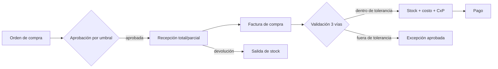
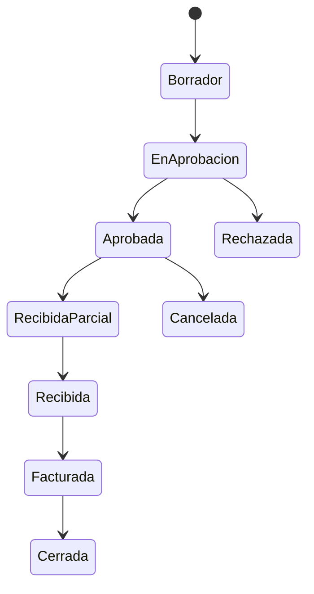

# Módulo de Compras (`COM`)

**Release:** R2 · **Requisitos:** `COM-001`…`COM-008`

## 1. Propósito y límites

**Responsable de:** perfil de proveedor, órdenes de compra, aprobaciones, recepciones, facturas de compra, devoluciones, compras en divisas y costos asignables.

**No responsable de:** pago (Tesorería), emisión fiscal (Facturación, solo valida datos del comprobante recibido), asientos (Contabilidad), stock físico (Inventario, dueño de la existencia).

## 2. Agregados y entidades

| Agregado | Entidades | Responsabilidad |
|---|---|---|
| `SupplierProfile` | `SupplierTerms` | Condiciones, moneda, retenciones, contacto |
| `PurchaseOrder` | `PurchaseOrderLine` | Solicitud y compromiso de compra |
| `GoodsReceipt` | `ReceiptLine` | Recepción total/parcial |
| `PurchaseInvoice` | `PurchaseInvoiceLine`, `Withholding` | Factura recibida y su validación |
| `PurchaseReturn` | `ReturnLine` | Devolución al proveedor |
| `LandedCost` | `LandedCostAllocation` | Flete/gastos asignados al costo |

## 3. Value objects

`PurchaseOrderNumber`, `SupplierRef`, `Quantity`, `UnitCost`, `Money`, `PaymentTerms`, `Tolerance`, `MatchResult`, `WithholdingRef`, `LandedCostType`.

## 4. Flujo de compra



## 5. Validación de tres vías

Se comparan **orden**, **recepción** y **factura** por línea:

```text
cantidad_facturada ≤ cantidad_recibida ≤ cantidad_ordenada (con tolerancia)
precio_facturado  ≈ precio_ordenado (tolerancia configurable, por % o monto)
```

- La tolerancia se configura por empresa/proveedor.
- Una diferencia dentro de tolerancia se registra con la diferencia marcada.
- Fuera de tolerancia se bloquea el registro automático y se requiere excepción aprobada con motivo.
- La factura de compra no puede registrarse sin recepción, salvo compra de servicios/gastos (`COM-008`).
- Todo el flujo es idempotente por número de factura del proveedor + tenant.

## 6. Aprobaciones

- Umbral por monto y tipo de compra.
- Aprobador distinto del solicitante cuando el monto lo exige.
- La aprobación registra actor, fecha, decisión y motivo.
- Una orden aprobada no se edita; los cambios se hacen con revisión y nueva aprobación.

## 7. Compras en divisas y costos

- Se registra moneda, tasa, fuente y fecha.
- El costo en moneda funcional se calcula con la tasa snapshot y se conserva para el inventario y la contabilidad.
- La diferencia cambiaria al pagar se registra en Tesorería/Contabilidad.
- Flete y gastos asignables se distribuyen por peso, volumen, cantidad o valor, según configuración; el método y la base quedan auditados.
- Los costos asignados actualizan el costo de entrada del inventario.

## 8. Comandos

| Comando | Descripción |
|---|---|
| `CreateSupplier` / `UpdateSupplierTerms` | Proveedor |
| `CreatePurchaseOrder` / `SubmitForApproval` / `ApproveOrder` | Orden |
| `RegisterReceipt` | Recepción parcial/total |
| `RegisterPurchaseInvoice` | Factura y validación |
| `ApproveMatchException` | Excepción de tres vías |
| `RegisterPurchaseReturn` | Devolución |
| `AllocateLandedCost` | Costos asignables |
| `RequestPayment` | Solicitud a Tesorería |

## 9. Consultas

- Órdenes pendientes de recepción y de facturación.
- Recepciones por orden y proveedor.
- Facturas de compra por estado y antigüedad.
- Diferencias de tres vías.
- Compras por proveedor, artículo y período.
- Costo real de compra por artículo.

## 10. Eventos

| Evento | Consumidores |
|---|---|
| `purchasing.purchase-order.created.v1` | Notificaciones, aprobaciones |
| `purchasing.purchase-order.approved.v1` | Compras, proveedor, notificaciones |
| `purchasing.goods-receipt.posted.v1` | Inventario, Contabilidad |
| `purchasing.purchase-invoice.registered.v1` | Tesorería, Contabilidad, Fiscal |
| `purchasing.purchase-return.posted.v1` | Inventario, Tesorería |
| `purchasing.purchase-invoice.match-exception.v1` | Notificaciones, aprobaciones |

## 11. Invariantes

| ID | Regla |
|---|---|
| COM-R-01 | La orden aprobada no se modifica; se corrige con revisión. |
| COM-R-02 | La recepción no excede la cantidad pendiente de la orden. |
| COM-R-03 | La factura no excede la recepción, salvo servicios o excepción aprobada. |
| COM-R-04 | La factura del proveedor es única por tenant y número. |
| COM-R-05 | La tolerancia se aplica por línea y queda registrada. |
| COM-R-06 | El costo en moneda funcional conserva la tasa snapshot. |
| COM-R-07 | Los costos asignados se distribuyen con base documentada. |
| COM-R-08 | La devolución no excede lo recibido y no devuelto. |
| COM-R-09 | La compra de servicios no genera movimiento de stock. |
| COM-R-10 | El pago se solicita solo sobre facturas registradas y aprobadas. |
| COM-R-11 | Toda excepción requiere aprobación y motivo. |
| COM-R-12 | El proveedor no se elimina si tiene documentos; se inactiva. |

## 12. Estados



Factura de compra: `Registrada → Validada → Aprobada → PagadaParcial → Pagada`.
Recepción: `Borrador → Confirmada → Revertida` (solo con autorización).

## 13. Casos de uso

1. Crear orden y aprobarla por umbral (`UC-10`).
2. Recibir parcialmente.
3. Registrar factura y validar tres vías.
4. Resolver excepción con aprobación.
5. Registrar devolución al proveedor.
6. Asignar flete al costo.
7. Solicitar pago.

## 14. Dependencias

- `ADM`: proveedor (tercero), empresa, sucursal, aprobaciones.
- `INV`: recepción, costo, devolución.
- `FAC`: validación de datos fiscales del comprobante recibido y retenciones (R3).
- `TES`: partida por pagar y pago.
- `CON`: asiento de compra y costo (R3).

## 15. Pendientes

- Importaciones y costos de aduana: R6.
- Compras consignadas y contratos marco: fuera de alcance.
- Umbrales de aprobación por defecto: definir con clientes.
- Retenciones de IVA/ISLR: `DEC-007` (validación legal).

## 16. Referencias

- [inventory.md](inventory.md)
- [treasury.md](treasury.md)
- [billing.md](billing.md)
- [PRD](../requirements/PRD.md)
