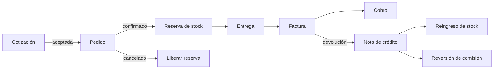
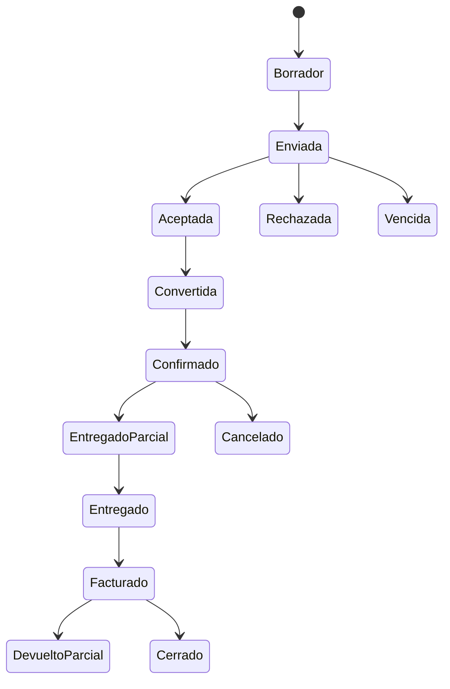

# Módulo de Ventas (`VEN`)

**Release:** R2 · **Requisitos:** `VEN-001`…`VEN-012`

## 1. Propósito y límites

**Responsable de:** cotizaciones, pedidos, entregas, devoluciones comerciales, listas de precios, descuentos, vendedores, comisiones, crédito del cliente y condiciones de venta.

**No responsable de:** emisión fiscal (Facturación), movimientos de stock (Inventario), cobros (Tesorería), asientos (Contabilidad). Solicita esas operaciones por contrato.

## 2. Agregados y entidades

| Agregado | Entidades | Responsabilidad |
|---|---|---|
| `PriceList` | `PriceListItem` | Precios por lista, moneda y vigencia |
| `Quote` | `QuoteLine` | Propuesta con vigencia y versión |
| `Order` | `OrderLine`, `Reservation` | Compromiso comercial y reserva |
| `Delivery` | `DeliveryLine` | Entrega total o parcial |
| `SalesReturn` | `ReturnLine` | Devolución comercial |
| `Salesperson` | `CommissionPlan` | Vendedor y esquema de comisión |
| `Commission` | — | Acumulación y reversión |
| `CustomerCredit` | — | Límite, saldo y condición |

## 3. Value objects

`Price`, `Discount`, `PriceListRef`, `QuoteValidity`, `OrderStatus`, `CreditLimit`, `PaymentTerms`, `SalesChannel`, `CommissionRate`, `TaxSnapshot`.

## 4. Flujo comercial

## 5. Resolución de precio

Orden determinista, ejecutado **en servidor**:

1. Lista de precios asignada al cliente.
2. Lista de precios por canal o segmento.
3. Lista base de la empresa.
4. Precio del artículo si no hay lista.

Luego:

- Descuento por línea (porcentaje o monto) con umbral.
- Descuento global autorizado.
- Impuesto según regla vigente del artículo y del cliente.
- Redondeo por línea según [ADR-004](../decisions/ADR-004-money-and-rounding.md).

El precio y el descuento aplicados se guardan como snapshot en la línea; un cambio posterior de lista no altera documentos previos.

## 6. Crédito y reservas

- **Crédito:** `saldo_abierto + pedido_pendiente ≤ límite`. Si se excede, se bloquea o requiere aprobación con permiso.
- **Morosidad:** un cliente con facturas vencidas puede bloquearse según configuración.
- **Reserva:** se crea al confirmar el pedido y se libera al cancelar; al facturar, la salida de stock consume la reserva.
- **Entrega parcial:** se factura lo entregado; el pedido permanece abierto por el saldo.

## 7. Comisiones

- Plan por vendedor: porcentaje sobre base (subtotal, margen o cobro) y vigencia.
- Se acumula al emitir la factura.
- Se revierte proporcionalmente con la nota de crédito.
- La liquidación al vendedor puede condicionarse al cobro (configurable); **PENDIENTE** de definición comercial.
- Todo cambio de plan queda auditado.

## 8. Comandos

| Comando | Descripción |
|---|---|
| `CreateQuote` / `ReviseQuote` / `AcceptQuote` | Cotización y versiones |
| `ConvertQuoteToOrder` | Conversión con trazabilidad |
| `ConfirmOrder` | Valida stock y crédito; reserva |
| `CancelOrder` | Libera reserva |
| `CreateDelivery` | Entrega parcial/total |
| `RequestInvoice` | Solicita emisión a Facturación |
| `RegisterReturn` | Devolución comercial |
| `AssignPriceList` / `SetCreditLimit` | Configuración del cliente |
| `ApproveDiscount` | Aprobación registrada |
| `AccrueCommission` / `ReverseCommission` | Comisiones |

## 9. Consultas

- Cotizaciones por estado y vigencia.
- Pedidos pendientes de entrega y de facturación.
- Ventas por vendedor, cliente, artículo y período.
- Comisiones acumuladas y liquidadas.
- Crédito disponible por cliente.
- Margen estimado por línea (precio − costo vigente).

## 10. Eventos

| Evento | Consumidores |
|---|---|
| `sales.quote.created.v1` | CRM, notificaciones |
| `sales.quote.accepted.v1` | Ventas, CRM |
| `sales.order.confirmed.v1` | Inventario, Facturación, INT |
| `sales.order.cancelled.v1` | Inventario, INT |
| `sales.delivery.posted.v1` | Inventario, Facturación |
| `sales.return.posted.v1` | Inventario, Facturación, Comisiones |
| `sales.commission.accrued.v1` | Reportes |
| `sales.credit-limit.exceeded.v1` | Notificaciones, aprobaciones |

## 11. Invariantes

| ID | Regla |
|---|---|
| VEN-R-01 | El precio se resuelve en servidor; el cliente no puede imponerlo. |
| VEN-R-02 | Una cotización vencida no se convierte sin autorización. |
| VEN-R-03 | Un pedido confirmado requiere stock disponible o autorización de sobregiro. |
| VEN-R-04 | Un pedido no puede exceder el crédito sin aprobación. |
| VEN-R-05 | La reserva se libera al cancelar o facturar. |
| VEN-R-06 | La entrega no puede exceder lo pedido. |
| VEN-R-07 | La factura no puede exceder lo entregado, salvo venta directa autorizada. |
| VEN-R-08 | La devolución no puede exceder lo facturado. |
| VEN-R-09 | La comisión se revierte con la nota de crédito. |
| VEN-R-10 | Los documentos conservan snapshot de precio, impuesto y cliente. |
| VEN-R-11 | Un documento emitido no se edita; se revierte. |
| VEN-R-12 | Todo cambio de precio o descuento queda auditado. |

## 12. Estados

Los estados de pedido, entrega y devolución se documentan por separado en el código y en las pruebas.

## 13. Casos de uso

1. Cotizar y convertir a pedido (`UC-05`).
2. Confirmar pedido con reserva y crédito (`UC-06`).
3. Entregar parcialmente y facturar.
4. Registrar devolución y nota de crédito (`UC-09`).
5. Aprobar descuento fuera de umbral.
6. Calcular y liquidar comisiones.

## 14. Dependencias

- `ADM`: terceros, empresa, sucursal, aprobaciones.
- `INV`: disponibilidad, reservas, costos.
- `FAC`: emisión de comprobantes.
- `TES`: crédito, cartera y cobros.
- `CRM` (R6): oportunidades y origen.

## 15. Pendientes

- Regla de liquidación de comisiones (al facturar o al cobrar): `PENDIENTE`.
- Ventas recurrentes/suscripciones: fuera de alcance.
- E-commerce: R6.
- Descuentos por volumen/escalonados: evaluar R3.

## 16. Referencias

- [PRD](../requirements/PRD.md)
- [billing.md](billing.md)
- [inventory.md](inventory.md)
- [treasury.md](treasury.md)
