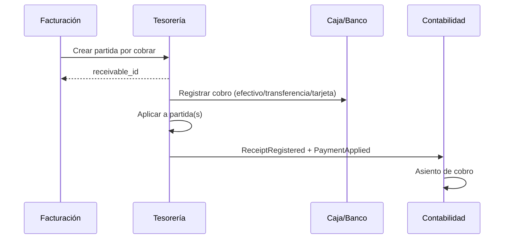

# Módulo de Tesorería (`TES`)

**Release:** R2 (caja, cobros, pagos, cartera básica), R3 (bancos, conciliación, multimoneda) · **Requisitos:** `TES-001`…`TES-012`

## 1. Propósito y límites

**Responsable de:** cajas y sesiones, cuentas bancarias, cobros, pagos, anticipos, cuentas por cobrar/pagar, aplicaciones, conciliación, transferencias y diferencias cambiarias.

**No responsable de:** emisión de comprobantes (Facturación), asientos (Contabilidad), precios ni inventario. **Es el dueño del saldo de cartera.**

## 2. Agregados y entidades

| Agregado | Entidades | Responsabilidad |
|---|---|---|
| `CashBox` | `CashSession`, `CashCount` | Caja física, apertura/cierre y arqueo |
| `BankAccount` | `BankStatement`, `Reconciliation` | Cuenta y conciliación |
| `Receivable` | `PaymentAllocation` | Partida por cobrar y aplicaciones |
| `Payable` | `PaymentAllocation` | Partida por pagar y aplicaciones |
| `Receipt` | `ReceiptLine` | Cobro de clientes |
| `Payment` | `PaymentLine` | Pago a proveedores/obligaciones |
| `Advance` | — | Anticipo de cliente o prepago |
| `Transfer` | — | Movimiento entre cajas/cuentas |
| `FxDifference` | — | Diferencia cambiaria |

## 3. Value objects

`Money`, `CurrencyCode`, `ExchangeRate`, `PaymentMethod`, `CashSessionStatus`, `OpenItemStatus`, `AllocationAmount`, `BankReference`, `ReconciliationMatch`.

## 4. Flujo de cobro

## 5. Caja

- Apertura con monto inicial y responsable.
- Toda operación en efectivo requiere sesión abierta.
- Cierre con conteo, diferencia y autorización.
- Reportes X (parcial) y Z (cierre).
- Un cajero no puede autorizar su propia diferencia.
- La sesión cerrada no se reabre; se corrige con un nuevo movimiento autorizado.

## 6. Cobros y pagos

- Un cobro puede tener varias líneas y medios de pago.
- Se aplica total o parcialmente a una o varias partidas.
- El saldo de la partida = importe original − aplicado.
- No se aplica más que el saldo (validación transaccional para evitar concurrencia).
- Los anticipos se registran como saldo a favor y se aplican después.
- Los pagos a proveedores descuentan retenciones cuando corresponda (R3); el importe retenido se registra como obligación con el fisco.
- Los pagos pueden ser parciales y programados.
- Toda operación es idempotente por clave de solicitud.

## 7. Multimoneda

- El cobro/pago registra moneda, tasa y fecha.
- La partida conserva la moneda del documento.
- Si el cobro es en moneda distinta, se calcula el importe equivalente con la tasa del cobro y se registra la diferencia cambiaria.
- La revaluación de saldos en moneda extranjera es un proceso contable explícito (R3), no automático por consulta.
- Prohibido aplicar pagos de monedas distintas sin conversión documentada.

## 8. Conciliación bancaria (R3)

- Importación de estado de cuenta (CSV/XLSX) con formato configurable.
- Reglas de coincidencia: referencia, monto, fecha, contraparte.
- Coincidencias automáticas, sugerencias y revisión manual.
- Diferencias y partidas no conciliadas quedan visibles.
- Cierre de conciliación con resumen y auditoría.
- La integración bancaria directa está pendiente (`DEC-009`).

## 9. Comandos

| Comando | Descripción |
|---|---|
| `OpenCashSession` / `CloseCashSession` | Caja |
| `RegisterCashCount` | Arqueo |
| `RegisterReceipt` / `RegisterPayment` | Cobro/pago |
| `ApplyPayment` / `ReverseApplication` | Aplicación |
| `RegisterAdvance` / `ApplyAdvance` | Anticipos |
| `TransferFunds` | Transferencia |
| `ImportBankStatement` / `Reconcile` | Conciliación |

## 10. Consultas

- Saldo de caja por sesión.
- Cartera por cliente/proveedor y antigüedad (R3).
- Partidas abiertas y vencidas.
- Cobros/pagos por período y medio.
- Conciliación pendiente.
- Diferencias cambiarias.

## 11. Eventos

| Evento | Consumidores |
|---|---|
| `treasury.receipt.registered.v1` | Contabilidad, notificaciones |
| `treasury.payment.registered.v1` | Contabilidad, notificaciones |
| `treasury.payment.applied.v1` | Contabilidad, cartera |
| `treasury.cash-session.closed.v1` | Reportes, auditoría |
| `treasury.bank.reconciled.v1` | Contabilidad, reportes |

## 12. Invariantes

| ID | Regla |
|---|---|
| TES-R-01 | Todo movimiento de caja pertenece a una sesión abierta. |
| TES-R-02 | La aplicación no excede el saldo de la partida. |
| TES-R-03 | La suma aplicada no excede el importe del cobro/pago. |
| TES-R-04 | Un cobro/pago confirmado no se edita; se revierte con contramovimiento. |
| TES-R-05 | El saldo de cartera es la suma de partidas abiertas. |
| TES-R-06 | La diferencia de arqueo requiere autorización y registro. |
| TES-R-07 | Toda operación en moneda distinta registra tasa y diferencia. |
| TES-R-08 | La transferencia afecta origen y destino en la misma transacción. |
| TES-R-09 | Un anticipo no se aplica dos veces. |
| TES-R-10 | La conciliación no modifica el movimiento bancario, solo lo marca. |
| TES-R-11 | Una sesión cerrada no admite nuevos movimientos. |
| TES-R-12 | Toda operación es idempotente por clave. |

## 13. Estados

- Partida: `Abierta → Parcial → Pagada → Anulada`.
- Cobro/pago: `Borrador → Confirmado → Aplicado → Revertido`.
- Sesión: `Abierta → EnCierre → Cerrada`.
- Conciliación: `Abierta → EnRevisión → Cerrada`.

## 14. Casos de uso

1. Registrar cobro parcial (`UC-08`).
2. Cobrar con múltiples medios.
3. Pagar a proveedor con retención (R3).
4. Cerrar caja (`UC-12`).
5. Conciliar banco (R3).
6. Aplicar anticipo.
7. Consultar cartera y antigüedad.

## 15. Dependencias

- `ADM`: terceros, empresa, sucursal.
- `FAC`: partidas por cobrar/pagar y retenciones.
- `COM`: partidas por pagar.
- `CON`: asientos.
- Bancos y pasarelas: `DEC-009`.

## 16. Pendientes

- Integración bancaria directa (`DEC-009`).
- Pagos masivos y nómina: R5.
- Revaluación y diferencias: validar con contabilidad (`DEC-012`).
- Tratamiento de IGTF en medios de pago: validar (`FIS-006`).

## 17. Referencias

- [billing.md](billing.md)
- [accounting.md](accounting.md)
- [ADR-004](../decisions/ADR-004-money-and-rounding.md)
- [functional-requirements.md](../requirements/functional-requirements.md)
