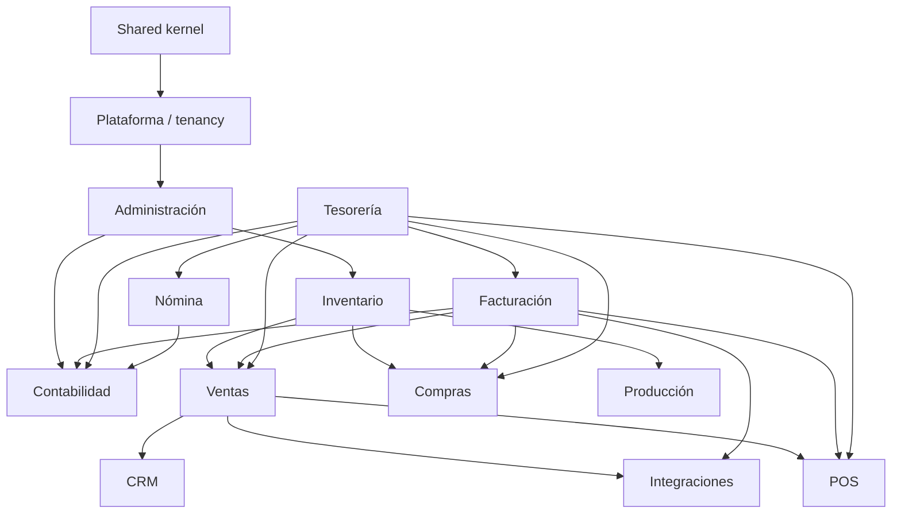

# Alcance funcional — ÁVILA ERP

**Versión:** 1.0 · **Fecha:** 2026-11-08 · **Estado:** línea base

Este documento define **qué entra y qué no** en cada release. Es la referencia para priorizar, estimar y aceptar trabajo. Los requisitos detallados están en [functional-requirements.md](../requirements/functional-requirements.md).

## 1. Modelo de alcance

- El producto se entrega en **seis releases** (R1…R6). Cada release agrega módulos completos o capacidades verificables.
- Un módulo puede introducirse en un release y completarse en otro; el alcance por release se declara explícitamente.
- **R2 es el primer producto comercializable**: resuelve compra, venta, inventario y facturación sin exigir contabilidad ni nómina.
- Nada de un release posterior se implementa "de paso" si compromete la calidad del release actual.
- Lo marcado como **fuera de alcance** no se diseña en detalle ni se promete a clientes.

## 2. Matriz de módulos por release

| Módulo | R1 Core | R2 Comercial | R3 Finance | R4 Retail | R5 People | R6 Enterprise |
|---|---|---|---|---|---|---|
| Plataforma / tenancy (`PLT`) | Núcleo | Facturación SaaS | — | — | — | Tenant dedicado |
| Administración (`ADM`) | Completo | Ajustes | — | — | — | SSO/SCIM |
| Inventario (`INV`) | — | Núcleo | — | Seriales | — | — |
| Ventas (`VEN`) | — | Completo | — | — | — | — |
| Compras (`COM`) | — | Completo | — | — | — | — |
| Facturación (`FAC`) | — | Núcleo completo | Retenciones, libros y contingencia | — | — | — |
| Fiscal (`FIS`) | — | Reglas base | Completo | — | — | — |
| Tesorería (`TES`) | — | Caja, cobros y pagos básicos | Completo | — | — | — |
| Contabilidad (`CON`) | — | — | Completo | — | Integración nómina | — |
| POS (`POS`) | — | — | — | Completo | — | — |
| RRHH / Nómina (`RRH`/`NOM`) | — | — | — | — | Completo | — |
| Producción (`PRO`) | — | — | — | — | — | Completo |
| CRM (`CRM`) | — | — | — | — | — | Completo |
| Integraciones (`INT`) | Outbox interno | Importación CSV | Conciliación por archivo | — | — | API pública, e-commerce, BI |

## 3. Alcance por dominio

### 3.1 Administración y plataforma (R1)
**Incluye:**
- Aprovisionamiento de organización, empresa y sucursal (`ADM-001`, `ADM-002`).
- Usuarios globales con múltiples membresías (`ADM-003`, `ADM-004`).
- Roles, permisos y alcance por empresa/sucursal/almacén (`ADM-005`, `ADM-006`).
- Autenticación, MFA y gestión de sesiones (`ADM-007`, `ADM-008`).
- Auditoría append-only (`ADM-009`).
- Catálogo de terceros y perfil fiscal de empresa (`ADM-010`, `ADM-011`).
- Series y numeración documental (`ADM-012`).
- Parámetros versionados, planes, límites y feature flags (`ADM-013`, `ADM-017`, `ADM-018`).
- Suspensión, exportación y acceso de soporte auditado (`ADM-014`…`ADM-016`).
- Preferencias de idioma, zona horaria y moneda (`ADM-019`).
- Configuración de flujos de aprobación (`ADM-020`).

**Excluye:** SSO empresarial, SCIM, personalización por código, multi-región.

### 3.2 Inventario (R2, ampliado en R4)
**Incluye:**
- Artículos, servicios, variantes y SKU (`INV-001`).
- Unidades de medida y conversiones (`INV-002`).
- Almacenes y existencias (`INV-003`, `INV-005`).
- Movimientos, kardex y trazabilidad (`INV-004`).
- Transferencias, ajustes y conteos (`INV-006`, `INV-007`).
- Lotes y vencimientos (`INV-008`).
- Valoración por costo promedio ponderado (`INV-010`).
- Reservas, política de stock negativo y puntos de reposición (`INV-011`…`INV-013`).

**Ampliación R4:** seriales (`INV-009`), integración con POS y códigos de barras.
**Excluye en R2:** costeo FIFO/LIFO, costos por proyecto, inventario en consignación.

### 3.3 Ventas (R2)
**Incluye:** cotizaciones, pedidos, reserva de stock, listas de precios, descuentos con aprobación, vendedores y comisiones, facturación desde pedido/entrega, devoluciones, crédito del cliente y anticipos (`VEN-001`…`VEN-012`).
**Excluye:** comercio electrónico, suscripciones recurrentes, CRM, contratos de servicio con facturación automática.

### 3.4 Compras (R2)
**Incluye:** proveedores, órdenes de compra con aprobación, recepciones parciales, factura de compra con validación de tres vías, devoluciones, compras en divisas, costos de flete asignables (`COM-001`…`COM-008`).
**Excluye:** importaciones con aduana, licitaciones, compras consignadas, contratos marco.

### 3.5 Facturación (R2, ampliado en R3)
**Incluye R2:** emisión de facturas con numeración fiscal, cálculo de impuestos, notas de crédito/débito, datos fiscales obligatorios, representación gráfica, anulación por reversión, series por sucursal e integración con proveedor de emisión digital (`FAC-001`…`FAC-003`, `FAC-006`…`FAC-008`, `FAC-010`, `FAC-011`, `FAC-013`).
**Incluye R3:** retenciones, libros fiscales, exportaciones, contingencia y adaptador de máquina fiscal legada (`FAC-004`, `FAC-005`, `FAC-009`, `FAC-012`, `FAC-014`).
**Excluye:** facturación electrónica certificada propia, homologación como proveedor tecnológico, contingencia avanzada sin validación.

### 3.6 Fiscal Venezuela (R2 base, R3 completo)
**Incluye R2:** motor de reglas versionado, gestión de alícuotas, IGTF en medios de pago, exenciones con soporte y auditoría fiscal (`FIS-001`, `FIS-002`, `FIS-006`…`FIS-008`, `FIS-010`).
**Incluye R3:** retenciones, obligaciones y calendario, libros y reportes (`FIS-003`, `FIS-004`, `FIS-005`, `FIS-009`).
**Excluye:** presentación automática de declaraciones ante el SENIAT, firma electrónica, integración directa no autorizada.

### 3.7 Tesorería (R2 básico, R3 completo)
**Incluye R2:** cajas, cobros y pagos, medios de pago, aplicación parcial, anticipos, saldos de cartera y cierre de caja (`TES-001`…`TES-005`, `TES-011`, `TES-012`).
**Incluye R3:** cuentas bancarias, conciliación, transferencias, multimoneda, diferencias cambiarias y aging completo (`TES-002`, `TES-006`…`TES-010`).
**Excluye:** integración bancaria automática (solo importación), pagos masivos, tesorería internacional.

### 3.8 Contabilidad (R3)
**Incluye:** plan de cuentas, asientos, diario/mayor/balanza, estados financieros, períodos y cierres, asientos automáticos por reglas, auxiliares, centros de costo, reversiones, apertura de saldos, bloqueo de período y conciliación subledger-GL (`CON-001`…`CON-012`).
**Excluye:** consolidación multiempresa, ajuste por inflación (sujeto a validación), contabilidad de sucursales como libros separados, auditoría externa integrada.

### 3.9 POS (R4)
**Incluye:** terminales y sesiones, venta rápida, códigos de barras, medios de pago, impresión ESC/POS, gaveta, offline con sincronización, cierres X/Z, anulaciones, factura fiscal desde POS y control de descuentos (`POS-001`…`POS-010`).
**Excluye:** autoservicio, kioscos, balanzas, RFID, e-commerce.

### 3.10 RRHH y nómina (R5)
**Incluye:** expediente, contratos, cargos, vacaciones y permisos, conceptos salariales, nómina periódica, deducciones y aportes, utilidades, prestaciones e intereses, liquidaciones, recibos, provisiones y pago vía tesorería (`RRH-001`…`RRH-004`, `NOM-001`…`NOM-010`).
**Excluye:** reclutamiento, evaluación de desempeño, capacitación, marcaje biométrico, nómina multi-país.

### 3.11 Producción (R6)
**Incluye:** recetas/BOM, órdenes de producción, consumo, desperdicio, costos, mano de obra y overhead, estados (`PRO-001`…`PRO-006`).
**Excluye:** planificación avanzada (MRP II), mantenimiento, manufactura discreta compleja.

### 3.12 CRM (R6)
**Incluye:** prospectos, oportunidades, pipeline, actividades, conversión a cliente y cotización desde oportunidad (`CRM-001`…`CRM-006`).
**Excluye:** marketing automation, correo masivo, atención al cliente postventa.

### 3.13 Integraciones (R6, con entregas previas)
**Incluye R6:** API pública versionada, credenciales, webhooks firmados, e-commerce (catálogo/pedidos), gestión documental y BI/export (`INT-001`…`INT-003`, `INT-005`…`INT-007`).
**Incluye antes:** importación CSV en R2 (`INT-004`) y conciliación bancaria por archivo en R3 (`INT-008`).
**Excluye:** iPaaS propio, conectores certificados con SAP/Oracle, EDI completo.

## 4. Fuera de alcance general (todos los releases)

- Facturación electrónica propia homologada por el SENIAT.
- Declaraciones tributarias presentadas automáticamente.
- Nómina de países distintos a Venezuela.
- Microservicios, multi-región activo-activo y consistencia global.
- Aplicaciones móviles nativas (la PWA cubre el caso inicial).
- Personalización de código por cliente en el producto SaaS.
- Inteligencia artificial generativa en procesos fiscales sin revisión humana.

## 5. Supuestos de alcance

| ID | Supuesto | Impacto si cambia |
|---|---|---|
| SUP-01 | La empresa opera con moneda funcional configurable y una o más monedas de transacción | Rediseño de tesorería y contabilidad |
| SUP-02 | La emisión fiscal se realiza mediante un proveedor autorizado o imprenta digital | Rediseño del módulo de facturación |
| SUP-03 | La organización puede tener varias empresas, pero no consolidación contable en R2 | Alcance de R3/R6 |
| SUP-04 | El POS puede operar offline y sincronizar; la emisión fiscal offline está sujeta a validación | Alcance de R4 |
| SUP-05 | Los límites de plan se aplican por organización | Cambios en empaquetado |

## 6. Dependencias entre módulos

**Semántica:** `A --> B` significa que **B depende de A** (la dependencia apunta hacia arriba). Incluye suscripción a eventos. El detalle y la prohibición de ciclos están en [modular-monolith.md](../architecture/modular-monolith.md).

## 7. Control de cambios de alcance

1. Toda incorporación de alcance requiere una historia con criterios de aceptación y una decisión de priorización.
2. Si desplaza un release, se registra el impacto en [roadmap.md](roadmap.md) y en [releases.md](../../backlog/releases.md).
3. No se acepta alcance "implícito" en un PR: si no está en este documento y en los requisitos, no se implementa.
4. Los recortes se documentan con su consecuencia y se comunican a Producto.

## 8. Documentos relacionados

- [Roadmap](roadmap.md)
- [PRD](../requirements/PRD.md)
- [Requisitos funcionales](../requirements/functional-requirements.md)
- [Releases](../../backlog/releases.md)
