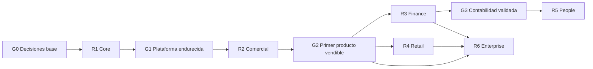

# Roadmap de producto — ÁVILA ERP

**Versión:** 1.0 · **Fecha:** 2026-11-08 · **Estado:** línea base; **sin fechas comprometidas**

## 1. Principios

1. **El roadmap es una secuencia de resultados, no un calendario.** No se publican fechas de entrega como compromiso. La duración se deriva de capacidad real y se revisa al cierre de cada release.
2. **Cada release debe ser usable por sí mismo.** R1 habilita; R2 vende; cada release posterior agrega valor sin exigir rehacer lo anterior.
3. **Primero el núcleo comercial y fiscal.** Un distribuidor debe poder comprar, vender, inventariar, facturar y cobrar antes de contabilizar o pagar nómina.
4. **Los criterios de salida son verificables.** Un release no se declara cerrado por "estar implementado", sino por cumplir sus criterios y validaciones.
5. **Las decisiones bloqueantes se resuelven antes del release que las necesita.** Ver `DEC-NNN` en [decisiones](../decisions/README.md).
6. **No se promete cumplimiento normativo sin validación externa.** Las materias fiscales y laborales tienen compuertas específicas.

## 2. Vista general

| Release | Nombre | Objetivo | Módulos | Depende de | ¿Vendible? |
|---|---|---|---|---|---|
| **R1** | ÁVILA Core | Plataforma multi-tenant segura y operable | PLT, ADM | — | No |
| **R2** | ÁVILA Comercial | Operar el ciclo comercial y fiscal de una PYME | INV, VEN, COM, FAC, FIS base, TES básico | R1 | **Sí** |
| **R3** | ÁVILA Finance | Cerrar la contabilidad y profesionalizar tesorería | CON, TES completo, FIS completo, FAC avanzado | R2 | Sí (complemento) |
| **R4** | ÁVILA Retail | Vender en mostrador con POS resiliente | POS, INV seriales, FAC/POS | R2 | Sí (complemento) |
| **R5** | ÁVILA People | Administrar personas y nómina | RRH, NOM, TES, CON | R1, R2 | Sí (complemento) |
| **R6** | ÁVILA Enterprise | Cubrir operaciones complejas e integrarse | PRO, CRM, INT, BI, SSO, tenant dedicado | R2, R3 | Sí (segmento alto) |

## 3. R1 — ÁVILA Core

**Objetivo:** entregar la fundación sobre la que se construye todo: aislamiento multi-tenant, identidad, autorización, auditoría, numeración, configuración versionada y operación observable.

**Alcance**
- Aprovisionamiento de organizaciones, empresas y sucursales (`ADM-001`, `ADM-002`).
- Usuarios, membresías, invitaciones, MFA y sesiones (`ADM-003`…`ADM-008`).
- RBAC + permisos + alcance por empresa/sucursal/almacén (`ADM-005`, `ADM-006`).
- Auditoría append-only (`ADM-009`).
- Terceros y perfil fiscal de empresa (`ADM-010`, `ADM-011`).
- Series, numeración e idempotencia (`ADM-012`).
- Parámetros versionados, feature flags, planes y límites (`ADM-013`, `ADM-017`, `ADM-018`).
- Soporte auditado, suspensión y exportación (`ADM-014`…`ADM-016`).
- Preferencias y flujos de aprobación (`ADM-019`, `ADM-020`).
- Plataforma SaaS: planes, medición, autoservicio y consola de operador (`PLT-001`…`PLT-003`, `PLT-005`). La facturación de suscripción (`PLT-004`) entra en R2 y el tenant dedicado (`PLT-006`) en R6.
- Ambientes, CI/CD, observabilidad, respaldo y restauración probados.

**Dependencias:** ninguna externa; requiere decisiones `DEC-001` (cloud/región), `DEC-003` (identidad) y `DEC-008` (residencia/retención de datos).

**Riesgos:** RSK-006 (aislamiento), RSK-008 (conocimiento concentrado), RSK-015 (latencia/costo cloud), RSK-018 (deuda por presión de fecha).

**Criterios de salida**
- [ ] Dos organizaciones con datos de prueba no se ven entre sí en API, UI, reportes, exportaciones ni jobs.
- [ ] RLS activa y probada con rol de aplicación sin privilegios.
- [ ] Numeración concurrente sin duplicados ni huecos inesperados (prueba de carga).
- [ ] Auditoría de operaciones sensibles verificable por consulta y por UI.
- [ ] Restauración desde respaldo ensayada con RPO/RTO documentados.
- [ ] Pipeline con pruebas, análisis de seguridad y migraciones en limpio.
- [ ] Los ADR fundacionales están aprobados.

## 4. R2 — ÁVILA Comercial (primer producto comercializable)

**Objetivo:** que un distribuidor, comercio o empresa de servicios pueda operar su ciclo comercial completo y emitir comprobantes fiscales válidos, sin contabilidad ni nómina.

**Alcance**
- Inventario núcleo: artículos, variantes, UoM, almacenes, movimientos, kardex, transferencias, ajustes, lotes/vencimientos, costo promedio, reservas y reposición (`INV-001`…`INV-008`, `INV-010`…`INV-014`).
- Ventas: cotización → pedido → entrega → factura, listas de precios, descuentos con aprobación, vendedores, comisiones, devoluciones y crédito (`VEN-001`…`VEN-012`).
- Compras: proveedores, órdenes, recepciones parciales, factura de compra con tres vías, devoluciones, divisas y flete (`COM-001`…`COM-008`).
- Facturación: emisión, impuestos, notas de crédito/débito, datos obligatorios, representación, anulación por reversión, series y adaptador de emisión (`FAC-001`…`FAC-003`, `FAC-006`…`FAC-008`, `FAC-010`, `FAC-011`, `FAC-013`).
- Fiscal base: motor versionado, alícuotas, IGTF, exenciones y auditoría fiscal (`FIS-001`, `FIS-002`, `FIS-006`…`FIS-008`, `FIS-010`).
- Tesorería básica: cajas, cobros, pagos, aplicación parcial, anticipos, saldos y cierre de caja (`TES-001`…`TES-005`, `TES-011`, `TES-012`).
- Migración e importación (`INT-004`) y exportaciones operativas.
- Reportes operativos: ventas, compras, stock, kardex, saldos de cartera y caja.

**Dependencias:** R1 completo; `DEC-002` (medio de emisión fiscal) resuelto para el adaptador; `DEC-007` (tratamiento de retenciones) si se ofrece facturación B2B con retención.

**Riesgos:** RSK-001 (cambio normativo), RSK-002 (moneda), RSK-004 (proveedor fiscal), RSK-014 (migración), RSK-017 (conciliación), RSK-021 (alcance de facturación).

**Criterios de salida**
- [ ] Un cliente piloto emite facturas reales durante un mes completo sin intervención correctiva.
- [ ] Inventario cuadra contra conteo físico en un almacén piloto.
- [ ] La numeración fiscal es única y auditable por empresa/sucursal/serie bajo concurrencia.
- [ ] Nota de crédito revierte una factura sin alterar el original y con trazabilidad completa.
- [ ] Cobros parciales y múltiples medios de pago cuadran contra caja y cartera.
- [ ] Migración desde Excel/ERP de un piloto con reporte de errores y saldos certificados.
- [ ] Pruebas de aislamiento y concurrencia verdes en CI.
- [ ] Validación de un contador/fiscalista externo sobre los documentos emitidos.
- [ ] Manual de usuario y material de onboarding del alcance R2.

**Es el primer release que se puede vender.** No incluye contabilidad completa ni POS.

## 5. R3 — ÁVILA Finance

**Objetivo:** cerrar el ciclo financiero: contabilidad, tesorería profesional y cumplimiento fiscal completo.

**Alcance**
- Contabilidad: plan de cuentas, asientos, diario/mayor/balanza, estados financieros, períodos, cierres, asientos automáticos, auxiliares, centros de costo, reversiones, apertura y bloqueo (`CON-001`…`CON-012`).
- Tesorería completa: bancos, conciliación, transferencias, multimoneda, diferencias cambiarias y aging (`TES-002`, `TES-006`…`TES-010`).
- Fiscal completo: retenciones, libros, obligaciones, calendario y reportes (`FIS-003`, `FIS-004`, `FIS-005`, `FIS-009`).
- Facturación avanzada: retenciones, libros, exportaciones, contingencia y adaptador de máquina fiscal (`FAC-004`, `FAC-005`, `FAC-009`, `FAC-012`, `FAC-014`).
- Reportes financieros y de cartera.

**Dependencias:** R2; `DEC-007` (retenciones), `DEC-009` (integración bancaria), `DEC-012` (ajuste por inflación) y validación contable externa.

**Riesgos:** RSK-001, RSK-005 (complejidad), RSK-017, RSK-022 (diferencias subledger-GL).

**Criterios de salida**
- [ ] Asientos automáticos cubren factura, nota de crédito, cobro, pago, compra, retención y ajuste.
- [ ] Balanza cuadrada y conciliación subledger-GL sin diferencias en el piloto.
- [ ] Cierre mensual ejecutado por un contador externo en el piloto.
- [ ] Libros y retenciones revisados por especialista.
- [ ] Reversión de asiento probada sin modificar el original.
- [ ] Reportes financieros exportables y conciliables.

## 6. R4 — ÁVILA Retail

**Objetivo:** operar caja rápida en mostrador con hardware estándar y tolerancia a cortes de conectividad.

**Alcance**
- Terminales, sesiones de caja, venta rápida, código de barras, medios de pago, impresión ESC/POS, gaveta, cierres X/Z, anulaciones, factura fiscal y descuentos controlados (`POS-001`…`POS-010`).
- Seriales y códigos de barras de inventario (`INV-009`).
- Sincronización offline con resolución de conflictos.

**Dependencias:** R2; `DEC-010` (legalidad de emisión offline) y `DEC-013` (hardware soportado).

**Riesgos:** RSK-003 (conectividad), RSK-016 (hardware fiscal legado), RSK-023 (pérdida de ventas offline).

**Criterios de salida**
- [ ] Venta completada sin internet y sincronizada al reconectar.
- [ ] Cierre de caja cuadra contra ventas y medios de pago.
- [ ] Factura fiscal emitida desde POS con numeración correcta.
- [ ] Prueba de caída de red y reinicio sin pérdida de ventas.
- [ ] Matriz de hardware validada.

## 7. R5 — ÁVILA People

**Objetivo:** administrar el ciclo laboral y la nómina con reglas parametrizadas y auditables.

**Alcance**
- Expediente, contratos, cargos, vacaciones y permisos (`RRH-001`…`RRH-004`).
- Conceptos, nómina periódica, deducciones y aportes, utilidades, prestaciones e intereses, liquidaciones, recibos, provisiones y pago (`NOM-001`…`NOM-010`).

**Dependencias:** R1; R2 (tesorería); R3 (contabilidad y provisión); `DEC-011` (validación laboral) y `DEC-014` (motor de cálculo).

**Riesgos:** RSK-005 (complejidad legal), RSK-024 (error de cálculo), RSK-025 (cambios de parámetros).

**Criterios de salida**
- [ ] Nómina de un piloto revisada por especialista laboral.
- [ ] Recálculo determinista ante cambios de parámetros con vigencia.
- [ ] Prestaciones y utilidades conciliadas contra cálculo manual del especialista.
- [ ] Liquidación de un empleado con traza de cada concepto.
- [ ] Asientos de nómina conciliados con contabilidad.

## 8. R6 — ÁVILA Enterprise

**Objetivo:** cubrir operaciones complejas, integrarse con el ecosistema y atender organizaciones mayores.

**Alcance**
- Producción: BOM, órdenes, consumo, desperdicio, costos, mano de obra y overhead (`PRO-001`…`PRO-006`).
- CRM: prospectos, oportunidades, pipeline, actividades y conversión (`CRM-001`…`CRM-006`).
- Integraciones: API pública, webhooks, e-commerce, BI y gestión documental (`INT-001`…`INT-003`, `INT-005`…`INT-007`). La conciliación por archivo (`INT-008`) se entrega en R3.
- SSO, tenant dedicado y SLA (`PLT-006`, `ADM-021` si se aprueba). La consolidación contable multiempresa queda fuera de alcance.

**Dependencias:** R2/R3; `DEC-001` (región), `DEC-005` (redondeo/moneda), `DEC-015` (BI), `DEC-016` (licencia).

**Riesgos:** RSK-007 (scope creep), RSK-015, RSK-026 (integración de terceros), RSK-027 (complejidad de consolidación).

**Criterios de salida**
- [ ] API pública documentada y con versionado, cuotas y sandbox.
- [ ] Un partner externo integra un flujo completo usando solo la API.
- [ ] Orden de producción costeada y conciliada con inventario y contabilidad.
- [ ] Pipeline de CRM convierte oportunidad en cotización y venta.
- [ ] Tenant dedicado aprovisionado y probado con el mismo código.

## 9. Secuencia y compuertas

| Compuerta | Se abre cuando |
|---|---|
| **G0** | Decisiones bloqueantes de R1 resueltas y ADR fundacionales aprobados |
| **G1** | Criterios de salida de R1 cumplidos y auditoría de aislamiento superada |
| **G2** | R2 vendible, piloto operando y validación fiscal externa documentada |
| **G3** | Contabilidad conciliada y cierre mensual validado por contador |
| **G4** | POS probado offline y facturación desde caja validada |
| **G5** | Nómina validada por especialista laboral |

## 10. Registro de riesgos

| ID | Riesgo | Prob. | Impacto | Mitigación | Release afectado |
|---|---|---|---|---|---|
| RSK-001 | Cambio normativo fiscal (nuevos medios de emisión) | Alta | Alto | Reglas versionadas, adaptador de emisión, vigilancia regulatoria | R2+ |
| RSK-002 | Volatilidad cambiaria o redenominación | Alta | Alto | Moneda versionada, escala configurable, migración de moneda | R2+ |
| RSK-003 | Conectividad/energía intermitente | Alta | Medio | PWA, POS offline, reintentos idempotentes | R2, R4 |
| RSK-004 | Retraso del proveedor de emisión fiscal | Media | Alto | Adaptador con dos proveedores, contingencia validada | R2 |
| RSK-005 | Complejidad laboral y fiscal | Alta | Alto | Parametrización, validación externa, alcance acotado | R3, R5 |
| RSK-006 | Fuga de datos entre tenants | Baja | Crítico | RLS, contratos, pruebas de aislamiento, auditoría | R1+ |
| RSK-007 | Scope creep y releases inflados | Alta | Medio | Control de alcance, compuertas, criterios de salida | Todos |
| RSK-008 | Dependencia de personas clave | Media | Alto | Documentación, pair review, ADR, rotación | Todos |
| RSK-009 | Baja disposición a pagar | Media | Alto | Validación de precios, plan de entrada, ROI | R2 |
| RSK-010 | Competencia con precios agresivos | Media | Medio | Diferenciación por integración y servicio | R2+ |
| RSK-011 | Dependencia de contadores | Media | Medio | Programa de aliados y herramientas | R3 |
| RSK-012 | Baja adopción por hábitos digitales | Media | Alto | Onboarding, plantillas, capacitación | R2 |
| RSK-013 | Concentración geográfica | Media | Bajo | Canales remotos y expansión por ciudades | R2+ |
| RSK-014 | Mala calidad de datos de migración | Alta | Medio | Validación, reporte de errores, saldos certificados | R2 |
| RSK-015 | Latencia/costo cloud desde Venezuela | Media | Medio | Región cercana, caché, medición de latencia | R1+ |
| RSK-016 | Hardware fiscal/POS legado | Media | Medio | Matriz de hardware, adaptadores, soporte acotado | R4 |
| RSK-017 | Conciliación bancaria sin APIs | Alta | Medio | Importación de archivos, reglas de match | R3 |
| RSK-018 | Deuda técnica por presión comercial | Media | Alto | Definition of Done, pruebas, revisión de arquitectura | Todos |
| RSK-019 | Canibalización entre planes | Media | Bajo | Límites y valor diferenciado | R2+ |
| RSK-020 | Impago y morosidad | Media | Medio | Cobro anticipado, suspensión gradual | R2+ |
| RSK-021 | Alcance de facturación ambiguo | Alta | Alto | Validación legal temprana, ADR de emisión | R2 |
| RSK-022 | Diferencias subledger-GL | Media | Alto | Contabilización transaccional, conciliación diaria | R3 |
| RSK-023 | Pérdida de ventas offline | Media | Alto | Cola local cifrada, sincronización verificada | R4 |
| RSK-024 | Error de cálculo de nómina | Media | Crítico | Motor determinista, pruebas doradas, revisión | R5 |
| RSK-025 | Cambios de parámetros laborales | Alta | Alto | Versionado por vigencia, recálculo auditado | R5 |
| RSK-026 | Integración de terceros inestable | Media | Medio | Contratos, reintentos, circuit breaker | R6 |
| RSK-027 | Complejidad de consolidación | Media | Medio | Alcance acotado, modelo de reportes | R6 |

## 11. Decisiones que condicionan el roadmap

| Decisión | Bloquea | Estado |
|---|---|---|
| `DEC-001` Proveedor y región cloud | R1 | Pendiente |
| `DEC-002` Medio de emisión fiscal | R2 | Pendiente |
| `DEC-003` Estrategia de identidad | R1 | Pendiente |
| `DEC-005` Redondeo y moneda | R1/R2 | Resuelta técnicamente en ADR-004; ratificación pendiente |
| `DEC-006` Planes y precios | Lanzamiento R2 | Pendiente |
| `DEC-007` Retenciones IVA/ISLR | R2/R3 | Pendiente de validación legal |
| `DEC-010` Emisión fiscal offline | R4 | Pendiente de validación legal |
| `DEC-011` Fórmulas laborales | R5 | Pendiente de validación legal |
| `DEC-016` Licencia y propiedad | Público | Pendiente |

## 12. Gobernanza del roadmap

- El roadmap se revisa al cierre de cada release y cuando cambie una decisión bloqueante.
- Cualquier cambio de secuencia se documenta aquí y en [releases.md](../../backlog/releases.md).
- No se agregan fechas al roadmap sin un compromiso explícito de dirección y capacidad verificada.
- Los recortes de alcance se registran con su impacto y se comunican a los interesados.

## 13. Documentos relacionados

- [Alcance funcional](functional-scope.md)
- [Modelo de negocio](business-model.md)
- [Releases](../../backlog/releases.md)
- [Epics](../../backlog/epics.md)
- [Decisiones](../decisions/README.md)
- [Revisión documental](../documentation-review.md)
