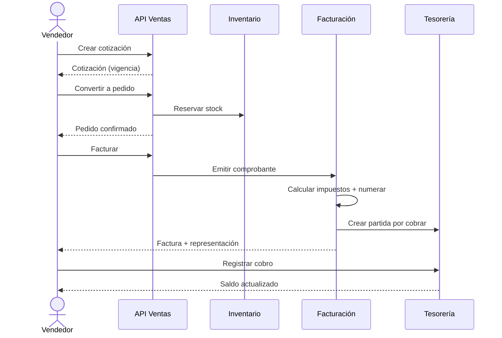
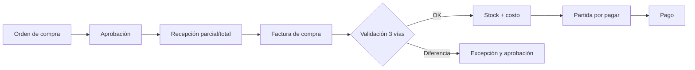
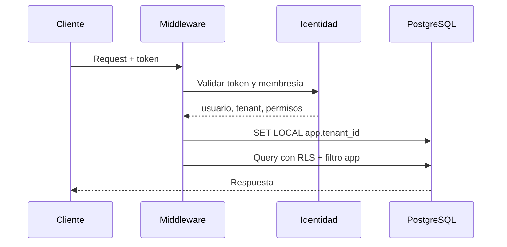
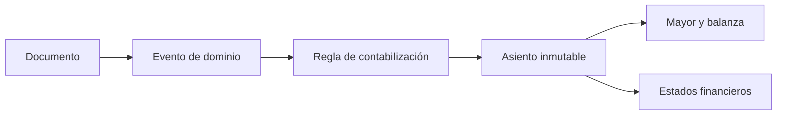

# PRD — Product Requirements Document · ÁVILA ERP

**Versión:** 1.0 · **Fecha:** 2026-11-08 · **Estado:** línea base para planificación

| Campo | Valor |
|---|---|
| Producto | ÁVILA ERP |
| Tagline | Todo tu negocio. En un solo lugar. |
| Mercado inicial | PYMEs de Venezuela (3–50 empleados) |
| Modelo | SaaS por suscripción, modular y multi-tenant |
| Alcance de este PRD | R1 y R2 en detalle; R3–R6 a nivel de objetivos y alcance |
| Documentos asociados | [Alcance](../product/functional-scope.md) · [RF](functional-requirements.md) · [RNF](non-functional-requirements.md) · [AC](acceptance-criteria.md) |

## 1. Propósito

Definir qué debe construirse, para quién, con qué reglas y cómo se aceptará, de modo que desarrollo, producto, QA y agentes de IA trabajen sobre la misma interpretación. Este PRD no reemplaza los requisitos detallados ni los documentos de dominio: los integra y prioriza.

## 2. Objetivos

### 2.1 Objetivos de negocio (horizonte inicial, hipótesis)
1. Lanzar un producto comercializable (R2) que permita a una PYME operar compra, venta, inventario y facturación sin depender de Excel.
2. Validar disposición a pagar con al menos cinco clientes piloto activos.
3. Lograr una activación (primera factura emitida) en menos de 30 días desde la contratación.
4. Alcanzar un churn mensual inferior al 2 % en la cartera piloto.
5. Documentar y validar el cumplimiento fiscal con un especialista antes del lanzamiento.

### 2.2 Objetivos de producto
1. Una sola fuente de verdad para documentos, stock, cartera y caja.
2. Aislamiento multi-tenant demostrable, no solo declarado.
3. Operación confiable bajo concurrencia (numeración, stock, pagos).
4. Curva de adopción baja: interfaz en español, flujos guiados y migración asistida.
5. Extensibilidad por configuración y API, no por código a medida.

### 2.3 No objetivos (en R1/R2)
- Contabilidad completa, nómina, POS, producción y CRM.
- Facturación electrónica propia homologada.
- Aplicación móvil nativa.
- Consolidación multiempresa.

## 3. Usuarios y perfiles

| Perfil | Descripción | Necesidades principales | Permisos típicos |
|---|---|---|---|
| Dueño / Gerente | Decide y controla | Visibilidad de ventas, margen, cartera y caja | Lectura amplia, aprobaciones |
| Administrador | Opera el sistema | Configurar, cargar datos, supervisar | Administración completa del tenant |
| Contador | Registra y valida | Documentos, impuestos, libros, conciliación | Fiscal, contabilidad, reportes |
| Vendedor | Vende | Cotizar, pedir, consultar stock y precios | Ventas propias |
| Almacenista | Custodia inventario | Recibir, transferir, contar | Inventario |
| Cajero | Cobra | POS, caja, arqueo | POS y caja |
| Analista de plataforma | Opera el SaaS | Aprovisionar, soportar, medir | Plataforma (auditado) |

Detalle de personas en [target-market.md §4](../product/target-market.md#4-personas-y-roles).

## 4. Casos de uso principales

### UC-01 · Aprovisionar una organización
**Actor:** analista de plataforma / autoservicio.
**Precondición:** solicitud aprobada o registro válido.
**Flujo:** crear organización → definir plan y límites → crear empresa y sucursal → invitar administrador → verificar aislamiento → registrar en auditoría.
**Postcondición:** organización operativa con datos iniciales y sin acceso a otros tenants.
**Requisitos:** `ADM-001`, `ADM-002`, `PLT-001`, `PLT-003`.

### UC-02 · Invitar usuario y asignar rol
**Actor:** administrador del tenant.
**Flujo:** invitar por correo → aceptar → asignar rol y alcance (empresa/sucursal) → validar permisos.
**Alternativas:** usuario ya existente en otra organización → se crea nueva membresía, sin compartir datos.
**Requisitos:** `ADM-003`…`ADM-006`.

### UC-03 · Configurar empresa y datos fiscales
**Actor:** administrador / contador.
**Flujo:** cargar RIF, razón social, domicilio, régimen y datos de contacto → configurar moneda funcional y series → validar campos obligatorios.
**Regla:** no se puede emitir un comprobante sin perfil fiscal completo (`BR-016`).
**Requisitos:** `ADM-011`, `ADM-012`, `FAC-007`.

### UC-04 · Registrar artículo y precio
**Actor:** administrador.
**Flujo:** crear artículo o servicio → definir UoM, impuestos por defecto, costo → asignar a lista de precios → verificar en cotización.
**Requisitos:** `INV-001`, `INV-002`, `INV-014`, `VEN-004`.

### UC-05 · Cotizar y convertir a pedido
**Actor:** vendedor.
**Flujo:** seleccionar cliente → agregar líneas → aplicar descuento (con aprobación si supera umbral) → guardar cotización con vigencia → convertir a pedido.
**Reglas:** `BR-024`; los precios se resuelven en servidor.
**Requisitos:** `VEN-001`, `VEN-002`, `VEN-004`.

### UC-06 · Confirmar pedido con reserva y crédito
**Actor:** vendedor / supervisor.
**Flujo:** validar stock → reservar → validar límite de crédito → confirmar → generar compromiso de entrega.
**Alternativas:** sin stock → pedido en espera o autorización de sobregiro; crédito excedido → bloqueo o aprobación con permiso.
**Reglas:** `BR-020`, `BR-022`, `BR-023`.
**Requisitos:** `VEN-003`, `VEN-009`, `INV-011`.

### UC-07 · Emitir factura fiscal
**Actor:** vendedor / facturador.
**Flujo:** seleccionar pedido/entrega → validar datos fiscales del cliente → calcular impuestos con reglas vigentes → asignar número fiscal → generar representación → registrar snapshot → emitir evento → crear partida por cobrar.
**Reglas:** `BR-009`, `BR-012`, `BR-013`, `BR-031`, `BR-032`.
**Requisitos:** `FAC-001`, `FAC-002`, `FAC-007`, `FAC-008`, `TES-003`.

### UC-08 · Registrar cobro parcial
**Actor:** cajero / administrador.
**Flujo:** seleccionar partida(s) → indicar monto y medio de pago → aplicar → actualizar saldo → registrar movimiento de caja/banco → auditar.
**Reglas:** `BR-027`, `BR-028`.
**Requisitos:** `TES-003`, `TES-005`, `TES-011`.

### UC-09 · Emitir nota de crédito
**Actor:** facturador / contador.
**Flujo:** seleccionar factura → motivo → líneas a revertir → calcular impuestos → asignar número → generar comprobante → revertir cartera y comisión → conservar vínculo con el original.
**Reglas:** `BR-009`, `BR-011`, `BR-025`, `BR-035`.
**Requisitos:** `FAC-003`, `VEN-007`, `VEN-008`.

### UC-10 · Comprar y recibir
**Actor:** comprador / almacenista.
**Flujo:** crear orden → aprobar según umbral → recibir parcial o total → registrar factura de compra → validar tres vías → actualizar stock y costo → crear partida por pagar.
**Reglas:** `BR-026`.
**Requisitos:** `COM-002`…`COM-005`, `INV-004`.

### UC-11 · Ajustar inventario por conteo
**Actor:** almacenista / supervisor.
**Flujo:** generar conteo → registrar cantidades → calcular diferencias → aprobar → generar movimiento de ajuste con motivo → actualizar costo y kardex.
**Reglas:** `BR-020`, `BR-021`.
**Requisitos:** `INV-007`.

### UC-12 · Cerrar caja
**Actor:** cajero / supervisor.
**Flujo:** contar efectivo → registrar medios de pago → comparar contra sistema → autorizar diferencia → cerrar sesión → generar reporte.
**Reglas:** `BR-028`, `BR-029`.
**Requisitos:** `TES-001`, `TES-012`.

### UC-13 · Cerrar período contable (R3)
**Actor:** contador.
**Flujo:** verificar asientos pendientes → conciliar subledgers → ejecutar cierre → bloquear período → emitir estados financieros.
**Reglas:** `BR-017`…`BR-019`.
**Requisitos:** `CON-005`, `CON-011`, `CON-012`.

### UC-14 · Procesar nómina (R5)
**Actor:** analista de RRHH.
**Flujo:** seleccionar período → validar novedades → calcular con parámetros vigentes → revisar → aprobar → generar recibos → pagar → contabilizar.
**Reglas:** `BR-030`, `BR-031`.
**Requisitos:** `NOM-002`…`NOM-010`.

### UC-15 · Vender en POS offline (R4)
**Actor:** cajero.
**Flujo:** abrir sesión → vender sin conexión → almacenar localmente → reconectar → sincronizar → resolver conflictos → emitir/regularizar comprobante.
**Reglas:** `BR-037`.
**Requisitos:** `POS-005`, `POS-008`.

### UC-16 · Migrar datos iniciales
**Actor:** administrador / implementador.
**Flujo:** descargar plantilla → cargar archivos → validar → corregir errores → importar por lotes → certificar saldos → registrar evidencia.
**Requisitos:** `INT-004`, `ADM-016`.

## 5. Flujos principales

### 5.1 Ciclo comercial

### 5.2 Ciclo de compras

### 5.3 Contexto de tenant en una petición

### 5.4 Contabilización

## 6. Reglas de negocio globales

> Las reglas específicas de cada módulo están en su documento de dominio. Estas reglas aplican transversalmente y **no deben duplicarse** en código.

| ID | Regla | Verificación |
|---|---|---|
| BR-001 | Toda consulta y escritura de negocio se limita al tenant validado. | Prueba de aislamiento |
| BR-002 | El tenant se deriva de la identidad y la membresía, nunca de datos del cliente sin validación. | Prueba de seguridad |
| BR-003 | Toda tabla de negocio tiene `tenant_id` obligatorio. | Revisión de esquema |
| BR-004 | Las relaciones de negocio usan claves compuestas que incluyen el tenant. | Revisión de migración |
| BR-005 | Los importes monetarios usan `decimal`, moneda y escala explícitas. | Revisión + pruebas |
| BR-006 | El redondeo se aplica por línea y luego se totaliza, según ADR-004. | Pruebas doradas |
| BR-007 | Todo documento con moneda distinta a la funcional registra tasa, fuente y vigencia. | Prueba de emisión |
| BR-008 | No se suman importes de monedas distintas sin conversión trazable. | Pruebas |
| BR-009 | Un comprobante fiscal emitido es inmutable. | Prueba de actualización prohibida |
| BR-010 | Un asiento contabilizado es inmutable. | Prueba de actualización prohibida |
| BR-011 | Las correcciones se realizan por reversión con referencia al original. | Prueba de nota de crédito |
| BR-012 | La numeración fiscal es única y sin huecos por serie, empresa y sucursal. | Prueba de concurrencia |
| BR-013 | El número fiscal se asigna dentro de la transacción de emisión. | Prueba de rollback |
| BR-014 | Los comandos críticos aceptan `Idempotency-Key` y no duplican efectos. | Prueba de repetición |
| BR-015 | Las operaciones sensibles registran auditoría con actor, antes/después y correlación. | Prueba de auditoría |
| BR-016 | No se emite un comprobante sin perfil fiscal completo de la empresa. | Prueba negativa |
| BR-017 | La fecha de negocio es `date` en `America/Caracas`; los timestamps se almacenan en UTC. | Revisión |
| BR-018 | Solo se contabiliza en períodos abiertos. | Prueba de período cerrado |
| BR-019 | Todo asiento cumple partida doble (debe = haber). | Constraint + prueba |
| BR-020 | El stock no puede quedar negativo salvo política explícita y permiso. | Prueba de concurrencia |
| BR-021 | Todo movimiento de inventario pertenece a una empresa y almacén válidos. | Constraint |
| BR-022 | Las reservas se liberan al cancelar o facturar el documento que las originó. | Prueba de flujo |
| BR-023 | Un pedido que excede el límite de crédito requiere aprobación con permiso. | Prueba |
| BR-024 | Un descuento superior al umbral requiere aprobación registrada. | Prueba |
| BR-025 | La comisión se acumula al facturar y se revierte con la nota de crédito. | Prueba |
| BR-026 | La factura de compra se valida contra orden y recepción con tolerancia configurable. | Prueba de tres vías |
| BR-027 | La aplicación de un pago no puede exceder el saldo de la partida. | Prueba de concurrencia |
| BR-028 | Toda operación de caja requiere una sesión abierta. | Prueba |
| BR-029 | La diferencia de arqueo requiere autorización y genera registro contable. | Prueba |
| BR-030 | Una nómina aprobada es inmutable; se corrige con una nueva corrida. | Prueba |
| BR-031 | Las reglas fiscales y laborales se resuelven por vigencia (`effective_from`/`effective_to`). | Prueba de versión |
| BR-032 | El documento conserva un snapshot de datos fiscales, ítems, impuestos y tasa. | Prueba de historial |
| BR-033 | Los permisos se validan en el servidor para cada recurso y acción. | Prueba de autorización |
| BR-034 | Toda aprobación registra actor, fecha, decisión y motivo. | Prueba |
| BR-035 | Los documentos conservan vínculo con su origen y su reversión. | Prueba |
| BR-036 | No se elimina un comprobante fiscal ni un asiento contabilizado. | Prueba negativa |
| BR-037 | Las ventas POS offline se sincronizan de forma idempotente y conciliable. | Prueba de reconexión |
| BR-038 | La suspensión de un tenant bloquea escrituras y permite lectura/exportación según política. | Prueba |
| BR-039 | La exportación de datos incluye todos los documentos y maestros del tenant en formato abierto. | Prueba de exportación |
| BR-040 | El borrado lógico solo se permite donde la ley y el dominio lo admiten. | Revisión |

## 7. Requisitos de usuario (épicas de valor)

| Necesidad del usuario | Resultado | Dónde se especifica |
|---|---|---|
| "Quiero facturar sin equivocarme" | Comprobante válido con numeración y datos correctos | `FAC-*`, [billing.md](../domain/billing.md) |
| "Quiero saber qué tengo y cuánto me cuesta" | Stock y costo confiables por almacén | `INV-*`, [inventory.md](../domain/inventory.md) |
| "Quiero vender y cobrar sin perder plata" | Pedido, factura, cobro y saldo trazables | `VEN-*`, `TES-*` |
| "Quiero comprar bien y pagar a tiempo" | Compra, recepción, factura y pago controlados | `COM-*`, [purchasing.md](../domain/purchasing.md) |
| "Quiero cerrar el mes sin caos" | Contabilidad conciliada y reportes | `CON-*`, [accounting.md](../domain/accounting.md) |
| "Quiero operar mi tienda rápido" | POS ágil y resiliente | `POS-*`, [point-of-sale.md](../domain/point-of-sale.md) |
| "Quiero pagar bien a mi gente" | Nómina auditable y validada | `NOM-*`, [payroll.md](../domain/payroll.md) |

## 8. Dependencias

| Dependencia | Tipo | Impacto | Estado |
|---|---|---|---|
| Proveedor de emisión fiscal / imprenta digital | Externa | Bloquea facturación válida | `DEC-002` pendiente |
| Tasa de cambio oficial y fuentes | Externa | Bloquea multimoneda | `DEC-005` pendiente |
| Pasarelas / medios de pago locales | Externa | Cobros y conciliación | `DEC-009` pendiente |
| Especialista fiscal | Externa | Validación de reglas y formatos | Pendiente de contratación |
| Especialista laboral | Externa | Validación de nómina | Pendiente de contratación |
| Infraestructura cloud y región | Externa | Latencia, residencia y costo | `DEC-001` pendiente |
| Módulos internos | Interna | Ver [flujo de dependencias](../product/functional-scope.md#6-dependencias-entre-módulos) | Definido |

## 9. Restricciones

- **Técnicas:** monolito modular, .NET 10 LTS, PostgreSQL 18, React 19, sin microservicios, sin broker externo en la etapa inicial.
- **Regulatorias:** toda regla fiscal o laboral requiere fuente y validación; no se codifican valores sin sustento.
- **Operativas:** conectividad intermitente, hardware heterogéneo, equipos de cómputo modestos.
- **Comerciales:** precio accesible, activación rápida, soporte en español.
- **De seguridad:** aislamiento estricto, mínimo privilegio, auditoría, sin secretos en repositorio.

## 10. Exclusiones

Ver [functional-scope.md §4](../product/functional-scope.md#4-fuera-de-alcance-general-todos-los-releases). En R1/R2 se excluyen además contabilidad, nómina, POS, producción, CRM, e-commerce y facturación electrónica propia.

## 11. Criterios de aceptación

Los criterios verificables están en [acceptance-criteria.md](acceptance-criteria.md), organizados por capacidad (`AC-MÓD-NN`). Cada requisito funcional referencia al menos uno. Un release se acepta cuando todos sus criterios asociados pasan y existe evidencia.

## 12. Métricas de éxito del producto

| Métrica | Objetivo inicial (hipótesis) | Medición |
|---|---|---|
| Tiempo a primera factura | ≤ 30 días desde contratación | Telemetría de activación |
| Facturas emitidas sin error fiscal | ≥ 99,5 % | Auditoría + incidencias |
| Diferencia de inventario en conteo piloto | ≤ 1 % | Conteo físico vs sistema |
| Cobros aplicados automáticamente | ≥ 90 % | Registro de aplicación |
| Cierres mensuales a tiempo (R3) | ≥ 90 % | Calendario contable |
| Tickets por cuenta/mes | ≤ 3 | Mesa de ayuda |
| Uptime mensual | ≥ 99,9 % | Monitoreo |
| Incidentes de aislamiento | 0 | Auditoría de seguridad |

## 13. Supuestos y decisiones abiertas

- Los precios y planes son hipótesis (`DEC-006`).
- La emisión fiscal se hará mediante proveedor autorizado (`DEC-002`).
- La moneda funcional es configurable; el tratamiento de redenominación está pendiente (`DEC-005`).
- Las fórmulas laborales requieren validación (`DEC-011`).
- Ver lista completa en [decisiones](../decisions/README.md).

## 14. Riesgos principales

RSK-001 (normativa), RSK-002 (moneda), RSK-006 (aislamiento), RSK-014 (migración), RSK-021 (alcance fiscal). Registro completo en [roadmap.md §10](../product/roadmap.md#10-registro-de-riesgos).

## 15. Documentos relacionados

- [Requisitos funcionales](functional-requirements.md)
- [Requisitos no funcionales](non-functional-requirements.md)
- [Criterios de aceptación](acceptance-criteria.md)
- [Modelo de dominio](../domain/domain-model.md)
- [Arquitectura](../architecture/architecture-overview.md)
